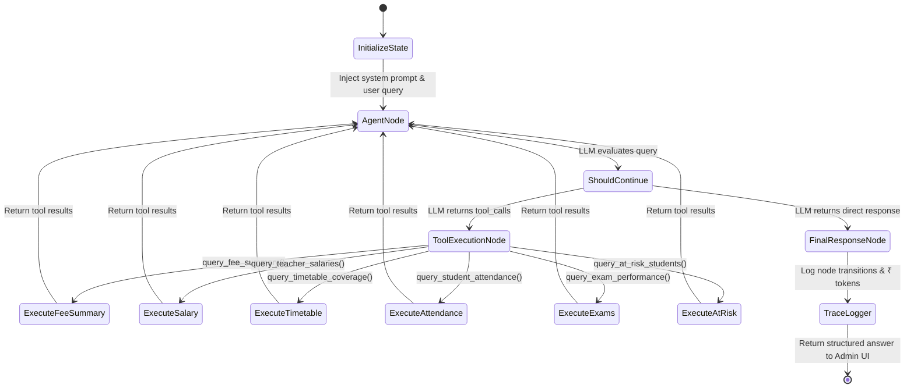
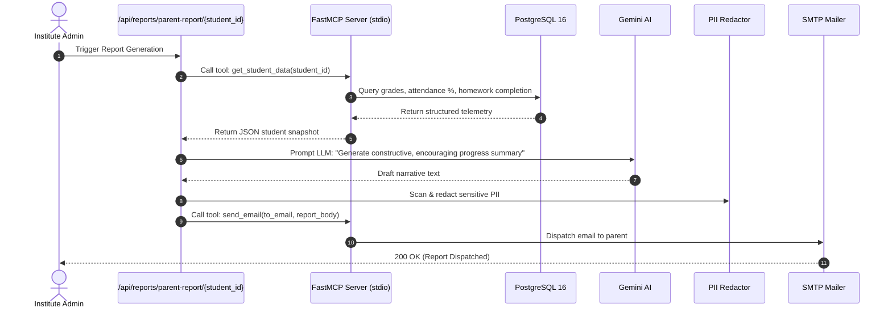

# EduIntel AI — AI Agents & LangGraph Orchestration

This document details the architecture, state machines, tool definitions, and MCP protocol integration for autonomous AI agents in EduIntel AI on branch `develop/production-readiness`.

---

## 1. Agent Architecture Overview

EduIntel incorporates three autonomous agent systems:
1. **Admin Assistant** ([`backend/app/agents/admin_assistant.py`](file:///home/dell/projects/eduIntel/backend/app/agents/admin_assistant.py)): A stateful LangGraph agent that answers administrative queries using 6 safe reporting tools.
2. **Portal Assistant** ([`backend/app/agents/portal_assistant.py`](file:///home/dell/projects/eduIntel/backend/app/agents/portal_assistant.py)): A conversational guide answering navigation and platform usage questions via RAG.
3. **Parent Report Agent** ([`backend/app/reports/parent_report_agent.py`](file:///home/dell/projects/eduIntel/backend/app/reports/parent_report_agent.py)): An agent pipeline using the Model Context Protocol (FastMCP) to synthesize academic performance into narrative progress emails for parents.

---

## 2. Admin Assistant LangGraph State Machine

The Admin Assistant allows institute leaders to query operational metrics in plain English. The agent graph is implemented using **LangGraph 0.1.0**:



### 2.1. Graph State Schema
```python
class AdminAgentState(TypedDict):
    messages: Annotated[list[BaseMessage], add_messages]
    session_id: str
    admin_user_id: str
```

### 2.2. The 6 Contained Reporting Tools (Phase 0A)
In Phase 0A, the agent's unrestricted SQL execution tool was deprecated and replaced with six safe, strictly typed tools:

| Tool Name | Parameters | SQL Execution Behavior | Data Returned |
|---|---|---|---|
| `query_fee_summary` | `status: Optional[str]`, `due_before: Optional[str]` | Parameterized SQLAlchemy `select` on `fee_records` | Total amount due, amount paid, overdue balances by student. |
| `query_teacher_salaries` | `month: int`, `year: int` | Parameterized `select` on `salary_records` joined with `users` | Base salaries, net disbursed, pending payments by teacher. |
| `query_timetable_coverage`| `day_of_week: Optional[str]` | Parameterized `select` on `timetable_entries` | Rooms scheduled, teacher assignments, unallocated time slots. |
| `query_student_attendance`| `date: Optional[str]`, `min_rate: Optional[float]` | Parameterized aggregation on `attendance_records` | Attendance percentages, absent rosters, historical trends. |
| `query_exam_performance` | `subject: Optional[str]`, `exam_name: Optional[str]` | Parameterized aggregation on `exam_results` | Class averages, top scores, pass/fail percentages. |
| `query_at_risk_students` | `risk_threshold: float` | Filters `exam_results` and `attendance_records` | Students flagged for urgent teacher intervention. |

---

## 3. Portal Assistant (Documentation RAG Agent)

The Portal Assistant ([`backend/app/agents/portal_assistant.py`](file:///home/dell/projects/eduIntel/backend/app/agents/portal_assistant.py)) assists students, teachers, and admins in navigating the platform:
- Integrates with the `portal_help_docs` ChromaDB vector collection.
- Retrieves system documentation sections based on user questions (e.g. *"How do I upload homework?"* or *"Where do I download salary slips?"*).
- Formulates a step-by-step guidance response with clickable links to application pages.

---

## 4. Parent Report Agent & FastMCP Server

The Parent Reporting pipeline automates one of the most time-consuming administrative tasks: drafting individual narrative reports for parents.



### FastMCP Tool Server Specification
Implemented in [`backend/app/mcp/server.py`](file:///home/dell/projects/eduIntel/backend/app/mcp/server.py):
- Runs as an independent process communication server over `stdio`.
- Exposes tools:
  - `get_student_data(student_id: str)`: Gathers attendance, recent marks, and assignment status.
  - `send_email(recipient: str, subject: str, html_body: str)`: Sends email using configured SMTP credentials.

---

## 5. Phase 5 Hardened Infrastructure, Concurrency & Lifecycle Architecture

During Phase 5, the agent subsystems were completely hardened against event loop starvation, thread orphanages, and state race conditions:

### 5.1 Async Graph Execution & Recursion Bounds
- Both `portal_assistant_graph` and `admin_assistant_graph` execute natively on the asyncio event loop via `ainvoke(...)`.
- Recursion limits are strictly bounded to prevent infinite tool execution loops:
  - `portal_assistant_graph`: Recursion limit $\le 5$.
  - `admin_assistant_graph`: Recursion limit $\le 6$.

### 5.2 Durable PostgreSQL Session Store & 4-Stage Lifecycle (Migration 0027)
- Replaced ephemeral in-memory memory with `DatabaseSessionStore` backed by `agent_sessions` and `agent_session_messages`.
- **Fail-Closed DB Gate:** In staging and production, missing database connectivity returns HTTP 503 instead of falling back to insecure in-memory stores.
- **Connection Pool Decoupling:** Database connections are acquired for short read/write cycles and **released back to the pool immediately** during external LLM token generation.
- **4-Stage Session Lifecycle:**
  1. *Inactivity Expiration (24h):* Active sessions expire after 24 hours of inactivity.
  2. *Retention Window (30d):* Sessions older than 30 days are scheduled for cleanup.
  3. *User Soft-Delete:* Users can soft-delete sessions (`is_deleted = True`), immediately hiding them from the UI.
  4. *Automated Permanent Purge:* Cascading deletion cleanses expired messages and sessions permanently.

### 5.3 Physical Worker Thread Tracking & Session Quiescence Barrier (Migration 0028)
- `BoundedWorkerPool` wraps thread pool execution with dynamic OS thread tracking and clean queue rejection.
- **Safe Future Handoff:** Native OS thread futures resolve cleanly back into the asyncio event loop without orphaned thread leaks.
- **Session Quiescence Barrier:** Prevents concurrent checkout race conditions where a new request checks out a session while an older worker is still finishing.
- **Turn Idempotency:** Migration `0028` introduced the partial unique index `uq_assistant_client_turn_session`, preventing duplicate assistant message insertion on retried client turns.

### 5.4 Pre-Flight Quota Reservation & Bounded Streaming
- All agent turns invoke `QuotaIntegrationService` before dispatching prompts to LLM providers.
- Bounded token reservations are locked in `tenant_ai_quotas` and settled after stream completion via the canonical Level 1 $\to$ Level 3 lock hierarchy.
- Length-truncated responses are explicitly recorded with `status = 'TRUNCATED'` and emit SSE `event: truncated`.

---

## 6. Agent Trace Logging & Observability

Every agent step is captured in the `agent_trace_logs` table:
```python
trace = AgentTraceLog(
    session_id=session_id,
    agent_name="admin_assistant",
    node_name="tool_execution",
    tool_name="query_fee_summary",
    execution_seconds=0.421,
    input_tokens=1850,
    output_tokens=140,
    cost_inr=0.038
)
```
Administrators can inspect full reasoning trajectories, token consumption, and INR costs in the Admin Portal under Observability.

