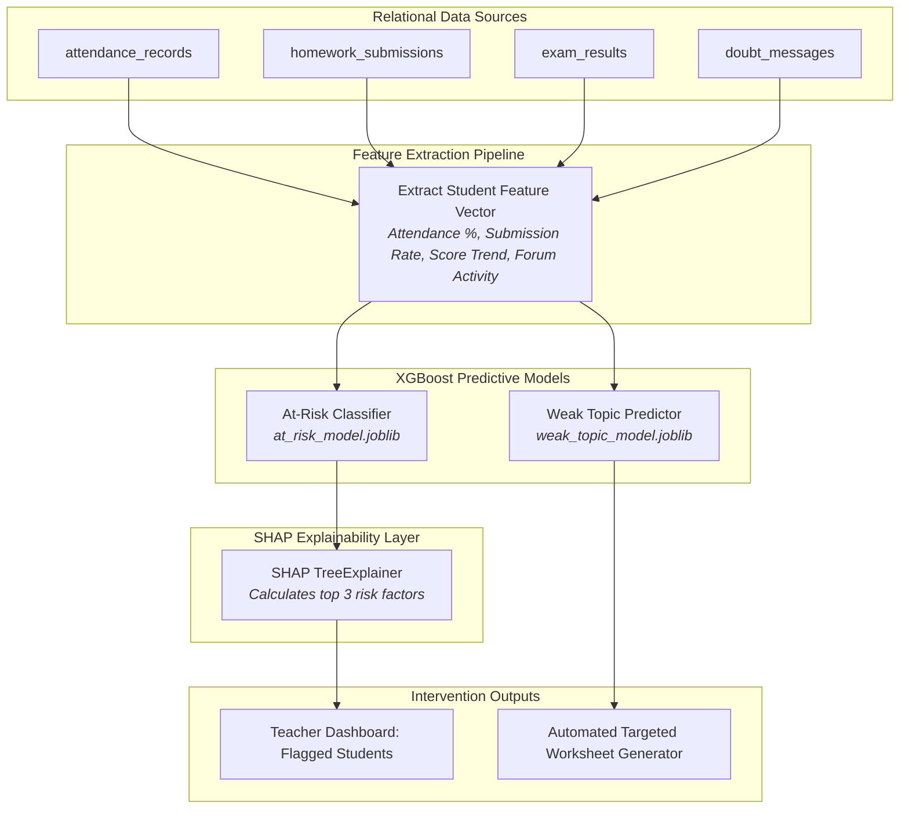

# EduIntel AI — Machine Learning & Predictive Diagnostics

This document details EduIntel AI's predictive machine learning models, feature engineering pipelines, SHAP explainability layer, and MLflow tracking on branch `develop/production-readiness`.

---

## 1. Machine Learning Architecture Overview

EduIntel incorporates specialized predictive machine learning models within [`backend/app/ml/`](file:///home/dell/projects/eduIntel/backend/app/ml/):
1. **At-Risk Student Classifier**: An XGBoost model that forecasts academic failure risk 4–6 weeks before major exams.
2. **Weak Topic Predictor**: A multi-output XGBoost model that isolates specific syllabus units causing learning deficits.
3. **SHAP Explainability Engine**: Computes Shapley values to provide human-interpretable explanations for teacher interventions.
4. **Automated Worksheet Generator**: Synthesizes targeted practice problem sets addressing the student's unique weak concepts.
5. **MLflow Experiment Registry**: Tracks model training runs, hyperparameters, and ROC-AUC curves in `backend/mlflow.db`.



---

## 2. At-Risk Student Classification Model

### 2.1. Problem Formulation
- **Objective**: Identify students who have a high probability of failing an upcoming term exam or dropping below 60% mastery.
- **Model Type**: Binary Classification (`0 = On-Track`, `1 = At-Risk`).
- **Algorithm**: `xgboost.XGBClassifier` with `binary:logistic` objective.
- **Storage Location**: Pre-trained model weights exported via joblib to [`backend/app/ml/models/at_risk_model.joblib`](file:///home/dell/projects/eduIntel/backend/app/ml/models/at_risk_model.joblib).

### 2.2. Feature Engineering Pipeline

| Feature Name | Type | Description |
|---|---|---|
| `attendance_rate` | Float $[0.0, 1.0]$ | Proportion of total class sessions attended in the last 60 days. |
| `homework_submission_rate` | Float $[0.0, 1.0]$ | Proportion of assignments submitted before deadline. |
| `homework_avg_score` | Float $[0.0, 100.0]$ | Average marks obtained on submitted homework. |
| `recent_exam_score` | Float $[0.0, 100.0]$ | Normalized percentage score on the most recent exam. |
| `score_trend_slope` | Float $[-\infty, +\infty]$ | Linear regression slope across the last 4 exam scores (positive = improving, negative = declining). |
| `doubt_forum_activity_count` | Integer $\ge 0$ | Number of messages/questions posted to the doubt forum in the last 30 days. |

---

## 3. Explainable AI with SHAP (TreeExplainer)

Black-box predictions undermine teacher trust. A raw probability score like *"Risk: 82%"* fails to inform teachers what action to take.

EduIntel uses **SHAP (SHapley Additive exPlanations)** with `shap.TreeExplainer`:
- For every inference request (`/api/ml/diagnose/{student_id}`), SHAP calculates the marginal contribution of each feature to the risk score.
- The service extracts the top 3 highest positive Shapley contributors and generates human-readable diagnostic statements.

### Example SHAP Diagnostic Output:
```json
{
  "student_id": "8c5912a4-5678-4321-9abc-123456789def",
  "is_at_risk": true,
  "risk_probability": 0.84,
  "top_risk_factors": [
    {
      "feature": "score_trend_slope",
      "impact": "+0.38",
      "explanation": "Exam scores declined by 14.5% over the past 3 evaluations."
    },
    {
      "feature": "attendance_rate",
      "impact": "+0.27",
      "explanation": "Attendance dropped to 68% in the last 30 days."
    },
    {
      "feature": "homework_submission_rate",
      "impact": "+0.19",
      "explanation": "Missed 3 consecutive homework assignments."
    }
  ],
  "recommended_intervention": "Schedule 1-on-1 academic counseling and issue parent notification."
}
```

---

## 4. Weak Topic Prediction & Automated Worksheets

### 4.1. Weak Topic Model
- **Algorithm**: Multi-label XGBoost classifier predicting student failure risk on specific curriculum topics (e.g., *Rotational Dynamics*, *Chemical Bonding*, *Integral Calculus*).
- **Location**: [`backend/app/ml/models/weak_topic_model.joblib`](file:///home/dell/projects/eduIntel/backend/app/ml/models/weak_topic_model.joblib).

### 4.2. Automated Worksheet Generation
When a teacher or student requests remediation (`/api/ml/worksheet/generate`):
1. The service looks up the student's predicted weak topics.
2. The LLM client constructs a customized problem set targeting those specific concepts.
3. Questions vary in difficulty (Easy $\to$ Medium $\to$ Hard) to rebuild conceptual mastery progressively.
4. The generated worksheet is returned as formatted Markdown/PDF ready for printing or digital submission.

---

## 5. MLflow Experiment Tracking

Model training runs, hyperparameters, and evaluation metrics are recorded using MLflow:
- **Tracking Database**: SQLite database located at `backend/mlflow.db`.
- **Artifact Repository**: Stored in `backend/mlruns/`.
- **Logged Metrics**: Precision, Recall, F1 Score, Log Loss, and ROC-AUC curve artifacts.
- **Retraining Script**: Executed via `backend/venv/bin/python -m app.ml.train`.

