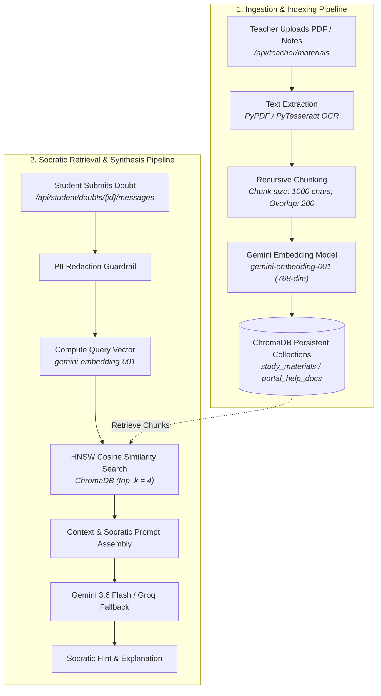

# EduIntel AI — RAG Architecture & Vector Retrieval

This document provides the technical architecture for EduIntel's **Retrieval-Augmented Generation (RAG)** pipeline, vector collection management in ChromaDB, and Socratic query synthesis on branch `develop/production-readiness`.

---

## 1. End-to-End RAG Architecture

EduIntel implements two synchronized RAG flows: an **Ingestion Pipeline** (converting uploaded documents into vector embeddings) and a **Retrieval & Synthesis Pipeline** (retrieving relevant context to guide student learning).



---

## 2. Vector Collections in ChromaDB

Vector persistence is managed by ChromaDB ([`backend/app/rag/service.py`](file:///home/dell/projects/eduIntel/backend/app/rag/service.py)) stored on disk at `backend/chroma_data/`.

### 2.1. Collection Definitions

| Collection Name | Content Type | Target Persona | Metadata Schema |
|---|---|---|---|
| **`portal_help_docs`** | Platform user manuals, feature guides, role permissions, FAQ items | All users (via Portal Assistant) | `{doc_type: "manual", section: string, role: string}` |
| **`study_materials`** | Academic notes, textbook excerpts, lecture slides, formula summaries | Students & Teachers | `{material_id: uuid, subject: string, teacher_id: uuid, chunk_index: int}` |

### 2.2. Embedding Specification
- **Model**: Google Gemini `models/embedding-001`.
- **Dimensionality**: 768-dimensional floating-point vectors.
- **Distance Metric**: Cosine similarity (`hnsw:space: cosine`).
- **Resiliency & Retries**: Wrapped in exponential backoff retry logic (`tenacity`) to absorb transient Google API rate limits.

---

## 3. Document Ingestion Pipeline

1. **Upload Handling**:
   - The teacher uploads a PDF or scanned homework sheet via `/api/teacher/materials`.
   - The file is saved to disk under `backend/uploads/{uuid}_{filename}`.
2. **Text Extraction**:
   - For digital PDFs: `pypdf.PdfReader` extracts clean text streams page by page.
   - For image uploads or scanned PDFs: `backend/app/ocr/service.py` executes image preprocessing and PyTesseract OCR.
3. **Text Chunking**:
   - Extracted text is split using a recursive character strategy:
     - Target chunk size: **1,000 characters**.
     - Chunk overlap: **200 characters** (prevents boundary information loss).
     - Separators: `["\n\n", "\n", " ", ""]`.
4. **Embedding Generation & Vector Upsert**:
   - Batch vectors are requested from Google Gemini Embeddings API.
   - Vectors and metadata are upserted into the `study_materials` ChromaDB collection.
   - In PostgreSQL, the `study_materials.is_indexed_in_rag` flag is updated to `True`.

---

## 4. Retrieval & Socratic Query Synthesis

When a student queries the doubt forum (`/api/student/doubts/{id}/messages`):
1. **Sanitization**: The student's message undergoes PII redaction and prompt injection scanning.
2. **Semantic Search**:
   - The sanitized query is embedded via `gemini-embedding-001`.
   - ChromaDB queries the `study_materials` collection with metadata filtering:
     ```python
     results = collection.query(
         query_embeddings=[query_vector],
         n_results=4,
         where={"subject": thread.subject}
     )
     ```
3. **Context Construction & Socratic Steering**:
   - Retrieved chunks are concatenated into a prompt context block.
   - The LLM is instructed:
     > *"You are the EduIntel AI Socratic Tutor. Use the provided study context to help the student understand the concepts. Never give raw answers to homework questions. Ask leading questions and guide their reasoning step by step."*
4. **Synthesis & Fallback**:
   - Primary inference runs on Google Gemini (`gemini-3.6-flash`).
   - If a 429 rate limit is encountered, the client automatically fails over to Groq (`openai/gpt-oss-120b`).

---

## 5. RAG Evaluation with Ragas

To monitor RAG retrieval accuracy and prevent hallucinations, an offline evaluation harness is implemented in [`backend/app/rag/eval/eval_rag.py`](file:///home/dell/projects/eduIntel/backend/app/rag/eval/eval_rag.py):

| Ragas Metric | Measurement Objective | Target Threshold |
|---|---|:---:|
| **Faithfulness** | Measures factual consistency of the answer against retrieved context (zero hallucinations). | $\ge 0.85$ |
| **Context Precision** | Measures whether retrieved context chunks are strictly relevant to the question. | $\ge 0.80$ |
| **Context Recall** | Measures whether all ground-truth facts required to answer the question were retrieved. | $\ge 0.80$ |
| **Answer Relevance** | Measures whether the answer directly addresses the student's doubt. | $\ge 0.85$ |

