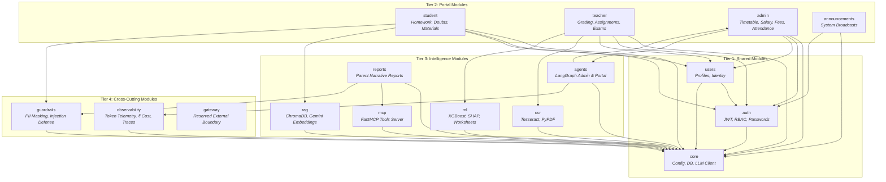

# EduIntel AI — Backend Modules Architecture

The EduIntel backend is built as a **Modular Monolith** organized into **16 distinct domain modules** grouped across **four functional tiers**. Each module is packaged inside its own directory within [`backend/app/`](file:///home/dell/projects/eduIntel/backend/app/), adhering to clean architecture principles with separate routers, schemas, models, and domain services.

---

## 1. Module Tier Topology & Dependency Graph

---

## 2. Tier 1 — Shared Modules

Shared modules form the foundational layer of the application. They provide identity, access control, database connections, and external API wrappers.

### 2.1. `core` — Foundation & Infrastructure
- **Directory**: [`backend/app/core/`](file:///home/dell/projects/eduIntel/backend/app/core/)
- **Key Files**:
  - `config.py`: `Settings` class using `pydantic-settings` to parse environment variables (`DATABASE_URL`, `JWT_SECRET_KEY`, `GEMINI_API_KEY`, `GROQ_API_KEY`, etc.).
  - `database.py`: Asynchronous engine creation (`create_async_engine`), `AsyncSession` factory (`async_sessionmaker`), and the FastAPI dependency `get_db()`.
  - `models.py`: Declarative Base and `TimestampMixin` (`id`, `created_at`, `updated_at`).
  - `llm_client.py`: Centralized LLM inference wrapper managing primary Google Gemini (`gemini-3.6-flash`) with automatic rate-limit detection and immediate fallback to Groq (`openai/gpt-oss-120b`). Emits `LLMCallUsage` metrics.

### 2.2. `auth` — Authentication & Identity
- **Directory**: [`backend/app/auth/`](file:///home/dell/projects/eduIntel/backend/app/auth/)
- **Key Files**:
  - `router.py`: Handles `/api/auth/signup`, `/api/auth/login`, `/api/auth/forgot-password`, `/api/auth/reset-password`.
  - `security.py`: Password hashing with bcrypt, JWT access token generation and decoding utilities.
  - `service.py`: User registration validation, password authentication logic, and token dispatch.
  - `models.py`: `User` model with `email`, `hashed_password`, `role`, and `is_active`.
  - `schemas.py`: Pydantic models for signup, login, password reset, and token response.

### 2.3. `users` — Profiles & Access Dependencies
- **Directory**: [`backend/app/users/`](file:///home/dell/projects/eduIntel/backend/app/users/)
- **Key Files**:
  - `dependencies.py`: Core FastAPI security dependencies: `get_current_user` (JWT validation) and `require_role(["admin", "teacher", "student"])`.
  - `router.py`: Endpoints for `/api/users/me` and role-specific profile updates.
  - `models.py`: `StudentProfile` (grade, roll_number, parent_email), `TeacherProfile` (department, designation), and `AdminProfile`.
  - `schemas.py`: Profile view and edit schemas.

---

## 3. Tier 2 — Portal Modules

Portal modules deliver domain logic tailored directly to the primary user roles of the application.

### 3.1. `student` — Student Portal & Homework
- **Directory**: [`backend/app/student/`](file:///home/dell/projects/eduIntel/backend/app/student/)
- **Key Files**:
  - `router.py`: Homework submission endpoints, doubt forum conversation thread creation, study material downloads, and dashboard statistics.
  - `models.py`: `HomeworkSubmission` (file path, status, marks, feedback) and `DoubtThread` / `DoubtMessage`.
  - `service.py`: Orchestrates homework uploads and dispatches doubt queries to the Socratic RAG pipeline.

### 3.2. `teacher` — Teacher Portal & Grading
- **Directory**: [`backend/app/teacher/`](file:///home/dell/projects/eduIntel/backend/app/teacher/)
- **Key Files**:
  - `router.py`: Assignment creation, homework grading with OCR text inspection, exam score entry, and flagged student reviews.
  - `models.py`: `Assignment` and `ExamResult`.
  - `service.py`: Computes assignment statistics, grades submissions, and links OCR text to submissions.

### 3.3. `admin` — Administrative Management
- **Directory**: [`backend/app/admin/`](file:///home/dell/projects/eduIntel/backend/app/admin/)
- **Key Files**:
  - `router.py`: Weekly timetable scheduling, teacher payroll/salary records, student fee installments, and attendance logging.
  - `models.py`: `TimetableEntry`, `SalaryRecord`, `FeeRecord`, and `AttendanceRecord`.
  - `service.py`: Business logic for financial calculations, overdue fee aggregations, and attendance rate percentages.

### 3.4. `announcements` — System-Wide Broadcasts
- **Directory**: [`backend/app/announcements/`](file:///home/dell/projects/eduIntel/backend/app/announcements/)
- **Key Files**:
  - `router.py`: CRUD endpoints for system announcements targeted to students, teachers, or all users.
  - `models.py`: `Announcement` model (`title`, `content`, `target_role`, `is_active`).

---

## 4. Tier 3 — Intelligence & AI Modules

These modules encapsulate document parsing, machine learning inference, vector retrieval, and agentic workflows.

### 4.1. `ocr` — Optical Character Recognition
- **Directory**: [`backend/app/ocr/`](file:///home/dell/projects/eduIntel/backend/app/ocr/)
- **Key Files**:
  - `service.py`: Image pre-processing (grayscale conversion, thresholding, noise reduction) using Pillow, text extraction via PyTesseract, and digital PDF text parsing via PyPDF.
  - `router.py`: Endpoint `/api/ocr/extract` for ad-hoc OCR extraction and confidence scoring.

### 4.2. `rag` — Vector Retrieval & Socratic Answering
- **Directory**: [`backend/app/rag/`](file:///home/dell/projects/eduIntel/backend/app/rag/)
- **Key Files**:
  - `service.py`: Manages two persistent ChromaDB collections (`portal_help_docs` and `study_materials`). Computes document embeddings using Google Gemini (`gemini-embedding-001`), executes semantic similarity search, and constructs prompt context.
  - `router.py`: Endpoints for document ingestion, search query testing, and RAG-augmented QA.

### 4.3. `ml` — Predictive Diagnostics & Explainability
- **Directory**: [`backend/app/ml/`](file:///home/dell/projects/eduIntel/backend/app/ml/)
- **Key Files**:
  - `diagnosis.py`: Real-time student at-risk prediction inference using `models/at_risk_model.joblib`.
  - `explain.py`: SHAP TreeExplainer calculating top feature impacts for diagnosed students.
  - `recommendations.py`: Weak topic prediction using `models/weak_topic_model.joblib`.
  - `worksheet_generator.py`: Generates targeted practice worksheets for predicted weak topics.
  - `train_at_risk_model.py` & `train_weak_topic_model.py`: Training pipelines tracking metrics to MLflow (`mlflow.db`).
  - `router.py`: Endpoints `/api/ml/diagnose/{student_id}`, `/api/ml/weak-topics/{student_id}`, and `/api/ml/worksheet/generate`.

### 4.4. `agents` — LangGraph AI Assistants
- **Directory**: [`backend/app/agents/`](file:///home/dell/projects/eduIntel/backend/app/agents/)
- **Key Files**:
  - `admin_assistant.py`: Stateful LangGraph state machine orchestrating 6 safe, parameterized administrative reporting tools (contained during Phase 0A). Disallows raw SQL execution.
  - `portal_assistant.py`: LangGraph conversational agent guiding users through EduIntel navigation and documentation using RAG.
  - `router.py`: Assistant chat endpoints `/api/admin/assistant/query` and `/api/portal/assistant/query`.

### 4.5. `mcp` — Model Context Protocol Server
- **Directory**: [`backend/app/mcp/`](file:///home/dell/projects/eduIntel/backend/app/mcp/)
- **Key Files**:
  - `server.py`: FastMCP server exposing database query and messaging tools (`get_student_data`, `send_email`) over stdio protocol.

### 4.6. `reports` — Automated Parent Reporting
- **Directory**: [`backend/app/reports/`](file:///home/dell/projects/eduIntel/backend/app/reports/)
- **Key Files**:
  - `parent_report_agent.py`: Aggregates academic grades, attendance percentages, and homework metrics; invokes LLM to draft a personalized narrative; redacts PII; and dispatches via SMTP.
  - `router.py`: Trigger endpoint `/api/reports/parent-report/{student_id}`.

---

## 5. Tier 4 — Cross-Cutting & Observability Modules

### 5.1. `guardrails` — Security & Safety Layer
- **Directory**: [`backend/app/guardrails/`](file:///home/dell/projects/eduIntel/backend/app/guardrails/)
- **Key Files**:
  - `pii_redaction.py`: High-performance regex engine that masks sensitive PII (Aadhaar numbers, Indian mobile numbers, emails, IPv4/v6, credit card numbers).
  - `prompt_injection.py`: Heuristic scanner detecting jailbreak attempts, role-play overrides, and system prompt tampering.
  - `anti_cheating.py`: Educational guardrail intercepting direct answer queries and enforcing Socratic pedagogical redirection.

### 5.2. `observability` — Telemetry & Cost Accounting
- **Directory**: [`backend/app/observability/`](file:///home/dell/projects/eduIntel/backend/app/observability/)
- **Key Files**:
  - `service.py`: Computes LLM token usage summaries, latency, and expenditure converted to Indian Rupees (₹).
  - `tracing.py`: Records LangGraph execution trajectories, node transitions, and tool execution times in `agent_trace_logs`.
  - `models.py`: SQLAlchemy models for `LLMUsageLog` and `AgentTraceLog`.

### 5.3. `gateway` — External Boundary
- **Directory**: [`backend/app/gateway/`](file:///home/dell/projects/eduIntel/backend/app/gateway/)
- **Status**: Reserved boundary for external API rate limiting, webhook receivers, or third-party LMS integrations.

