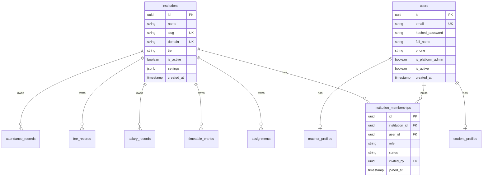

# EduIntel AI — Multi-Tenant System Architecture Specification

**Audit Date:** October 30, 2026  
**Auditor:** Principal Software Architect, Application Security Engineer & Database Architect  
**Branch:** `develop/production-readiness`  
**Classification:** Definitive Architecture Specification (Target Model for Phase 2 Implementation)

---

## 1. Executive Summary

This document defines the comprehensive architecture for transforming EduIntel from a single-institute system into an enterprise-grade, Multi-Tenant Software-as-a-Service (SaaS) platform. 

The architecture encompasses:
1. **The Multi-Institution Membership Model:** Decoupling platform identity from institutional affiliation.
2. **Complete Tenant Ownership Inventory:** Classifying all 20 relational entities and indirect relationship paths.
3. **Polyglot Tenant Isolation:** Extending tenant boundaries across PostgreSQL RLS, ChromaDB vector collections, local/cloud file storage, LangGraph AI agents, FastMCP tools, and Machine Learning pipelines.

---

## 2. Multi-Institution Membership Model (Workstream G)

### 2.1. The Single-Tenant Flaw vs. Target Model
In the legacy schema, `role` is stored directly on the `users` table, and proposals to simply add `institution_id` to `users` fail the requirements of a real-world educational SaaS:
- **Teachers:** In coaching hubs (e.g. Kota, Hyderabad, Delhi), expert teachers frequently teach Physics or Mathematics across multiple independent coaching institutes. A single `institution_id` on `users` forces teachers to register separate email accounts for every institute.
- **Students / Parents:** Parents often have multiple children enrolled in different schools/institutes or a single child attending both a formal school and a weekend coaching academy.
- **Platform Administrators:** Platform super-admins need global management access without dummy accounts in every school.

### 2.2. The Target Identity & Membership Schema



### 2.3. Entity Specifications

#### 1. `institutions` Table
Represents an independent coaching academy, school, or educational enterprise:
- `id`: `UUID` (PK, `gen_random_uuid()`).
- `name`: `VARCHAR(255)` (e.g. "Apex IIT-JEE Academy").
- `slug`: `VARCHAR(100)` (Unique, Indexed, e.g. "apex-academy" for subdomain routing `apex.eduintel.ai`).
- `domain`: `VARCHAR(255)` (Nullable, custom domain e.g. "portal.apexacademy.in").
- `tier`: `VARCHAR(50)` (`'starter' | 'pro' | 'enterprise'`).
- `is_active`: `BOOLEAN` (Default `TRUE`).
- `settings`: `JSONB` (Institution branding, logo URL, academic calendar, grading scales).
- `created_at`, `updated_at`: `TIMESTAMPTZ`.

#### 2. `users` Table (Global Platform Identity)
Represents a human identity authenticated by the platform:
- `id`: `UUID` (PK).
- `email`: `VARCHAR(255)` (Globally Unique, Indexed).
- `hashed_password`: `VARCHAR(255)` (Bcrypt).
- `name`: `VARCHAR(255)` (Full Name).
- `phone`: `VARCHAR(50)` (Mobile number).
- `is_platform_admin`: `BOOLEAN` (Default `FALSE` — Super Administrator).
- `is_active`: `BOOLEAN` (Default `TRUE`).
- `created_at`, `updated_at`: `TIMESTAMPTZ`.

#### 3. `institution_memberships` Table (Institutional Association)
Connects a user to an institution and defines their authorization role:
- `id`: `UUID` (PK).
- `institution_id`: `UUID` (FK -> `institutions.id`, ON DELETE CASCADE).
- `user_id`: `UUID` (FK -> `users.id`, ON DELETE CASCADE).
- `role`: `VARCHAR(50)` (`'admin' | 'teacher' | 'student' | 'guardian'`).
- `status`: `VARCHAR(50)` (`'active' | 'invited' | 'suspended'`).
- `invited_by`: `UUID` (FK -> `users.id`, Nullable).
- `joined_at`: `TIMESTAMPTZ`.
- **Constraint:** `UNIQUE (institution_id, user_id)` — Prevents duplicate membership in the same institute.

### 2.4. Lifecycle & Authorization Workflows
1. **Multi-Tenancy Sign-In Flow:**
   - User authenticates with global credentials (`email`, `password`).
   - If user belongs to exactly one institution, backend issues JWT scoped to that `institution_id`.
   - If user belongs to multiple institutions, backend returns HTTP 200 with list of active memberships (`[{"institution_id": "...", "name": "Apex Academy", "role": "teacher"}, ...]`).
   - Client selects active institution, calling `POST /auth/select-tenant`, which issues the tenant-scoped JWT.
2. **Institution Switching:**
   - Authenticated user calls `POST /auth/switch-tenant/{institution_id}`. Backend validates active membership in `institution_memberships` and issues a refreshed JWT.
3. **Invitation Workflow:**
   - Institute Admin calls `POST /admin/memberships/invite` with `email` and `role`.
   - System creates pending membership. If user exists, sends notification; if new, sends onboarding link.
4. **Revocation:**
   - Setting `status = 'suspended'` immediately cuts access to that specific institution without terminating the user's accounts at other institutes.

---

## 3. Complete Tenant Ownership Inventory (Workstream C)

The table below catalogs all 20 relational entities, their current implementation, tenant ownership classification, and required tenant isolation strategy.

| Entity | Current Table | Ownership Classification | Current Relationship | Required Tenant Strategy |
|---|---|:---:|---|---|
| **Institutions** | *New Table* | **Platform-Owned** | Root tenant entity | Primary tenant partition key |
| **Memberships** | *New Table* | **Institution-Owned** | Links `users` to `institutions` | Scoped by `institution_id` & `user_id` |
| **Users** | `users` | **Globally Shared / Platform** | Standalone auth table | Global identity; email globally unique |
| **Student Profiles** | `student_profiles` | **Institution-Owned** | FK -> `users.id` | Add `institution_id`; composite unique `(institution_id, roll_number)` |
| **Teacher Profiles** | `teacher_profiles` | **Institution-Owned** | FK -> `users.id` | Add `institution_id`; departmental classification |
| **Admin Profiles** | `admin_profiles` | **Institution-Owned** | FK -> `users.id` | Add `institution_id`; designation |
| **Password Reset** | `password_reset_tokens`| **User-Owned** | FK -> `users.id` | User-scoped credential token |
| **Assignments** | `assignments` | **Institution-Owned** | FK -> `users.id` (teacher) | Add `institution_id`; RLS enabled; composite key `(institution_id, id)` |
| **Homework Submissions**| `homework_submissions` | **Institution-Owned** | FK -> `assignments.id`, FK -> `users.id` | Add `institution_id`; composite FK referencing `assignments(institution_id, id)` |
| **Doubt Threads** | `doubt_threads` | **Institution-Owned** | FK -> `users.id` (student) | Add `institution_id`; RLS enabled |
| **Doubt Messages** | `doubt_messages` | **Institution-Owned** | FK -> `doubt_threads.id`, FK -> `users.id` | Add `institution_id`; inherited from parent thread |
| **Study Materials** | `study_materials` | **Institution-Owned** | FK -> `users.id` (teacher) | Add `institution_id`; physical file prefixing & ChromaDB metadata tag |
| **Exam Results** | `exam_results` | **Institution-Owned** | FK -> `users.id` (student) | Add `institution_id`; RLS enabled |
| **Timetable Entries** | `timetable_entries` | **Institution-Owned** | FK -> `users.id` (teacher) | Add `institution_id`; composite unique `(institution_id, class_section, day, period)` |
| **Salary Records** | `salary_records` | **Institution-Owned** | FK -> `users.id` (teacher) | Add `institution_id`; strict RLS policy; confidential financial partition |
| **Fee Records** | `fee_records` | **Institution-Owned** | FK -> `users.id` (student) | Add `institution_id`; strict RLS policy; confidential financial partition |
| **Attendance Records** | `attendance_records` | **Institution-Owned** | FK -> `users.id` (student) | Add `institution_id`; composite index `(institution_id, attendance_date)` |
| **Announcements** | `announcements` | **Institution-Owned** | FK -> `users.id` (creator) | Add `institution_id`; RLS enabled |
| **Audit Logs** | `audit_logs` | **Institution-Owned** | FK -> `users.id` | Add `institution_id`; PII-redacted prompt query storage |
| **Agent Trace Logs** | `agent_trace_logs` | **Institution-Owned** | `session_id` string | Add `institution_id`; AI latency and token observability |
| **LLM Usage Logs** | `llm_usage_logs` | **Platform / Tenant Shared** | `endpoint` string | Add `institution_id` (nullable for system runs); aggregate billing |

### 3.1. Indirect Relationships & Leakage Prevention
Cross-tenant leakage often occurs through indirect relationship chains:
- **Vulnerability Scenario:** A malicious student submits homework referencing an `assignment_id` belonging to another institution.
- **Enforcement:** Enforce composite foreign keys on all child tables:
  ```sql
  ALTER TABLE homework_submissions
  ADD CONSTRAINT fk_submissions_assignment_tenant
  FOREIGN KEY (institution_id, assignment_id)
  REFERENCES assignments(institution_id, id);
  ```
  PostgreSQL automatically rejects any submission where the child's `institution_id` does not match the parent assignment's `institution_id`.

---

## 4. AI, RAG, ML & Storage Isolation Architecture (Workstream E)

Tenant isolation must extend across non-relational storage layers:

```
┌────────────────────────────────────────────────────────────────────────┐
│                        FastAPI Request Handler                         │
│             (Extracts & Validates TenantContext from JWT)              │
└───────────────────┬────────────────────────────────┬───────────────────┘
                    │                                │
    PostgreSQL Transaction Context            ChromaDB Vector Store
    SET LOCAL app.current_institution_id      where={"institution_id": tenant_id}
                    │                                │
    File System / Cloud Storage               LangGraph Agent State
    uploads/{institution_id}/...              session_id = "{tenant_id}_{user_id}_uuid"
```

### 4.1. ChromaDB Vector Isolation
- **The Problem:** The current implementation uses two global collections (`portal_help_docs` and `study_materials`). Ingested chunks carry no tenant metadata, allowing semantic search queries to cross institution boundaries.
- **The Solution (Metadata Partitioning):**
  1. **Global Collection:** `portal_help_docs` remains globally shared (platform onboarding docs have no proprietary student or institute data).
  2. **Tenant Partitioning in `study_materials`:** All ingested chunks MUST include `institution_id` in their metadata:
     ```python
     collection.upsert(
         documents=chunks,
         ids=ids,
         metadatas=[{
             "institution_id": str(institution_id),
             "material_id": str(material_id),
             "subject": subject,
             "title": title,
             "chunk_index": i
         } for i in range(len(chunks))]
     )
     ```
  3. **Mandatory Query Filtering:** All vector similarity searches MUST pass the tenant filter:
     ```python
     results = collection.query(
         query_texts=[query],
         n_results=n_results,
         where={"institution_id": str(current_tenant_id)} # Hard boundary!
     )
     ```

### 4.2. File & Object Storage Isolation
- **The Problem:** All files currently reside in flat directories (`backend/uploads/homework/` and `backend/uploads/study_materials/`).
- **The Solution (Tenant Directory Namespaces):**
  1. Organize local/S3 storage strictly by tenant UUID:
     - `uploads/{institution_id}/homework/{file_id}_{filename}`
     - `uploads/{institution_id}/study_materials/{file_id}_{filename}`
  2. In Phase 8 (AWS S3), use IAM policies or pre-signed URLs scoped to `s3://eduintel-uploads/{institution_id}/*`.
  3. Download routes verify that the requested file path matches `uploads/{current_tenant_id}/*` before serving bytes.

### 4.3. LangGraph AI Agents Isolation
- **Session ID Namespacing:** Clients must not supply arbitrary unvalidated `session_id`s. The backend must enforce session key namespacing:
  `session_key = f"{current_tenant_id}:{current_user.id}:{client_session_uuid}"`
- **Agent State Propagation:** In `AdminAssistant`, inject `institution_id` into the LangGraph `AgentState`.
- **Tool Binding:** All 6 database reporting tools called by the agent must receive `institution_id` and execute queries filtered by tenant context.

### 4.4. FastMCP Server Isolation
- Tools in [`backend/app/mcp/server.py`](file:///home/dell/projects/eduIntel/backend/app/mcp/server.py) (`get_student_data`, `send_email`) must require `caller_institution_id`.
- `get_student_data` must verify that the student belongs to `caller_institution_id` before reading exam or attendance records.

### 4.5. Machine Learning Models & Inference Isolation
- **Global Pre-Trained Weights:** XGBoost models (`at_risk_model.joblib`, `weak_topic_model.joblib`) are pre-trained on generalized academic patterns and do not contain tenant-specific training weights.
- **Inference Feature Extraction:** The feature calculation in [`app/ml/service.py:_get_student_history`](file:///home/dell/projects/eduIntel/backend/app/ml/service.py#L48) queries PostgreSQL. Because the session has `SET LOCAL app.current_institution_id`, the database RLS prevents retrieving student records from another institution.
- **Tenant Isolation in MLflow:** In Phase 5, MLflow tracking runs and evaluation benchmarks must use tenant-prefixed experiment names (e.g. `tenant_{slug}_rag_eval`).

