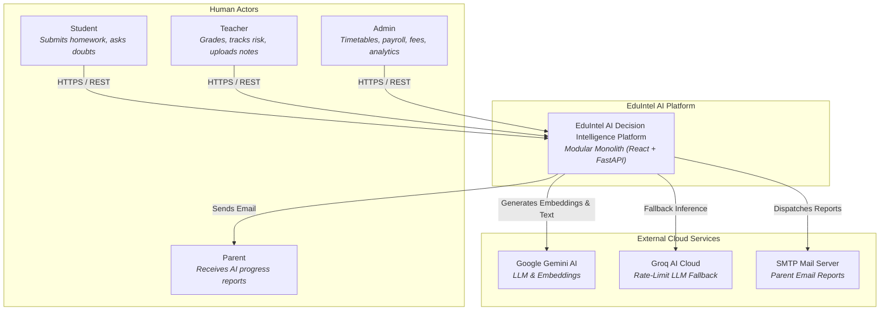
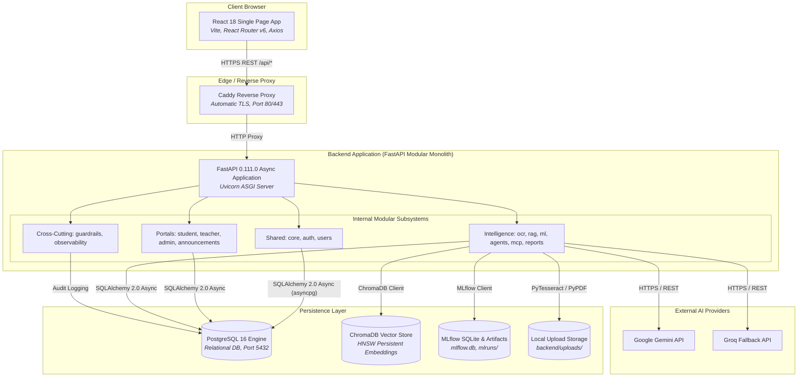
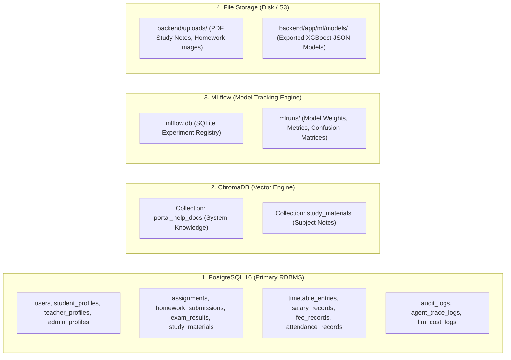
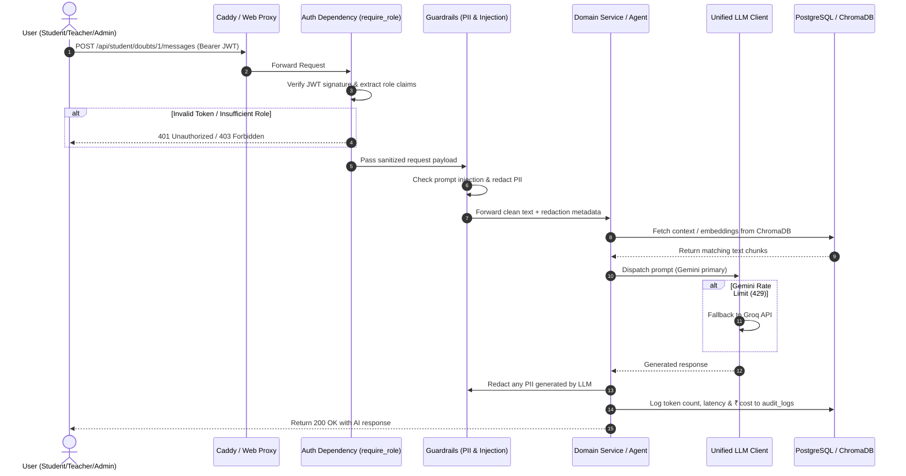

# EduIntel AI — System Overview & Architecture

## 1. Architectural Philosophy & Principles

EduIntel AI is engineered as a **Modular Monolith**. Rather than prematurely distributing components into isolated microservices with network boundaries, the system is consolidated into a single deployable unit while enforcing rigorous modular boundaries internally. 

### Core Design Principles
1. **Domain Boundary Separation**: The codebase is partitioned into 16 discrete domain modules. Modules interact strictly via exported service interfaces, never by directly mutating foreign database models or bypassing validation.
2. **Polyglot Persistence**: The system selects the optimal persistence mechanism for each data type:
   - *Relational Data (PostgreSQL 16)*: Users, academic grades, finance, schedules, and audit records.
   - *Vector Data (ChromaDB)*: High-dimensional semantic embeddings for study materials and portal help documents.
   - *Model Artifacts & Metrics (MLflow)*: Machine learning parameters, metrics, and trained model artifacts.
   - *Blob / File Storage (Local Filesystem / S3)*: Homework photo uploads, PDF lecture notes, and OCR caches.
3. **Asynchronous Non-Blocking I/O**: The backend leverages Python 3.12's `asyncio` event loop with FastAPI and SQLAlchemy 2.0 AsyncIO to ensure that database queries and network calls do not block concurrent requests.
4. **Defense-in-Depth AI Guardrails**: All AI interactions pass through layered security filters: PII redaction before persistence or LLM invocation, prompt injection detection, and Socratic anti-cheating interception.
5. **AI Provider Redundancy & Resiliency**: The core LLM client implements automatic rate-limit detection on Google Gemini (`gemini-3.6-flash`), immediately falling back to Groq (`openai/gpt-oss-120b`) without failing the user's request.

---

## 2. C4 Architecture Models

### 2.1. C4 Level 1 — System Context Diagram

The System Context diagram illustrates how external actors interact with the EduIntel platform and its external dependencies.

---

### 2.2. C4 Level 2 — Container Diagram

The Container diagram illustrates the high-level technical shape of EduIntel, showing how frontend, backend, and storage containers collaborate.

---

## 3. Data Persistence Topology

EduIntel decouples storage responsibilities across four distinct engines:

---

## 4. Cross-Cutting Execution Flow

Every HTTP request to an authenticated intelligence endpoint (e.g., student doubt query, admin AI query) traverses a standardized pipeline:

