# EduIntel AI — Database Schema and Entity-Relationship Diagram (ERD)

This document provides the definitive architectural specification for EduIntel's **19 PostgreSQL tables**, their column constraints, foreign key relationships, indexes, and entity-relationship models on branch `develop/production-readiness`.

---

## 1. Entity-Relationship Diagram (ERD)

```mermaid
erDiagram
    users ||--o| student_profiles : "has profile"
    users ||--o| teacher_profiles : "has profile"
    users ||--o| admin_profiles : "has profile"
    users ||--o{ password_reset_tokens : "requests"
    
    users ||--o{ assignments : "creates (Teacher)"
    users ||--o{ study_materials : "uploads (Teacher)"
    users ||--o{ exam_results : "takes (Student)"
    users ||--o{ exam_results : "records (Teacher/Admin)"
    
    users ||--o{ homework_submissions : "submits (Student)"
    users ||--o{ homework_submissions : "grades (Teacher)"
    assignments ||--o{ homework_submissions : "receives"
    
    users ||--o{ doubt_threads : "opens (Student)"
    doubt_threads ||--o{ doubt_messages : "contains"
    users ||--o{ doubt_messages : "sends"
    
    users ||--o{ timetable_entries : "assigned_teacher"
    users ||--o{ timetable_entries : "created_by"
    
    users ||--o{ salary_records : "receives (Teacher)"
    users ||--o{ salary_records : "disbursed_by"
    
    users ||--o{ fee_records : "charged_to (Student)"
    users ||--o{ fee_records : "recorded_by"
    
    users ||--o{ attendance_records : "recorded_for (Student)"
    users ||--o{ attendance_records : "marked_by (Teacher/Admin)"
    
    users ||--o{ announcements : "created_by"
    users ||--o{ audit_logs : "triggers"
    users ||--o{ agent_trace_logs : "initiates"

    users {
        uuid id PK
        string email UK
        string hashed_password
        string role
        boolean is_active
        timestamp created_at
        timestamp updated_at
    }

    student_profiles {
        uuid id PK
        uuid user_id FK,UK
        string grade
        string roll_number
        string parent_name
        string parent_email
        string parent_phone
        timestamp created_at
        timestamp updated_at
    }

    teacher_profiles {
        uuid id PK
        uuid user_id FK,UK
        string department
        string designation
        string phone
        timestamp created_at
        timestamp updated_at
    }

    admin_profiles {
        uuid id PK
        uuid user_id FK,UK
        string department
        string phone
        timestamp created_at
        timestamp updated_at
    }

    password_reset_tokens {
        uuid id PK
        uuid user_id FK
        string token UK
        timestamp expires_at
        boolean is_used
        timestamp created_at
    }

    assignments {
        uuid id PK
        uuid teacher_id FK
        string title
        text description
        string subject
        timestamp due_date
        integer max_marks
        timestamp created_at
        timestamp updated_at
    }

    homework_submissions {
        uuid id PK
        uuid assignment_id FK
        uuid student_id FK
        string file_path
        text ocr_extracted_text
        string status
        integer marks_obtained
        text teacher_feedback
        uuid graded_by FK
        timestamp submitted_at
        timestamp graded_at
    }

    doubt_threads {
        uuid id PK
        uuid student_id FK
        string title
        string subject
        string status
        timestamp created_at
        timestamp updated_at
    }

    doubt_messages {
        uuid id PK
        uuid thread_id FK
        uuid sender_id FK
        string sender_role
        text message_text
        boolean is_socratic_redirect
        timestamp created_at
    }

    study_materials {
        uuid id PK
        uuid teacher_id FK
        string title
        string subject
        string file_path
        string file_type
        boolean is_indexed_in_rag
        timestamp created_at
        timestamp updated_at
    }

    exam_results {
        uuid id PK
        uuid student_id FK
        string exam_name
        string subject
        numeric marks_obtained
        numeric total_marks
        numeric percentage
        timestamp exam_date
        uuid recorded_by FK
        timestamp created_at
    }

    timetable_entries {
        uuid id PK
        string day_of_week
        time start_time
        time end_time
        string subject
        string room_number
        uuid teacher_id FK
        uuid created_by FK
        timestamp created_at
        timestamp updated_at
    }

    salary_records {
        uuid id PK
        uuid teacher_id FK
        numeric base_salary
        numeric bonus
        numeric deductions
        numeric net_salary
        date payment_date
        string payment_status
        uuid created_by FK
        timestamp created_at
        timestamp updated_at
    }

    fee_records {
        uuid id PK
        uuid student_id FK
        numeric amount_due
        numeric amount_paid
        date due_date
        string payment_status
        date payment_date
        string remarks
        uuid created_by FK
        timestamp created_at
        timestamp updated_at
    }

    attendance_records {
        uuid id PK
        uuid student_id FK
        date attendance_date
        string status
        uuid marked_by FK
        timestamp created_at
        timestamp updated_at
    }

    announcements {
        uuid id PK
        string title
        text content
        string target_role
        boolean is_active
        uuid created_by FK
        timestamp created_at
        timestamp updated_at
    }

    audit_logs {
        uuid id PK
        uuid user_id FK
        string action
        string target_entity
        uuid target_id
        integer pii_redactions_count
        boolean prompt_injection_detected
        text details_json
        timestamp created_at
    }

    agent_trace_logs {
        uuid id PK
        string session_id
        string agent_name
        string node_name
        string tool_name
        numeric execution_seconds
        integer input_tokens
        integer output_tokens
        numeric cost_inr
        timestamp created_at
    }
```

---

## 2. Relational Table Specifications

### 2.1. Authentication & Profiles
1. **`users`**:
   - `id`: `UUID` (Primary Key, `gen_random_uuid()`).
   - `email`: `VARCHAR(255)` (Unique, Indexed, Non-null).
   - `hashed_password`: `VARCHAR(255)` (Non-null, bcrypt).
   - `role`: `VARCHAR(50)` (Non-null, `'student' | 'teacher' | 'admin'`).
   - `is_active`: `BOOLEAN` (Default `TRUE`).
   - `created_at`, `updated_at`: `TIMESTAMPTZ` (Auto UTC).
2. **`student_profiles`**:
   - `id`: `UUID` (PK).
   - `user_id`: `UUID` (FK -> `users.id`, ON DELETE CASCADE, Unique).
   - `grade`: `VARCHAR(50)` (e.g. "Grade 11 - JEE").
   - `roll_number`: `VARCHAR(50)`.
   - `parent_name`: `VARCHAR(255)`.
   - `parent_email`: `VARCHAR(255)`.
   - `parent_phone`: `VARCHAR(50)`.
3. **`teacher_profiles`**:
   - `id`: `UUID` (PK).
   - `user_id`: `UUID` (FK -> `users.id`, ON DELETE CASCADE, Unique).
   - `department`: `VARCHAR(100)` (e.g. "Physics", "Mathematics").
   - `designation`: `VARCHAR(100)`.
   - `phone`: `VARCHAR(50)`.
4. **`admin_profiles`**:
   - `id`: `UUID` (PK).
   - `user_id`: `UUID` (FK -> `users.id`, ON DELETE CASCADE, Unique).
   - `department`: `VARCHAR(100)`.
   - `phone`: `VARCHAR(50)`.
5. **`password_reset_tokens`**:
   - `id`: `UUID` (PK).
   - `user_id`: `UUID` (FK -> `users.id`, ON DELETE CASCADE).
   - `token`: `VARCHAR(255)` (Unique, Indexed).
   - `expires_at`: `TIMESTAMPTZ`.
   - `is_used`: `BOOLEAN` (Default `FALSE`).

### 2.2. Academic Workflows
6. **`assignments`**:
   - `id`: `UUID` (PK).
   - `teacher_id`: `UUID` (FK -> `users.id`, Indexed).
   - `title`: `VARCHAR(255)` (Non-null).
   - `description`: `TEXT`.
   - `subject`: `VARCHAR(100)` (Indexed).
   - `due_date`: `TIMESTAMPTZ`.
   - `max_marks`: `INTEGER` (Default 100).
7. **`homework_submissions`**:
   - `id`: `UUID` (PK).
   - `assignment_id`: `UUID` (FK -> `assignments.id`, Indexed).
   - `student_id`: `UUID` (FK -> `users.id`, Indexed).
   - `file_path`: `VARCHAR(500)` (Path to uploaded file in `backend/uploads/`).
   - `ocr_extracted_text`: `TEXT` (Extracted text from PyTesseract / PyPDF).
   - `status`: `VARCHAR(50)` (`'pending' | 'submitted' | 'graded'`).
   - `marks_obtained`: `INTEGER` (Nullable until graded).
   - `teacher_feedback`: `TEXT`.
   - `graded_by`: `UUID` (FK -> `users.id`, Nullable).
   - `submitted_at`, `graded_at`: `TIMESTAMPTZ`.
8. **`doubt_threads`**:
   - `id`: `UUID` (PK).
   - `student_id`: `UUID` (FK -> `users.id`, Indexed).
   - `title`: `VARCHAR(255)`.
   - `subject`: `VARCHAR(100)` (Indexed).
   - `status`: `VARCHAR(50)` (`'open' | 'resolved'`).
9. **`doubt_messages`**:
   - `id`: `UUID` (PK).
   - `thread_id`: `UUID` (FK -> `doubt_threads.id`, ON DELETE CASCADE, Indexed).
   - `sender_id`: `UUID` (FK -> `users.id`, Indexed).
   - `sender_role`: `VARCHAR(50)` (`'student' | 'teacher' | 'assistant'`).
   - `message_text`: `TEXT`.
   - `is_socratic_redirect`: `BOOLEAN` (Default `FALSE`).
10. **`study_materials`**:
    - `id`: `UUID` (PK).
    - `teacher_id`: `UUID` (FK -> `users.id`, Indexed).
    - `title`: `VARCHAR(255)`.
    - `subject`: `VARCHAR(100)` (Indexed).
    - `file_path`: `VARCHAR(500)`.
    - `file_type`: `VARCHAR(50)` (`'pdf' | 'docx' | 'image'`).
    - `is_indexed_in_rag`: `BOOLEAN` (Default `FALSE`).
11. **`exam_results`**:
    - `id`: `UUID` (PK).
    - `student_id`: `UUID` (FK -> `users.id`, Indexed).
    - `exam_name`: `VARCHAR(255)`.
    - `subject`: `VARCHAR(100)`.
    - `marks_obtained`: `NUMERIC(5,2)`.
    - `total_marks`: `NUMERIC(5,2)`.
    - `percentage`: `NUMERIC(5,2)`.
    - `exam_date`: `DATE`.
    - `recorded_by`: `UUID` (FK -> `users.id`).

### 2.3. Institutional Administration
12. **`timetable_entries`**:
    - `id`: `UUID` (PK).
    - `day_of_week`: `VARCHAR(20)` (`'Monday'` to `'Saturday'`, Indexed).
    - `start_time`: `TIME`.
    - `end_time`: `TIME`.
    - `subject`: `VARCHAR(100)`.
    - `room_number`: `VARCHAR(50)`.
    - `teacher_id`: `UUID` (FK -> `users.id`, Indexed).
    - `created_by`: `UUID` (FK -> `users.id`).
13. **`salary_records`**:
    - `id`: `UUID` (PK).
    - `teacher_id`: `UUID` (FK -> `users.id`, Indexed).
    - `base_salary`: `NUMERIC(10,2)`.
    - `bonus`: `NUMERIC(10,2)` (Default 0).
    - `deductions`: `NUMERIC(10,2)` (Default 0).
    - `net_salary`: `NUMERIC(10,2)`.
    - `payment_date`: `DATE`.
    - `payment_status`: `VARCHAR(50)` (`'paid' | 'pending'`).
    - `created_by`: `UUID` (FK -> `users.id`).
14. **`fee_records`**:
    - `id`: `UUID` (PK).
    - `student_id`: `UUID` (FK -> `users.id`, Indexed).
    - `amount_due`: `NUMERIC(10,2)`.
    - `amount_paid`: `NUMERIC(10,2)` (Default 0).
    - `due_date`: `DATE` (Indexed).
    - `payment_status`: `VARCHAR(50)` (`'pending' | 'partial' | 'paid' | 'overdue'`).
    - `payment_date`: `DATE`.
    - `remarks`: `VARCHAR(255)`.
    - `created_by`: `UUID` (FK -> `users.id`).
15. **`attendance_records`**:
    - `id`: `UUID` (PK).
    - `student_id`: `UUID` (FK -> `users.id`, Indexed).
    - `attendance_date`: `DATE` (Indexed).
    - `status`: `VARCHAR(20)` (`'present' | 'absent' | 'late'`).
    - `marked_by`: `UUID` (FK -> `users.id`).
16. **`announcements`**:
    - `id`: `UUID` (PK).
    - `title`: `VARCHAR(255)`.
    - `content`: `TEXT`.
    - `target_role`: `VARCHAR(50)` (`'all' | 'student' | 'teacher'`).
    - `is_active`: `BOOLEAN` (Default `TRUE`).
    - `created_by`: `UUID` (FK -> `users.id`).

### 2.4. Audit & Observability
17. **`audit_logs`**:
    - `id`: `UUID` (PK).
    - `user_id`: `UUID` (FK -> `users.id`, Nullable, Indexed).
    - `action`: `VARCHAR(100)` (e.g. `'ai_query'`, `'socratic_redirect'`, `'auth_login'`).
    - `target_entity`: `VARCHAR(100)`.
    - `target_id`: `UUID`.
    - `pii_redactions_count`: `INTEGER` (Default 0).
    - `prompt_injection_detected`: `BOOLEAN` (Default `FALSE`).
    - `details_json`: `TEXT` (JSON serialized metadata).
    - `created_at`: `TIMESTAMPTZ` (Indexed).
18. **`agent_trace_logs`**:
    - `id`: `UUID` (PK).
    - `session_id`: `VARCHAR(100)` (Indexed).
    - `agent_name`: `VARCHAR(100)` (`'admin_assistant' | 'portal_assistant'`).
    - `node_name`: `VARCHAR(100)`.
    - `tool_name`: `VARCHAR(100)` (Nullable).
    - `execution_seconds`: `NUMERIC(6,3)`.
    - `input_tokens`: `INTEGER` (Default 0).
    - `output_tokens`: `INTEGER` (Default 0).
    - `cost_inr`: `NUMERIC(8,4)` (Cost in ₹).
    - `created_at`: `TIMESTAMPTZ`.
19. **`alembic_version`**:
    - `version_num`: `VARCHAR(32)` (PK, tracks active migration revision).

