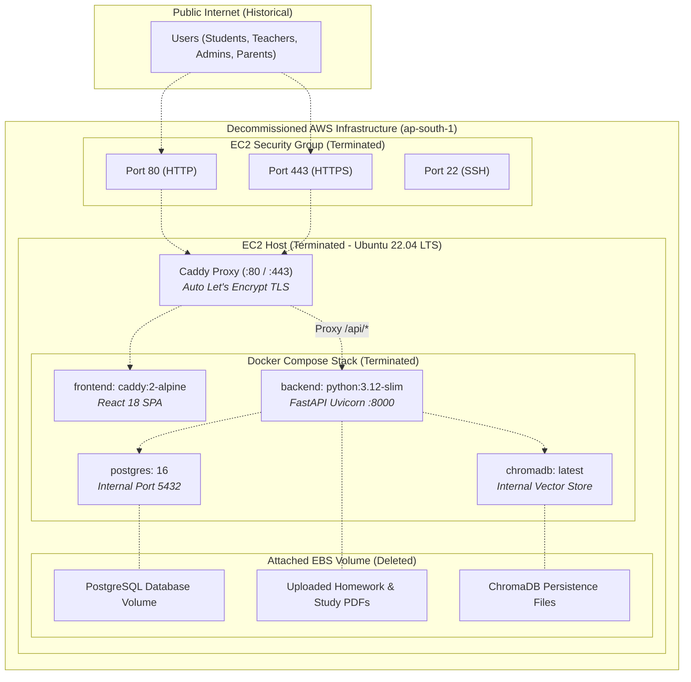
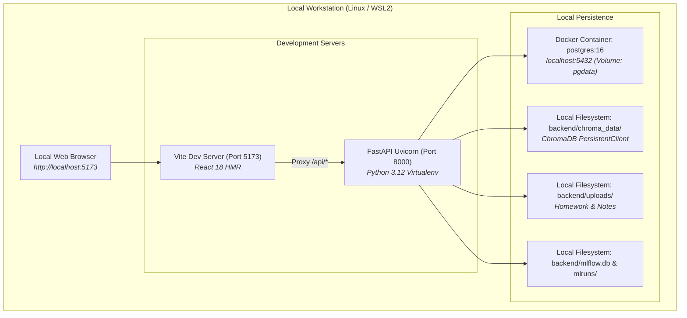
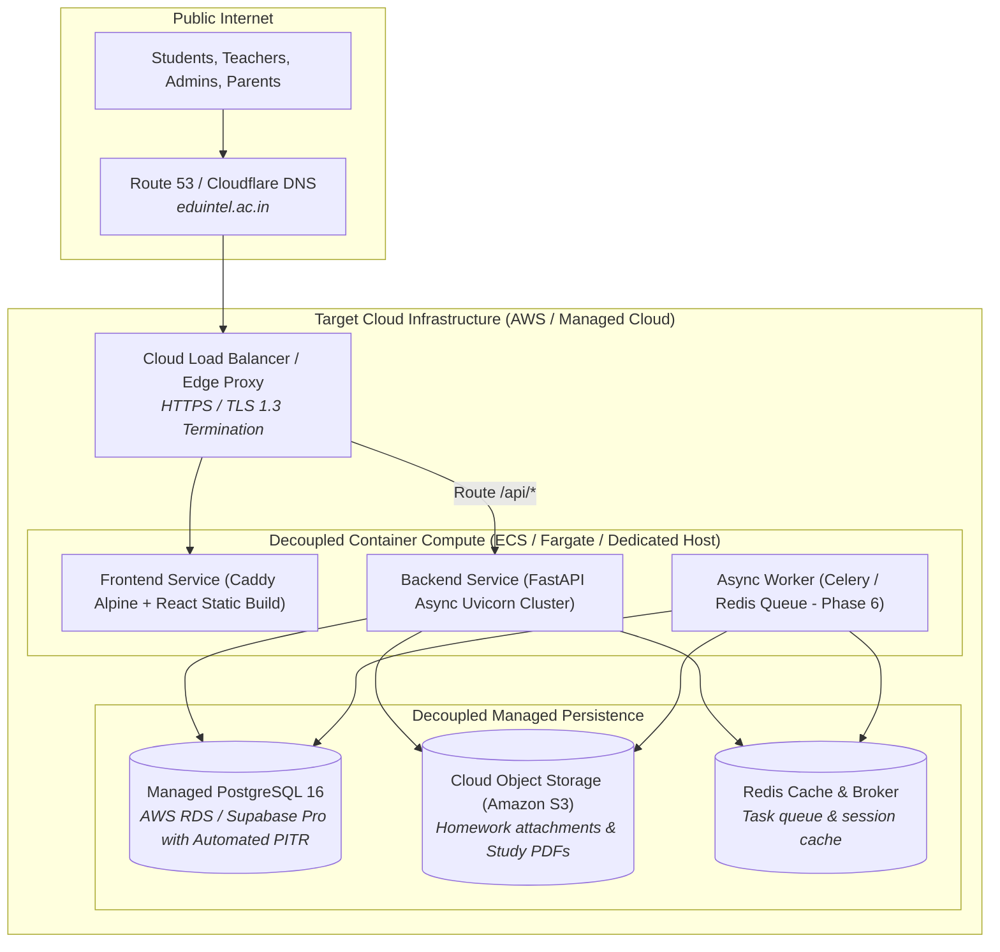

# EduIntel AI — Deployment Topology: Historical, Current & Proposed Architecture

This document specifies the deployment topology for EduIntel AI on branch `develop/production-readiness`, explicitly distinguishing between the **decommissioned historical AWS deployment**, the **current local-only development environment**, and the **proposed production architecture** planned for Phase 8.

---

## 1. Current Deployment Status: 100% Local Development

> [!IMPORTANT]
> **The previous EduIntel AWS cloud deployment has been fully decommissioned.**
> - The previous AWS EC2 instance has been **terminated**.
> - All associated EBS storage volumes have been **deleted**.
> - The assigned AWS Elastic IP address has been **released**.
> - Zero cloud resources or billing meters remain active on AWS.
> 
> **Current state:** All active development, testing, and evaluation are conducted **entirely on local development machines** (WSL2 Ubuntu / Linux) using Docker Compose and Python virtual environments. Data independence from AWS has been verified.

---

## 2. Historical AWS Deployment Architecture (Decommissioned)

Before decommissioning, EduIntel was hosted on a single AWS EC2 virtual machine in the `ap-south-1` (Mumbai) region. This historical architecture is documented below for reference:

### Decommission Verification Audit Trail
Prior to and during decommissioning the AWS environment, a read-only inventory was performed, followed by backup verification and confirmed resource shutdown:
1. **Full Backup Extracted**: Logical database dump, ChromaDB directory, uploads, and ML models transferred to `/home/dell/eduintel-backups/eduintel-backup-20261030/`.
2. **Restoration Verification**: PostgreSQL database restoration was verified 100% intact on an isolated local container on port 5433.
3. **Verified Shutdown Information**:
   - **EC2 Instance**: `eduintel-server` (ID: `i-057291d7796b1fcac`) in region `ap-south-1` was terminated.
   - **EBS Volumes**: Root EBS volume deleted; additional Docker EBS volume manually deleted.
   - **Elastic IP**: `13.205.55.115` was unassociated and released.
   - **Storage Check**: No S3 buckets were found in the account-wide check.
   - **Networking & Databases**: No load balancers, NAT gateways, or RDS database instances were found in the checked region (`ap-south-1`).
   - **Billing Verification**: The October 2026 billing statement confirmed **$0.00 before tax and $0.00 tax**.
   - *Note on Scope*: Verified shutdown applies to all documented EduIntel resources in the operational region (`ap-south-1`) and account-wide S3/Billing. It does not claim that every possible AWS resource in every unexplored global region was independently audited.
4. **AWS Deployment Status**: Fully decommissioned and no longer active.

---

## 3. Current Local Development Topology

All application components now run entirely within the developer's local environment:

---

## 4. Proposed Production Deployment Architecture (Phase 8 Target)

When EduIntel returns to cloud production in Phase 8 (Production Deployment & Pilot Onboarding), it will adopt a modern, decoupled architecture resolving the single-point-of-failure vulnerabilities of the historical EC2 deployment:

### Key Architectural Improvements over Historical Deployment:
1. **Decoupled Database**: Migrating PostgreSQL off the application compute host onto AWS RDS or Supabase Pro eliminates compute starvation caused by PyTesseract OCR and PDF parsing.
2. **Automated Point-in-Time Recovery (PITR)**: Continuous transaction log (WAL) archiving replaces manual host-level `pg_dump` cron jobs.
3. **Stateless Compute**: Moving uploads from local disk to Amazon S3 allows application containers to scale horizontally.
4. **Resilience**: Managed failover guarantees high availability during hardware degradation.
