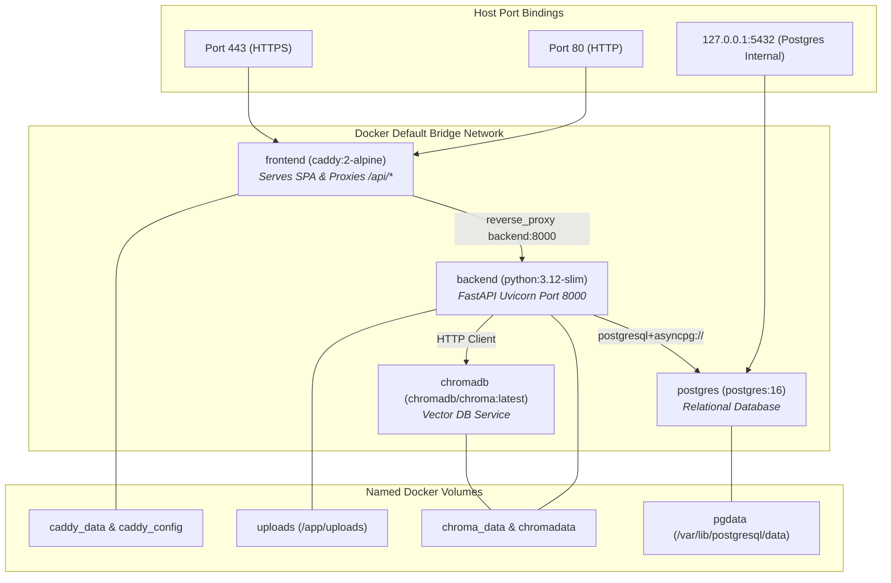

# EduIntel AI — Docker & Container Architecture

This document specifies the containerization architecture, Dockerfiles, compose services, volume persistence, and networking topology for EduIntel AI on branch `develop/production-readiness`.

---

## 1. Container Topology & Compose Services

The production container deployment is orchestrated via root [`docker-compose.yml`](file:///home/dell/projects/eduIntel/docker-compose.yml):



---

## 2. Service Specifications

### 2.1. `frontend` Container
- **Source**: [`frontend/Dockerfile`](file:///home/dell/projects/eduIntel/frontend/Dockerfile)
- **Base Image (Build)**: `node:20-slim`
- **Base Image (Runtime)**: `caddy:2-alpine`
- **Build Stage**:
  ```dockerfile
  FROM node:20-slim AS build
  WORKDIR /app
  COPY package.json package-lock.json ./
  RUN npm ci
  COPY . .
  ARG VITE_API_URL=/api
  ENV VITE_API_URL=$VITE_API_URL
  RUN npm run build
  ```
- **Runtime Stage**: Copies `/app/dist` to `/usr/share/caddy` and configures `Caddyfile`.
- **Exposed Ports**: `80:80`, `443:443`.
- **Caddy Reverse Proxy Logic** ([`frontend/Caddyfile`](file:///home/dell/projects/eduIntel/frontend/Caddyfile)):
  ```caddyfile
  :80 {
      handle /api/* {
          uri strip_prefix /api
          reverse_proxy backend:8000
      }
      handle {
          root * /usr/share/caddy
          try_files {path} /index.html
          file_server
      }
  }
  ```

### 2.2. `backend` Container
- **Source**: [`backend/Dockerfile`](file:///home/dell/projects/eduIntel/backend/Dockerfile)
- **Base Image**: `python:3.12-slim`
- **OS Dependencies**: Installs `tesseract-ocr`, `libpq-dev`, and `gcc` for OCR and C extensions.
- **Entrypoint**: `uvicorn app.main:app --host 0.0.0.0 --port 8000`.
- **Environment**: Injects `backend/.env` file.
- **Mounts**:
  - `uploads:/app/uploads`: Persists uploaded homework photos and study PDFs.
  - `chroma_data:/app/chroma_data`: Persists local ChromaDB vector collections.
  - `./backend/app/ml/models:/app/app/ml/models`: Mounts pre-trained XGBoost JSON models.

### 2.3. `postgres` Container
- **Image**: `postgres:16`
- **Volume**: `pgdata:/var/lib/postgresql/data`
- **Port Mapping**: Bound strictly to `127.0.0.1:5432:5432` on the host to prevent public Internet exposure.

### 2.4. `chromadb` Container
- **Image**: `chromadb/chroma:latest`
- **Volume**: `chromadata:/chroma/chroma`
- **Networking**: Accessible only within internal Docker network by the backend container.

---

## 3. Data Volume Lifecycle & Backup Policy

| Volume Name | Storage Contents | Criticality | Backup Procedure |
|---|---|:---:|---|
| **`pgdata`** | PostgreSQL tables, users, marks, fees, audit logs | 🔴 Critical | Logical `pg_dump` backup script executed daily. |
| **`uploads`** | Raw PDF study notes, student homework photos | 🔴 Critical | Tar archive backup synchronized to external storage. |
| **`chroma_data`**| ChromaDB HNSW vector indices | 🟡 Medium | Snapshot directory or regenerate from `study_materials`. |
| **`caddy_data`** | Let's Encrypt TLS certificates and private keys | 🟡 Medium | Persisted across container restarts to avoid TLS rate limits. |

---

## 4. Operational Container Commands

```bash
# Build and launch all containers in detached mode
docker compose up -d --build

# View real-time logs across all services
docker compose logs -f

# Inspect container health and resource utilization
docker compose ps
docker stats

# Execute bash inside the running backend container
docker compose exec backend bash

# Stop all containers safely preserving volume data
docker compose down
```

