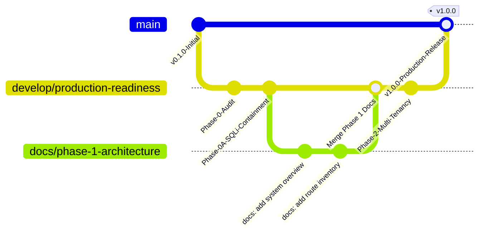

# EduIntel AI — Engineering Standards & Development Workflow

This document outlines the software engineering standards, Git branching rules, code style guidelines, and pull request conventions governing the EduIntel project on branch `develop/production-readiness`.

---

## 1. Git Branching & Release Strategy

EduIntel uses a modified GitFlow branching model tailored for rapid iterative delivery with strict safety boundaries.



### Branch Hierarchy
- **`main`**: Production branch. Must always be stable, tested, and deployable. Direct commits are forbidden.
- **`develop/production-readiness`**: Integration branch for the 9-phase production-readiness roadmap (Phases 0 through 8). All phase PRs merge here.
- **Feature Branches**:
  - Format: `feature/<phase-number>-<short-description>` (e.g., `feature/phase-2-multi-tenant-rls`).
  - Bugfix format: `fix/<issue-name>` (e.g., `fix/jwt-expiration-timezone`).
  - Documentation format: `docs/<topic>` (e.g., `docs/phase-1-architecture`).

---

## 2. Commit Message Conventions

EduIntel enforces the **Conventional Commits** specification:

```
<type>(<scope>): <short description in present tense>

[optional body explaining WHY and WHAT changed]

[optional footer referencing issues or breaking changes]
```

### Allowed Types:
- **`feat`**: A new user-facing feature or API endpoint.
- **`fix`**: A bug fix or security patch.
- **`docs`**: Documentation changes only (e.g., in `docs/` or `README.md`).
- **`refactor`**: Code restructuring without altering external functionality.
- **`test`**: Adding or updating unit/integration tests.
- **`chore`**: Dependency updates, configuration tweaks, or tooling maintenance.

### Examples:
```text
feat(admin): add parameterized query tool for teacher timetable coverage
fix(auth): correct token expiry calculation to use timezone-aware UTC
docs(api): document all 57 endpoints in route inventory
test(rag): add pytest suite for recursive chunking overlap
```

---

## 3. Code Quality & Styling Standards

### 3.1. Python (Backend)
- **Version**: Python 3.12+
- **Style Guide**: PEP 8 compliance enforced via `ruff`.
- **Typing**: Strict type annotations on all function signatures, parameters, and return values:
  ```python
  async def get_fee_summary(
      student_id: UUID, 
      db: AsyncSession
  ) -> FeeSummaryResponse:
      ...
  ```
- **Pydantic**: Use Pydantic v2 schemas for all request validation and response serialization.
- **Error Handling**: Use explicit FastAPI `HTTPException` with informative error messages and accurate status codes. Never use generic bare `except: pass`.

### 3.2. JavaScript / React (Frontend)
- **Framework**: React 18 with functional components and hooks (`useState`, `useEffect`, `useContext`).
- **Styling**: Adhere to the established CSS variable system in `frontend/src/components/ui/ui.css` (primary colors, card backgrounds, typography, border radii). Do not introduce arbitrary inline styling hacks.
- **Icons**: Use `lucide-react` icons exclusively for visual consistency.
- **API Requests**: Centralize HTTP calls through the configured Axios client in `frontend/src/api/client.js` with automated JWT header injection.

---

## 4. Definition of Done (DoD) for Pull Requests

Before any pull request is merged into `develop/production-readiness`:

1. **No Application Regression**: All existing unit and integration tests pass cleanly via `pytest`.
2. **Zero Hardcoded Secrets**: Scanned to confirm no passwords, JWT secret keys, Gemini API tokens, or AWS credentials exist in commit diffs.
3. **Database Migration Safety**: If models were updated, a valid Alembic migration is included with tested `upgrade()` and `downgrade()` methods.
4. **Documentation Updated**: Relevant markdown documents under `docs/` (e.g. `route-inventory.md`, `feature-matrix.md`) are updated to reflect the new state.
5. **Architectural Review**: Confirms that module boundary integrity is preserved (no cyclic dependencies, no unauthorized cross-module database writes).

