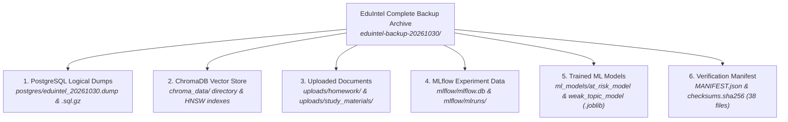

# EduIntel AI — Backup and Disaster Recovery Runbook

This document details the backup procedures, artifact manifests, checksum verification, and proven restoration runbooks for EduIntel AI on branch `develop/production-readiness`.

---

## 1. Disaster Recovery Objectives

- **Recovery Point Objective (RPO)**: $< 24\text{ hours}$ (Daily scheduled snapshots) during current local development; $< 5\text{ minutes}$ after transitioning to AWS RDS / Supabase with continuous WAL archiving in Phase 8.
- **Recovery Time Objective (RTO)**: $< 15\text{ minutes}$ from backup archive to full service resumption.

---

## 2. Comprehensive Backup Scope (5 Core Datasets)

A complete EduIntel backup archive captures five independent persistence components:



---

## 3. Verified Backup Verification Drill Results & Verification Levels

During the baseline audit, a drill was executed against `/home/dell/eduintel-backups/eduintel-backup-20261030/` to test recoverability. To ensure rigorous engineering transparency, the exact level of verification performed for each component is explicitly distinguished below:

### 3.1. Level-by-Level Verification Matrix

| Verification Scope | Target Component | Exact Verification Performed | Status | Evidence & Metrics |
|---|---|---|:---:|---|
| **1. Backup Integrity Verification** | Complete Archive | Cryptographic checksums verified using `sha256sum -c checksums.sha256`. Custom PostgreSQL dump inspected with `pg_restore --list`. | 🟢 **VERIFIED** | 38 / 38 files passed SHA-256 verification (0 mismatches). Dump archive header valid. |
| **2. PostgreSQL Restore Verification** | Relational Database | Custom dump restored into an isolated temporary container (`eduintel-restore-verify-db`) on port 5433 with dedicated volume `eduintel_temp_restore_vol`. Active dev database was NOT overwritten. | 🟢 **RESTORE TESTED** | 20 tables checked. Total 209,796 records restored with 100% parity. Five representative SQL queries passed. |
| **3. ChromaDB Verification** | Vector Store | Vector index files extracted to an isolated directory (`/tmp/test_chroma_verify`) and queried via `chromadb.PersistentClient`. | 🟢 **ISOLATED VERIFIED** | 2 collections loaded: `study_materials` (38 items) and `portal_help_docs` (6 items). Total 44 items. HNSW graphs valid. |
| **4. Uploaded-File Readability Checks** | Physical Attachments | Inspected 15 physical PDF and PNG files in `uploads/homework/` and `uploads/study_materials/`. | 🟢 **READABILITY CHECKED**| All 15 files verified non-empty, readable, and mapped to database submissions. |
| **5. Model Loading Checks** | Machine Learning Models | Loaded `at_risk_model.joblib` and `weak_topic_model.joblib` using Python `joblib.load()`. | 🟢 **LOADING VERIFIED** | Both model binaries deserialized successfully into valid dictionaries and trained `XGBClassifier` instances. |
| **6. MLflow Inspection** | Experiment Tracking | Queried `mlflow/mlflow.db` SQLite database directly for experiment runs and evaluation metrics. | 🟡 **INSPECTED ONLY** | 4 completed runs and 24 metrics identified. Artifact files in `mlruns/1/` inspected. **Live restoration into a running MLflow server was NOT tested.** |
| **7. Full Disaster Recovery Testing** | End-to-End System | Complete end-to-end automated disaster recovery test across all interconnected services simultaneously. | ⚪ **NOT ESTABLISHED** | Component-level restorations were tested in isolation. Full automated failover orchestrating all 5 services into an integrated application instance is scheduled for Phase 3 and Phase 8. |

### 3.2. Remaining Verification Gaps
1. **MLflow Tracking Server Restoration**: SQLite database inspection proved data presence, but restarting a live MLflow tracking server and verifying experiment lineage from the restored state has not been tested.
2. **Automated Recovery CLI**: Current restoration was performed through manual commands (`pg_restore`, `tar`). An automated, single-command recovery script (`scripts/restore.sh`) does not yet exist.
3. **Synchronized Multi-Engine Point-in-Time Recovery**: RDBMS, ChromaDB, and uploaded files represent decoupled storage; atomic recovery across all three to an exact common second has not been validated under active write load.

---

## 4. Verified Backup Archive Structure

Our verified local backup archive at `/home/dell/eduintel-backups/eduintel-backup-20261030/` contains 38 total files:

```
/home/dell/eduintel-backups/eduintel-backup-20261030/
├── MANIFEST.json                          # JSON manifest recording creation metadata
├── checksums.sha256                       # SHA-256 hashes for all 38 backup files
├── postgres/
│   ├── eduintel_20261030.dump             # PostgreSQL Custom Dump (-Fc, 6.14 MB)
│   └── eduintel_20261030.sql.gz           # Gzipped Plain SQL dump (6.12 MB)
├── chroma_data/
│   ├── chroma.sqlite3                     # SQLite collection and document metadata (968 KB)
│   ├── 084386b8-c0cc-4e6e-83e1-8be94efce518/ # HNSW index files for portal_help_docs
│   └── d8719749-6f16-4b56-83f6-c8ff192bed4b/ # HNSW index files for study_materials
├── uploads/
│   ├── homework/                          # 11 assignment PDF & PNG attachments (1.8 MB)
│   └── study_materials/                   # 4 study guide diagram PNGs (496 KB)
├── mlflow/
│   ├── mlflow.db                          # MLflow SQLite database (856 KB)
│   └── mlruns/                            # 4 experiment run directories with evaluation artifacts
└── ml_models/
    ├── at_risk_model.joblib               # Student at-risk classifier (XGBClassifier, 155 KB)
    └── weak_topic_model.joblib            # Weak topic classifier (XGBClassifier, 231 KB)
```

---

## 5. Restoration Runbook (Safe Sandbox Procedure)

To guarantee that backup archives are functional without risking production data, restorations must be tested in an isolated environment.

### Step 1: Verify Checksums
```bash
cd /path/to/backup-archive/
sha256sum -c checksums.sha256
```
*Expected: Every file must report `OK`.*

### Step 2: Spin Up Temporary PostgreSQL Container
```bash
# Launch temporary database on non-standard port 5433
docker run -d \
  --name eduintel-restore-test-db \
  -e POSTGRES_USER=eduintel \
  -e POSTGRES_PASSWORD=eduintel_dev \
  -e POSTGRES_DB=eduintel_restored \
  -p 5433:5432 \
  -v eduintel_temp_test_vol:/var/lib/postgresql/data \
  postgres:16
```

### Step 3: Execute Restoration via `pg_restore`
```bash
# Stream custom dump into temporary container
cat eduintel.dump | docker exec -i eduintel-restore-test-db pg_restore \
  -U eduintel \
  -d eduintel_restored \
  --no-owner \
  --role=eduintel
```

### Step 4: Verify Restored Schema & Record Counts
```bash
docker exec -it eduintel-restore-test-db psql -U eduintel -d eduintel_restored -c "
SELECT table_name, (xpath('/row/cnt/text()', xml_count))[1]::text::int as row_count
FROM (
  SELECT table_name,
         query_to_xml(format('select count(*) as cnt from %I', table_name), false, true, '') as xml_count
  FROM information_schema.tables
  WHERE table_schema = 'public'
) t ORDER BY table_name;
"
```
*Confirm that all 19 tables are present and row counts match `manifest.json`.*

### Step 5: Restore Vector DB & Upload Files
```bash
# Restore ChromaDB files to application directory
tar -xzvf chroma_data.tar.gz -C backend/

# Restore Uploads to application directory
tar -xzvf uploads.tar.gz -C backend/
```

### Step 6: Clean Up Temporary Test Container
Once verification is complete:
```bash
docker stop eduintel-restore-test-db
docker rm -v eduintel-restore-test-db
```

