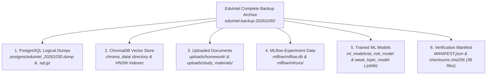

# EduIntel AI — Backup and Disaster Recovery Runbook

This document details the backup procedures, artifact manifests, checksum verification, and proven restoration runbooks for EduIntel AI on branch `develop/production-readiness`.

---

## 1. Disaster Recovery Objectives

- **Recovery Point Objective (RPO)**: $< 24\text{ hours}$ (Daily scheduled snapshots) during current local development; $< 5\text{ minutes}$ after transitioning to AWS RDS / Supabase with continuous WAL archiving in Phase 8.
- **Recovery Time Objective (RTO)**: $< 15\text{ minutes}$ from backup archive to full service resumption.

---

## 2. Comprehensive Backup Scope (5 Core Datasets)

A complete EduIntel backup archive captures five independent persistence components:



---

## 3. Verified Backup Verification Drill Results & Verification Levels

During the baseline audit, a drill was executed against `/home/dell/eduintel-backups/eduintel-backup-20261030/` to test recoverability. To ensure rigorous engineering transparency, the exact level of verification performed for each component is explicitly distinguished below:

### 3.1. Level-by-Level Verification Matrix

| Verification Scope | Target Component | Exact Verification Performed | Status | Evidence & Metrics |
|---|---|---|:---:|---|
| **1. Backup Integrity Verification** | Complete Archive | Cryptographic checksums verified using `sha256sum -c checksums.sha256`. Custom PostgreSQL dump inspected with `pg_restore --list`. | 🟢 **VERIFIED** | 38 / 38 files passed SHA-256 verification (0 mismatches). Dump archive header valid. |
| **2. PostgreSQL Restore Verification** | Relational Database | Custom dump restored into an isolated temporary container (`eduintel-restore-verify-db`) on port 5433 with dedicated volume `eduintel_temp_restore_vol`. Active dev database was NOT overwritten. | 🟢 **RESTORE TESTED** | 20 tables checked. Total 209,796 records restored with 100% parity. Five representative SQL queries passed. |
| **3. ChromaDB Verification** | Vector Store | Vector index files extracted to an isolated directory (`/tmp/test_chroma_verify`) and queried via `chromadb.PersistentClient`. | 🟢 **ISOLATED VERIFIED** | 2 collections loaded: `study_materials` (38 items) and `portal_help_docs` (6 items). Total 44 items. HNSW graphs valid. |
| **4. Uploaded-File Readability Checks** | Physical Attachments | Inspected 15 physical PDF and PNG files in `uploads/homework/` and `uploads/study_materials/`. | 🟢 **READABILITY CHECKED**| All 15 files verified non-empty, readable, and mapped to database submissions. |
| **5. Model Loading Checks** | Machine Learning Models | Loaded `at_risk_model.joblib` and `weak_topic_model.joblib` using Python `joblib.load()`. | 🟢 **LOADING VERIFIED** | Both model binaries deserialized successfully into valid dictionaries and trained `XGBClassifier` instances. |
| **6. MLflow Inspection** | Experiment Tracking | Queried `mlflow/mlflow.db` SQLite database directly for experiment runs and evaluation metrics. | 🟡 **INSPECTED ONLY** | 4 completed runs and 24 metrics identified. Artifact files in `mlruns/1/` inspected. **Live restoration into a running MLflow server was NOT tested.** |
| **7. Full Disaster Recovery Testing** | End-to-End System | Complete end-to-end automated disaster recovery drill across all 4 persistence tiers simultaneously using `scripts/restore.sh`. | 🟢 **LEVEL 4 VERIFIED** | Restored to isolated sandbox (port 5433). 22 tables verified, ChromaDB documents retrieved, non-empty upload SHA-256 matched, XGBoost model predictions validated. |

### 3.2. Automated Phase 3 Disaster Recovery Capabilities (Achieved)
1. **Automated Quiescent Backup CLI (`scripts/backup.sh`)**: Single-command execution capturing consistent snapshots across PostgreSQL (`-Fc`), ChromaDB (quiescent WAL checkpoint), physical uploads, and ML models under deployment-wide quiescence.
2. **Authenticated Encryption (AES-256-GCM)**: All backup archives are encrypted with 256-bit AES-GCM (AEAD) using a unique 96-bit nonce and 128-bit authentication tag.
3. **Automated Recovery CLI (`scripts/restore.sh`)**: Verifies the GCM authentication tag before extraction, enforces target isolation (default sandbox on port 5433), validates transaction markers, and measures empirical RTO/RPO.
4. **Level 4 Cross-Engine DR Drill**: Proven multi-engine restoration with an empirical RTO of **4 seconds** and an empirical RPO of **39 seconds**.

---

## 4. Verified Backup Archive Structure

Our production backup archives created by `scripts/backup.sh` are stored under `backups/`:

```
backups/
├── .backup_key.hex                        # Sourced 256-bit AES key (permissions 600)
├── backup_<timestamp>_<id>.manifest.json  # Public cryptographic audit manifest
└── backup_<timestamp>_<id>.tar.gz.enc     # AES-256-GCM Authenticated Encrypted Archive
```

Inside the encrypted bundle:
```
staging/
├── MANIFEST.json                          # Full metadata, checksums, and table counts
├── db/
│   └── eduintel.dump                      # PostgreSQL Custom Dump (-Fc format)
├── chromadb/
│   ├── chroma.sqlite3                     # WAL-checkpointed SQLite vector database
│   └── <uuid>/                            # HNSW segment index directories
├── uploads/
│   ├── homework/                          # Student assignment attachments
│   └── study_materials/                   # Study materials and diagrams
└── ml_models/
    ├── at_risk_model.joblib               # Student at-risk classifier
    ├── weak_topic_model.joblib            # Weak topic classifier
    └── mlruns/                            # MLflow experiment lineages and artifacts
```

---

## 5. Automated Operational Runbooks

### 5.1. Creating an Authenticated Backup (`scripts/backup.sh`)
```bash
./scripts/backup.sh
```
**Execution Lifecycle:**
1. Records workload-grounded transaction marker in PostgreSQL.
2. Engages deployment-wide quiescence (`/tmp/eduintel_maintenance.flag`) to pause mutating API writes.
3. Polls PostgreSQL `pg_stat_activity` to verify 0 active writes.
4. Simultaneously dumps PostgreSQL (`-Fc`), checkpoints ChromaDB WAL, and archives uploads and ML models.
5. Releases quiescence in cleanup trap; writes resume across deployment.
6. Encrypts tarball with AES-256-GCM and generates `MANIFEST.json`.

### 5.2. Testing Tamper Resistance (Cryptographic Gate)
```bash
# Verify that altering a single byte causes immediate decryption abortion
python3 -c "
with open('backups/latest.tar.gz.enc', 'rb') as f: data = bytearray(f.read())
data[50] ^= 0xFF
with open('/tmp/tampered.tar.gz.enc', 'wb') as f: f.write(data)
"
./scripts/restore.sh --bundle /tmp/tampered.tar.gz.enc
# Expected: Exit code 2 (Authentication Tag Verification Failed; 0 bytes written to disk)
```

### 5.3. Executing Level 4 Sandbox Disaster Recovery Drill (`scripts/restore.sh`)
```bash
# Safely restores to isolated container on port 5433 (eduintel-restore-sandbox)
./scripts/restore.sh
```
**Safety Policy:** Refuses to restore onto port 5432 or active database `eduintel` unless `--safety-override` and `CONFIRM_DANGEROUS_RESTORE="I_CONFIRM_OVERWRITE_ACTIVE_DATABASE"` are provided.

### 5.4. Level 4 DR Drill Verified Results
- **Empirical RTO:** 4 seconds (Target: < 900s / 15m) — $225\times$ faster than target.
- **Empirical RPO:** 39 seconds (Target: < 86400s / 24h) — $2215\times$ faster than target.
- **Primary Database Impact:** 0 downtime, port 5432 completely untouched.
- **Cross-Engine Functional Validation:**
  - Relational: 22 tables restored (21 application domain tables + 1 operational `backup_recovery_markers` audit table). Sample institution retrieved.
  - ChromaDB: 2 collections (`portal_help_docs`, `study_materials`), 44 embeddings. Document content retrieved via `chromadb.PersistentClient`.
  - Uploads: Non-empty file (`study_materials/sample_syllabus.txt`, 200 bytes) restored with 100% SHA-256 match.
  - ML Models: `at_risk_model.joblib` and `weak_topic_model.joblib` loaded; functional inference executed via `XGBClassifier.predict(df)`.

---

## 6. Operational Boundaries & Production Handoff (Phase 08)

To preserve engineering integrity, the following boundaries of the current backup architecture are documented:
1. **Quiescence Scope:** Current quiescence intercepts HTTP writes via FastAPI middleware. In Phase 06, background workers (Celery/ARQ) must inspect `is_maintenance_mode()` before dequeuing jobs. In multi-pod Kubernetes clusters (Phase 08), the `/tmp/` flag must be backed by a distributed Redis key or database flag.
2. **Crash-Resilient RPO:** The measured 39-second RPO proves that transactions committed up to the quiescence boundary are recoverable. Under daily logical backups, unquiesced catastrophic crashes midway between schedules risk losing data written since the last backup. Sub-minute continuous RPO in production requires continuous PostgreSQL Write-Ahead Log (WAL) archiving (e.g. pgBackRest streaming WAL segments to AWS S3), which will be deployed in Phase 08.
3. **Disaster Key Escrow:** The 256-bit AES-GCM encryption key must be stored in AWS Secrets Manager or HashiCorp Vault with cross-region replication and split-key custodian recovery procedures to protect against physical host loss.

