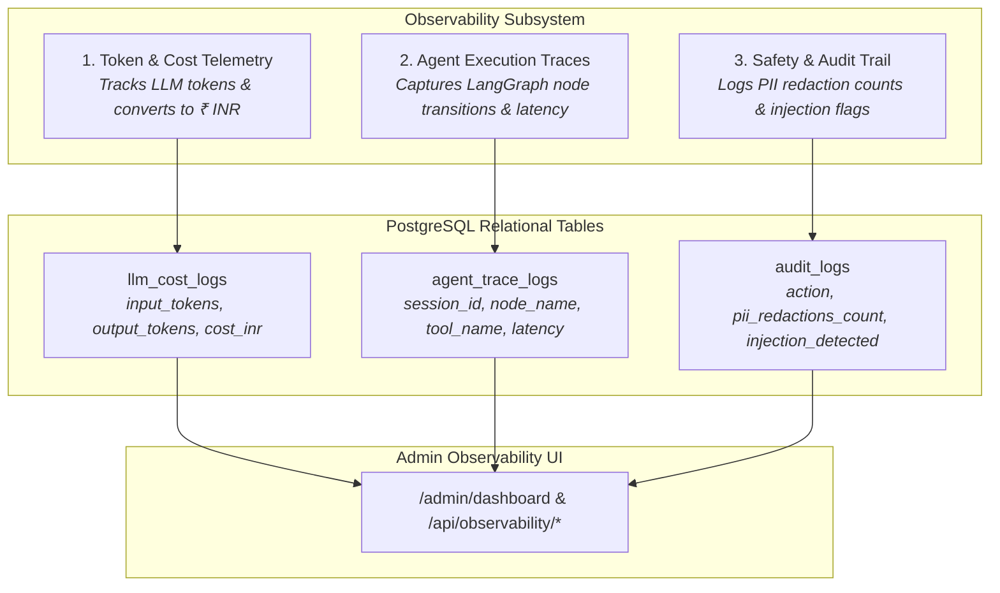

# EduIntel AI — Observability, Telemetry & Cost Accounting

This document specifies the observability framework, LLM cost telemetry, LangGraph agent tracing, and audit logging architecture for EduIntel AI on branch `develop/production-readiness`.

---

## 1. Observability Architecture Overview

The observability subsystem ([`backend/app/observability/`](file:///home/dell/projects/eduIntel/backend/app/observability/)) captures real-time operational telemetry across three core dimensions:



---

## 2. LLM Token Telemetry & INR Cost Accounting

Because commercial LLM providers charge per token, unmonitored agent loops can cause unexpected expenses. EduIntel instruments every model call through [`backend/app/core/llm_client.py`](file:///home/dell/projects/eduIntel/backend/app/core/llm_client.py) and records the telemetry:

### 2.1. Cost Calculation Formula
For Google Gemini (`gemini-3.6-flash`):
- Input tokens rate: $\approx \$0.075 \text{ per } 1\text{M tokens}$ ($\approx ₹0.00625 \text{ per } 1\text{k tokens}$).
- Output tokens rate: $\approx \$0.30 \text{ per } 1\text{M tokens}$ ($\approx ₹0.025 \text{ per } 1\text{k tokens}$).
- Current USD to INR conversion: Fixed at ₹83.50 per USD (configurable in `Settings`).

$$\text{Cost (₹)} = \left(\frac{\text{Input Tokens}}{1{,}000{,}000} \times \$0.075 + \frac{\text{Output Tokens}}{1{,}000{,}000} \times \$0.30\right) \times 83.50$$

### 2.2. Cost Reporting Endpoints
Administrators query financial burn rates via `/api/observability/costs`:
```json
{
  "period": "October 2026",
  "total_tokens_consumed": 284500,
  "total_cost_inr": 4.12,
  "requests_by_provider": {
    "gemini": 412,
    "groq_fallback": 6
  },
  "top_cost_modules": [
    {"module": "rag_doubts", "cost_inr": 2.45},
    {"module": "admin_assistant", "cost_inr": 1.15},
    {"module": "parent_reports", "cost_inr": 0.52}
  ]
}
```

---

## 3. LangGraph Agent Trace Logging

Autonomous agents require node-level visibility to debug loops, tool failures, and latency spikes.

### 3.1. `agent_trace_logs` Table Schema
Every state transition inside the Admin Assistant or Portal Assistant writes a row:

| Column | Type | Description |
|---|---|---|
| `id` | UUID | Primary key |
| `session_id` | VARCHAR(100) | Unique conversation session identifier |
| `agent_name` | VARCHAR(100) | Name of agent (`admin_assistant` or `portal_assistant`) |
| `node_name` | VARCHAR(100) | State graph node executed (e.g. `agent_node`, `tool_node`) |
| `tool_name` | VARCHAR(100) | Specific tool invoked (e.g. `query_fee_summary`), null if direct LLM node |
| `execution_seconds`| NUMERIC(6,3) | Wall-clock execution time for this specific node |
| `input_tokens` | INTEGER | Tokens consumed in this step |
| `output_tokens`| INTEGER | Tokens generated in this step |
| `cost_inr` | NUMERIC(8,4) | INR expenditure for this step |
| `created_at` | TIMESTAMPTZ | UTC timestamp |

### 3.2. Querying Agent Traces
Administrators query recent execution graphs via `/api/observability/traces?session_id={id}` to inspect tool inputs and outputs during debugging.

---

## 4. Safety & Audit Trail

The append-only `audit_logs` table provides a chronological record of security and administrative events:
- User login attempts and failures
- Prompt injection triggers
- PII redaction event counts
- Socratic redirection events

---

## 5. Phase 7 Observability Roadmap

In Phase 7 (Observability, APM & Structured Logging), the following enhancements are scheduled:
1. **Prometheus Metrics Exporter**: Expose `/metrics` endpoint with HTTP request duration histograms, active database connection pool sizes, and cache hit rates.
2. **Structured JSON Logging**: Standardize Python `structlog` formatting across all modules with correlation IDs injected via ASGI middleware.
3. **Grafana Dashboards**: Pre-built dashboards visualizing latency, token spend, at-risk student counts, and active concurrent user sessions.

