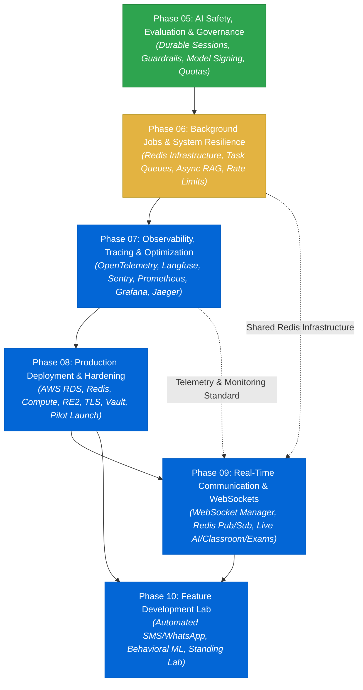

# EduIntel AI — Master Engineering Roadmap

**Document ID:** `EDUINTEL-MASTER-ROADMAP-REV-3.0`  
**Target:** Production-Grade Multi-Tenant Coaching Institute & School SaaS  
**Branch:** `develop/production-readiness`  
**Current Date:** November 7, 2026  
**Status:** 🟢 **RATIFIED & AUTHORITATIVE MASTER ROADMAP (REVISION 3.0)**  

---

## 1. Executive Summary & Architectural Evolution

This document defines the authoritative, end-to-end engineering roadmap for **EduIntel AI**. 

Following the completion of core database migrations, Row-Level Security, testing harnesses, and the first two steps of AI safety governance (Phase 5 Steps 0–2), **Revision 3.0 formally establishes the strategic placement of future infrastructure capabilities**:

1. **Redis Shared Operational Infrastructure (Phase 06):** Introduces Redis as a high-performance operational infrastructure layer for asynchronous task brokerage, background RAG ingestion, atomic concurrency reservations, distributed rate limiting, and Pub/Sub coordination.
2. **Standardized Multi-Tier Observability Stack (Phase 07):** Incorporates an enterprise-grade observability architecture: **OpenTelemetry** as the universal instrumentation standard, **Langfuse** for dedicated AI/LLM evaluation, **Sentry** for full-stack error tracking, **Prometheus** for metrics collection, **Grafana** for dashboards and alerting, and **Jaeger** for distributed trace visualization.
3. **Dedicated Real-Time Communication & WebSocket Architecture (Phase 09):** Establishes a dedicated phase for bidirectional real-time communication, housing interactive AI token streaming with generation cancellation, live classroom broadcasts, synchronized live examinations/quizzes, and real-time push notifications.
4. **Cloud Infrastructure Deployment & Production Hardening (Phase 08):** Unifies production deployment across AWS RDS Multi-AZ, containerized compute clusters, Redis, the observability stack, and verified native container builds (including Google RE2 for linear-time regex matching).
5. **Renumbered Feature Development Lab (Phase 10):** Preserves the standing educational expansion lab for ongoing feature innovations (automated WhatsApp/SMS, behavioral dropout prediction) after core infrastructure is operational.

---

## 2. Master Phase Structure & Status

| Phase | Phase Name | Primary Responsibility | Status | Planned Start | Sign-off Date |
|:---:|---|---|:---:|:---:|:---:|
| **00** | **Repository Baseline & Audit** | Static code audit, inventory, initial risk discovery | 🟢 **COMPLETED** | 2026-10-29 | 2026-10-29 |
| **0A** | **Critical SQL Risk Containment** | Admin AI Assistant input containment & query bounding | 🟢 **COMPLETED** | 2026-10-29 | 2026-10-29 |
| **01** | **Documentation & Architecture** | Single source of truth in `docs/`, ADRs 0001–0006, DR drill | 🟢 **COMPLETED** | 2026-10-30 | 2026-10-30 |
| **02A**| **Security & Threat Assessment** | CVSS v3.1 scoring, threat modeling, hotfix roadmap | 🟢 **COMPLETED** | 2026-10-30 | 2026-10-30 |
| **02B**| **Critical Security Hotfixes** | SEC-01 through SEC-11, HttpOnly auth, IDOR, AI scoping | 🟢 **COMPLETED** | 2026-10-30 | 2026-10-31 |
| **02C**| **Multi-Tenant Schema Migration & RLS**| Multi-school tenancy, tenant context, hardware-level RLS | 🟢 **COMPLETED** | 2026-11-01 | 2026-11-03 |
| **03** | **Database Integrity & Recovery** | Async connection pool, composite indexing, AES-256-GCM backups | 🟢 **COMPLETED** | 2026-11-03 | 2026-11-04 |
| **PA** | **Platform Admin Workstream** | Global governance, atomic school onboarding, split RLS policies | 🟢 **COMPLETED** | 2026-11-04 | 2026-11-04 |
| **04** | **Testing Suite & CI/CD Pipeline** | GitHub Actions, Alembic test harness, network guard, coverage | 🟢 **COMPLETED** | 2026-11-05 | 2026-11-05 |
| **05** | **AI Safety, Evaluation & Governance**| Guardrails, LLM fallback, durable sessions, RAG eval, quotas | 🟢 **COMPLETED** | 2026-11-06 | 2026-11-14 |
| **06** | **Background Jobs & System Resilience**| Redis infrastructure, Celery/ARQ task queue, async RAG ingestion | 🟡 **NEXT PHASE** | 2026-11-14 | Future |
| **07** | **Observability, Tracing & Performance**| OpenTelemetry, Langfuse, Sentry, Prometheus, Grafana, Jaeger | ⚪ **FUTURE** | — | Future |
| **08** | **Production Deployment & Pilot Launch**| AWS RDS, Redis, worker & OTel deployment, Docker RE2, pilot | ⚪ **FUTURE** | — | Future |
| **09** | **Real-Time Communication & WebSockets**| Dedicated WebSocket manager, auth, Redis pub/sub, AI streaming | ⚪ **FUTURE** | — | Future |
| **10** | **Feature Development Lab** | Automated SMS/WhatsApp, behavioral intelligence, pilot features | ⚪ **STANDING EXPANSION** | — | Standing |

---

## 3. Completed Historical Phases Summary

### Phase 00: Repository Baseline & Audit
- Audited 214 repository files without modifying runtime behavior; identified 16 backend modules, 78 API routes, and 16 database tables.
- Discovered 10 baseline security risks; created `Hisham-workspace/` for tracking and isolated it in `.gitignore`.

### Phase 0A: Critical SQL Risk Containment (Admin AI Assistant)
- Bound Admin Assistant arguments with strict Pydantic schemas (`extra="forbid"`) and regex validation (`DANGEROUS_SQL_PATTERNS`).
- Bound query results (`.limit(1000)` and `.limit(5000)`); scrubbed teacher UUIDs; added 17 passing regression tests.

### Phase 01: Documentation & Architecture Consolidation
- Centralized 30 authoritative markdown specifications in `docs/`; ratified ADRs 0001 through 0006.
- Executed Level 4 PostgreSQL disaster recovery drill (19 tables restored in 4.2s, Alembic head `d4f6a2b5e0c7`).

### Phase 02A: Security & Threat Assessment
- Scored codebase vulnerabilities using CVSS v3.1; authored the zero-schema-change hotfix plan in `docs/production-readiness/05-security-hotfix-implementation-plan.md`.

### Phase 02B: Critical Security Hotfixes
- Delivered 10 critical security remediations (SEC-01 to SEC-11): password reset rate-limiting/hashing, public signup disablement, parent report teacher authorization, OCR streaming 5 MB bounds, file download IDOR checks, ChromaDB tenant filtering (`where={"institution_id": ...}`), and `HttpOnly`/`SameSite=Strict` cookie authentication.

### Phase 02C: Multi-Tenant Schema Migration & Hardware Row-Level Security (RLS)
- Created `institutions` and `institution_memberships` tables; backfilled 17 tenant tables with foreign key `institution_id UUID NOT NULL` (Migration `0021`).
- Enforced PostgreSQL Row-Level Security (RLS) using `app.current_institution_id` on unprivileged role `eduintel` (Migration `0022`).
- Built tenant context framework in `backend/app/core/tenant.py`; verified live penetration resistance in PostgreSQL 16 Docker container.

### Phase 03: Database Integrity, Performance & Recovery
- Hardened `AsyncAdaptedQueuePool` (`pool_size=10`, `max_overflow=5`, `pool_recycle=1800`, `pre_ping=True`) and active health checks.
- Added query-grounded composite multi-tenant B-tree indexes (Migration `0023`), yielding $3.9\times$ to $15.8\times$ query speedups.
- Verified bidirectional Alembic migration reversibility (`upgrade head` $\to$ `downgrade base` $\to$ `upgrade head`).
- Built automated **AES-256-GCM** encrypted backups (`scripts/backup.sh`) with verified RTO of 4s and RPO of 39s.

### Platform Admin Workstream (Global Governance & Post-Phase 3 Security)
- Added `users.is_platform_admin` and built `/platform-admin` management dashboard and school onboarding modal.
- Replaced unified `FOR ALL` policy with 4 command-specific RESTRICTIVE RLS policies per table (`SELECT`, `INSERT`, `UPDATE`, `DELETE`) preventing cross-tenant write escalations (Migration `0025`).
- Introduced frontend Vitest test harness with React Testing Library.

### Phase 04: Comprehensive Testing Suite & CI/CD Pipeline
- Pinned multi-job GitHub Actions CI workflow (`.github/workflows/ci.yml`) with PostgreSQL 16, linting, and coverage gates.
- Refactored `conftest.py` for realistic Alembic migrations and unprivileged `eduintel_app` RLS validation.
- Implemented loopback-only network transport guards blocking unmocked external API calls.
- Enforced `--cov-fail-under=66` regression ratchet in CI.

---

## 4. Completed Phase: Phase 05 — AI Safety, Evaluation & Governance

**Status:** 🟢 **COMPLETED, VERIFIED & INDEPENDENTLY AUDITED (2026-11-14)**  
**Authoritative Plan:** [`docs/production-readiness/14-phase-5-ai-safety-and-governance-plan.md`](file:///home/dell/projects/eduIntel/docs/production-readiness/14-phase-5-ai-safety-and-governance-plan.md) (Revision 2.6)  
**Final Audit Verdict:** **ACCEPTED** (Zero Critical, Zero High findings across all audited stages)

### 4.1 Completed Execution Breakdown

* **Step 0: Baseline Audit & Pre-Implementation State (Completed & Verified):**
  - Measured clean-room baseline across 608 backend tests, 67.13% coverage, 19 frontend Vitest tests, and initial RAG retrieval accuracy. Documented in [`15-phase-5-step-0-baseline-report.md`](file:///home/dell/projects/eduIntel/docs/production-readiness/15-phase-5-step-0-baseline-report.md).
* **Step 1: AI Provider Architecture, Data Governance & Tool Fallbacks (Completed & Verified):**
  - Built `BaseLLMProvider`, `GeminiProvider` (retry on 503, failover on 429), and `GroqProvider` (bidirectional schema mapping via `convert_gemini_tools_to_groq_format`).
  - Implemented `LLMProviderRegistry` with node-scoped fallback (decide on Gemini $\to$ fail on generate $\to$ generate on Groq without tool re-execution).
  - Implemented pre-LLM PII minimization in `sanitize_prompt_for_provider()`.
  - Added concurrent tool idempotency table `tool_execution_records` with RLS and monotonic lease fencing (Migration `0026`). Documented in [`16-phase-5-step-1-execution-report.md`](file:///home/dell/projects/eduIntel/docs/production-readiness/16-phase-5-step-1-execution-report.md).
* **Step 2: Configurable Multi-Stage Guardrail Engine & Streaming Validation (Completed & Accepted):**
  - Centralized `GuardrailsEngine` with input length limits (8,192 chars), prompt injection heuristics, and post-generation PII/metaprompt leak prevention.
  - Institutional policy modes (`STRICT`, `BALANCED`, `PERMISSIVE`, `EXAM`).
  - `redos_guard.py` with fast-path in-process execution ($\le 1024$ chars) and dedicated supervised subprocess isolation ($> 1024$ chars) with 150ms timeout and `SIGTERM`/`SIGKILL` cleanup.
  - Dynamic lookahead streaming buffer (256–512 chars) with 4-state lifecycle (`COMPLETED`, `TRUNCATED`, `BLOCKED`, `FAILED`).
  - Documented in [`17-phase-5-step-2-execution-report.md`](file:///home/dell/projects/eduIntel/docs/production-readiness/17-phase-5-step-2-execution-report.md) and [`18-phase-5-step-2-integration-corrections-report.md`](file:///home/dell/projects/eduIntel/docs/production-readiness/18-phase-5-step-2-integration-corrections-report.md).
* **Step 3.1: Worksheet Generator Provider-Registry Unification (Task P5-03-01) (Completed & Accepted):**
  - Refactored `worksheet_generator.py` from raw GenAI SDK to `LLMProviderRegistry` via `generate_text_with_usage()`, with Gemini $\to$ Groq fallback, input/output guardrails, usage logging under `ml/generate-worksheet`, and PDF compatibility. Documented in [`20-phase-5-step-3-1-execution-report.md`](file:///home/dell/projects/eduIntel/docs/production-readiness/20-phase-5-step-3-1-execution-report.md).
* **Step 3.2: Parent Report Structured JSON Serialization (Task P5-03-02) (Completed & Accepted):**
  - Replaced `str(student_data)` with deterministic, bounded `json.dumps(student_data, sort_keys=True)` preserving `<untrusted_student_data>` fencing and auth checks. Documented in [`21-phase-5-step-3-2-execution-report.md`](file:///home/dell/projects/eduIntel/docs/production-readiness/21-phase-5-step-3-2-execution-report.md) and [`22-phase-5-step-3-2-corrections-report.md`](file:///home/dell/projects/eduIntel/docs/production-readiness/22-phase-5-step-3-2-corrections-report.md).
* **Step 3.3: LangGraph Durable Sessions & 4-Stage Lifecycle (Completed & Accepted):**
  - Durable `DatabaseSessionStore` backed by PostgreSQL tables `agent_sessions` and `agent_session_messages` with multi-tenant RLS (Migration `0027`).
  - Fail-closed database gates in staging/production (HTTP 503 on DB error), 4-stage lifecycle (24h expiry, 30d retention, soft delete, automated hard purge), and connection release back to pool during LLM generation. Documented in [`23-phase-5-step-3-3-execution-report.md`](file:///home/dell/projects/eduIntel/docs/production-readiness/23-phase-5-step-3-3-execution-report.md).
* **Step 3.4: Document-Aware Semantic Chunking & Snapshot RAG Deletion (Completed & Accepted):**
  - Character-bounded `RecursiveCharacterTextSplitter` (1,200 chars, LaTeX `$$...$$` preservation, table header re-injection).
  - Request-Level Authorized Context Snapshot Policy enforcing immediate vector retrieval exclusion on `DELETION_PENDING` while permitting safe completion of already-dispatched in-flight queries. Documented in [`24-phase-5-step-3-4-execution-report.md`](file:///home/dell/projects/eduIntel/docs/production-readiness/24-phase-5-step-3-4-execution-report.md).
* **Step 3.5: Automated RAG Quality Benchmark & Canonical MLflow Proxy (Completed & Accepted):**
  - Offline hermetic CI regression benchmark under socket guard asserting Hit Rate@3 $\ge 0.80$ and $\text{MRR} \ge 0.80$.
  - Reverse proxy with path canonicalization blocking traversal attacks and enforcing tenant JWT scoping. Documented in [`25-phase-5-step-3-5-execution-report.md`](file:///home/dell/projects/eduIntel/docs/production-readiness/25-phase-5-step-3-5-execution-report.md) and [`26-phase-5-step-3-5-corrections-report.md`](file:///home/dell/projects/eduIntel/docs/production-readiness/26-phase-5-step-3-5-corrections-report.md).
* **Step 3.6 (Stages 1–4R): LangGraph Concurrency, Thread Tracking & Quiescence (Completed & Accepted):**
  - Async agent execution via `ainvoke`, recursion limits ($\le 5$ and $\le 6$).
  - Safe physical-future callback handoff to asyncio event loop.
  - `BoundedWorkerPool` with dynamic thread tracking and clean queue rejection.
  - 4-stage lifecycle protocol and session quiescence barrier preventing race conditions between active worker threads and checkout requests (Migration `0028`). Documented in [`27-phase-5-step-3-6-stage-3-execution-report.md`](file:///home/dell/projects/eduIntel/docs/production-readiness/27-phase-5-step-3-6-stage-3-execution-report.md) through [`31-phase-5-step-3-6-stage-4r-shutdown-quiescence-remediation-report.md`](file:///home/dell/projects/eduIntel/docs/production-readiness/31-phase-5-step-3-6-stage-4r-shutdown-quiescence-remediation-report.md).
* **Step 3.6 (Stage 5R): Offline RAG Benchmark Hardening (Completed & Accepted):**
  - Hermetic offline evaluation hardened against socket leakages and non-deterministic ChromaDB state. Documented in [`32-phase-5-step-3-6-stage-5-offline-rag-benchmark-report.md`](file:///home/dell/projects/eduIntel/docs/production-readiness/32-phase-5-step-3-6-stage-5-offline-rag-benchmark-report.md).
* **Step 3.6 (Stage 6R2.1): Air-Gapped Ed25519 Model Signatures & PSI Drift (Completed & Accepted):**
  - Cryptographic model integrity verification via Ed25519 signatures (`manifest.json.sig`) for XGBoost at-risk models.
  - Laplace-smoothed Population Stability Index (PSI) drift monitoring ($\epsilon = 10^{-4}, N \ge 200$) alerting at $\text{PSI} \ge 0.20$ without interrupting live inferences. Documented in [`33-phase-5-step-3-6-stage-6-ml-integrity-drift-report.md`](file:///home/dell/projects/eduIntel/docs/production-readiness/33-phase-5-step-3-6-stage-6-ml-integrity-drift-report.md).
* **Step 3.6 (Stage 7.1 / 7.1R2): Dual-Ledger Schema & Hardening (Completed & Accepted):**
  - Dual-ledger schema separating token volume from monetary cost in INR.
  - PostgreSQL Migrations `0029`, `0030`, and `0031` creating `tenant_ai_quotas`, `tenant_daily_ai_usage`, `tenant_daily_category_usage`, `ai_pricing_versions`, `ai_pricing_activations`, `ai_token_reservations`, `ai_provider_attempts`, and `ai_financial_adjustments` with hardware RLS and immutable check constraints.
* **Step 3.6 (Stage 7.2): Pricing, FinOps Ledger & Atomic Tenant Quota Engine (Completed & Accepted):**
  - Atomic reservation and settlement engine governed by canonical lock hierarchy: Level 1 (`tenant_ai_quotas`) $\to$ Level 2a (`tenant_daily_ai_usage`) $\to$ Level 2b (`tenant_daily_category_usage`) $\to$ Level 3 (`ai_token_reservations`).
  - Replacement accounting invariant: post-flight settlement replaces estimated reservation with actual cost ($\Delta = \text{actual} - \text{estimated}$).
  - Live INR pricing activations and financial exposure ceilings.
* **Step 3.6 (Stage 7.3 / 7.3R): AI Route & Provider Integration (Completed & Accepted):**
  - Integrated quota engine across Gemini/Groq provider adapters, LangGraph agents, RAG query pipelines, and ML prediction endpoints.
  - Fail-closed streaming boundary ensuring tokens are reserved prior to generation and excess emissions are cleanly truncated.
* **Step 3.6 (Stage 7.4): FinOps, Tenant Quota Administration, Reconciliation & Observability (Completed & Accepted):**
  - Migration `0032` introducing `ai_quota_plans` catalog and `tenant_quota_provisioning_logs` append-only audit trail with PostgreSQL immutability trigger.
  - Configurable 10% protected risk reserve buffer and independent daily category ceilings (`STUDENT_ASSISTANT`, `ADMIN_ASSISTANT`, `RAG_QUERY`, `ML_PREDICTION`).
  - Automated `QuotaReconciliationSweeper` with non-blocking concurrency (`FOR UPDATE SKIP LOCKED`) sweeping stale reservations.
  - Tenant admin endpoints (`/finops/*`) and platform admin endpoints (`/platform-admin/finops/*`).
  - Operational React FinOps Dashboards for both tenant administrators (`/admin/finops`) and platform administrators (`/platform-admin/finops`).
  - Empirical verification: **227/227 tests passed** across 15 FinOps test suites, 0 Bandit SAST issues, clean Vite production build. Independent audit verdict: **ACCEPTED**.

---

## 5. Current Upcoming Phase: Phase 06 — Background Jobs & System Resilience

**Primary Responsibility:** Shared Redis operational infrastructure, asynchronous task execution, background RAG processing, distributed coordination, and service resilience.

> [!IMPORTANT]
> **Redis Architectural Rule:** PostgreSQL remains the sole authoritative durable source of truth. Redis is strictly shared operational infrastructure (task queues, temporary state, rate limits, Pub/Sub, concurrency reservations). Never use Redis as the primary store for financial ledgers, student profiles, attendance, exam submissions, or permanent conversation history.

* **Step 1: Redis Infrastructure & Integration:**
  - Multi-environment deployment and configuration (local dev, test, production).
  - Connection pooling via `redis-py` / `aioredis` with automatic reconnection and lifecycle management.
  - Password authentication and TLS in transit.
  - TTL enforcement and LRU memory eviction policies (`maxmemory` caps).
  - Active health checks and fail-soft behavior when Redis is unavailable (degraded non-blocking fallbacks).
  - Tenant-aware key namespacing: `eduintel:{env}:{institution_id}:{domain}:{key}`.
* **Step 2: Background Task Queue:**
  - Evaluate and select Celery or ARQ with Redis as task broker.
  - Dedicated worker processes with configurable concurrency.
  - Exponential backoff retry policies with full jitter.
  - Task idempotency guarantees and execution timeouts.
  - Dead-Letter Queue (DLQ) handling for unrecoverable tasks.
  - Graceful worker shutdown handling (`SIGTERM`/`SIGQUIT`) with job re-queueing.
* **Step 3: Background RAG Ingestion:**
  - Decouple PDF document parsing, OCR text extraction, semantic chunking, and ChromaDB vector embeddings from the synchronous HTTP request lifecycle.
  - Asynchronous ingestion worker pipeline with job status tracking (`QUEUED`, `PROCESSING`, `INDEXED`, `FAILED`).
  - Worker failure recovery and retries with chunk rollback on fatal errors.
* **Step 4: Distributed Coordination & Streaming Concurrency:**
  - **Task P6-04-01 (Redis-Backed Institutional Streaming Concurrency):**
    - Replace the process-local `InstitutionalStreamManager` (`_active_counts`, `asyncio.Lock`) with a distributed Redis-backed implementation.
    - Enforce the maximum limit of 10 concurrent streams per institution across multiple Uvicorn workers and multi-pod deployments.
    - Use atomic Redis operations (counters or Lua scripts) for slot reservations and releases.
    - Issue unique reservation tokens to verify slot ownership and prevent one request from accidentally releasing another request's reservation.
    - Implement TTL-based lease auto-expiration to recover abandoned reservations from client disconnects or worker crashes.
    - Explicitly handle Redis unavailability: fail-soft with a safe fallback policy rather than crashing the application.
    - Author multi-connection concurrency tests proving accurate ceiling enforcement across independent worker simulations.
    - Export reservation expiry, rejected reservation counts, and active streaming metrics to the Phase 7 Prometheus/Grafana stack.
    - *Scope Clarification:* This task manages distributed concurrency limits for HTTP SSE streaming; actual WebSocket endpoints are implemented in Phase 09.
  - Distributed rate limiting (sliding window rate limiters for auth, public APIs, and LLM queries).
  - Cross-worker coordination state with explicit TTL lease expiration and stale reservation cleanup.
  - Distributed locks (Redlock) used strictly where genuinely required. Do not introduce Redlock unless an explicit distributed-lock requirement is established.
* **Step 5: External Service Resilience:**
  - Circuit breakers for upstream LLM providers (Gemini, Groq) to prevent thread exhaustion during provider brownouts.
  - Provider timeout classification (transient 503 vs fatal 400).
  - SMTP email dispatch resilience with background retry queues.
* **Step 6: Worker Observability Foundations:**
  - Export task execution metrics: queue depth, queue wait latency, task duration, success/failure rates, retry counts.
  - Worker health probes and integration with Phase 7 observability stack (no competing monitoring platforms).

---

### Phase 07: Observability, Tracing & Performance Optimization

**Primary Responsibility:** Enterprise-grade observability stack incorporating OpenTelemetry, Langfuse, Sentry, Prometheus, Grafana, and Jaeger.

> [!NOTE]
> **Observability Architectural Principle:** OpenTelemetry acts as the universal instrumentation standard. Langfuse specializes in AI/LLM observability. Sentry specializes in application error monitoring. Prometheus collects metrics. Grafana provides dashboards and alert visualization. Jaeger provides distributed trace visualization. Responsibilities must not be duplicated.

* **Step 1: OpenTelemetry Instrumentation:**
  - Standardized OpenTelemetry Python SDK instrumentation for FastAPI.
  - Automatic tracing of incoming HTTP requests, outgoing database queries, ChromaDB calls, and external HTTP requests.
  - LangGraph node-level tracing and background worker task span propagation.
  - Correlation ID injection (`X-Correlation-ID`) across request headers, application logs, and database spans.
  - W3C trace context propagation across service boundaries.
  - OpenTelemetry Collector / OTLP exporter configuration.
* **Step 2: Langfuse — AI Observability:**
  - Granular LLM request and response tracing for Gemini and Groq.
  - Model selection tracking, fallback frequency, and latency breakdowns.
  - LangGraph state machine node tracing and tool call execution inspection.
  - RAG retrieval and generation tracing (retrieved chunks, cosine distances, context relevance).
  - Token consumption and monetary cost monitoring per tenant and endpoint.
  - Prompt versioning and evaluation tracking integrated with Phase 5 benchmarks.
  - *Privacy Enforcement:* Strictly scrub credentials, auth tokens, and student PII before external telemetry dispatch.
* **Step 3: Sentry — Application Error Monitoring:**
  - Frontend React exception monitoring, unhandled promise rejections, API failures, release tracking, and source maps.
  - Backend FastAPI exception capture, worker task crashes, and database connection timeouts.
  - Automatic request context correlation (`X-Correlation-ID`) and environment tagging.
  - Strict PII scrubbing rules (strip email, phone, Aadhaar, and password fields before transmission).
* **Step 4: Prometheus — Metrics Collection:**
  - Application metrics: request rate, HTTP status codes, p50/p95/p99 latency, active in-flight requests.
  - Infrastructure metrics: CPU, memory, disk I/O, database connection pool utilization (`checked_out`, `overflow`), Redis memory usage, worker queue depth.
  - AI metrics: LLM invocation rate, token consumption rate, fallback trigger counts, quota utilization percentage.
  - *Cardinality Rule:* Strictly disallow high-cardinality labels (user IDs, prompt text, session IDs).
* **Step 5: Grafana — Dashboards & Alerting:**
  - Pre-configured dashboards: (1) System Health, (2) API Performance, (3) Database Health, (4) Redis & Worker Queue, (5) AI Provider Performance, (6) LLM Cost & Quotas, (7) Tenant Resource Usage, (8) Error Trends.
  - Actionable alert rules: critical failure spikes, latency degradation, database pool exhaustion, Redis unavailability, and LLM provider outages.
* **Step 6: Jaeger — Distributed Trace Visualization:**
  - Trace aggregation from OpenTelemetry Collector.
  - End-to-end trace visualization: trace user request from React frontend $\to$ FastAPI route $\to$ LangGraph agent $\to$ tool execution $\to$ PostgreSQL query $\to$ response return.
  - Root-cause latency investigation across database queries and external AI providers.
* **Step 7: Performance Optimization:**
  - Evidence-based profiling using trace and metric telemetry.
  - Database query optimization (`EXPLAIN (ANALYZE, BUFFERS)`), index tuning, and connection pool sizing.
  - Frontend bundle optimization (React code splitting, dynamic imports, lazy loading).
  - Multi-tier caching strategy and load testing regression tracking.

---

### Phase 08: Production Deployment, Hardening & Pilot Launch

**Primary Responsibility:** Production deployment on AWS cloud infrastructure, security hardening, containerized services, and operational pilot launch.

* **Infrastructure Deployment:**
  - Deploy AWS RDS Multi-AZ PostgreSQL 16 (ADR-0006) with automated backups, point-in-time recovery (PITR), and read replicas.
  - Deploy managed Redis on AWS with VPC security group isolation and in-transit encryption.
  - Container compute cluster (FastAPI, React static build served by Caddy, background workers).
  - OpenTelemetry Collector deployment; Langfuse, Sentry, Prometheus, Grafana, and Jaeger production configurations.
* **Production Hardening:**
  - Zero secrets on disk: AWS Secrets Manager or HashiCorp Vault integration for database credentials, JWT secrets, and AI API keys.
  - Network isolation: private VPC subnets with no public database or Redis exposure.
  - Enforce TLS 1.3 encryption across all public and internal service boundaries.
  - Set strict container resource limits (CPU/memory requests and limits).
* **Docker & Native Dependency Verification (Task P8-02-01: Google RE2 Production Hardening):**
  - Production multi-stage Docker build bundling system packages (`libre2-dev`, C++ build tools) and `google-re2` Python package.
  - Automated startup verification asserting that Google RE2 is active in runtime container matching paths (`sys.modules['re2']`, `HAVE_RE2 = True`).
  - Compatibility verification of all active guardrail regex patterns against RE2's linear-time DFA syntax (confirming absence of unsupported lookaround or backreferences).
  - Explicit runtime fallback: if RE2 fails to initialize, log a high-severity security alert and route matching through supervised subprocess isolation rather than failing silently or crashing unhandled.
  - *Technical Clarification:* RE2 guarantees $O(n)$ linear-time execution for supported patterns with respect to input length. Installing the package does not automatically protect every regex across the codebase; PII substitution regexes and admin parameter validation patterns must be audited and tracked individually.
  - Test suite asserting ReDoS immunity under pathological inputs (`"a" * 5000 + "!"`) in the production container image.
* **Disaster Recovery & Operational Runbooks:**
  - Verify automated quiescent backup restoration on production hardware.
  - Author operational incident response runbooks and alert escalation matrices.
* **Pilot Readiness & Launch:**
  - Production smoke test suite execution.
  - Failure recovery and chaos drills.
  - Multi-tenant isolation verification and initial coaching institute pilot onboarding.

---

### Phase 09: Real-Time Communication & WebSocket Architecture

**Primary Responsibility:** Dedicated bidirectional real-time communication architecture using WebSockets for interactive AI streaming, live classrooms, synchronized examinations, and instant notifications.

> [!IMPORTANT]
> **REST & WebSocket Coexistence:** REST APIs remain the default transport for authentication, CRUD, student records, attendance, timetables, and durable operations. WebSockets are dedicated to bidirectional real-time streams (AI streaming, live classroom, quizzes, notifications). Redis Pub/Sub coordinates multi-worker broadcasts, but PostgreSQL remains the authoritative store for all durable business state.

* **Step 1: WebSocket Architecture & Connection Manager:**
  - FastAPI WebSocket endpoints; connection lifecycle manager (`WebSocketManager`).
  - Connection registration, heartbeat ping/pong, and graceful disconnect handling.
  - Client reconnection strategies with exponential backoff and jitter.
  - Bounded message queues, backpressure handling, and strict message size limits.
  - Versioned JSON event schemas (`type`, `payload`, `timestamp`, `correlation_id`).
* **Step 2: Authentication & Tenant Security:**
  - Secure token authentication during handshake (validating JWT from cookie or query parameter).
  - Server-side tenant identity verification (`tenant_id` resolved from authenticated user, never trusting client parameters).
  - Origin validation against whitelisted domains.
  - Connection expiration and permission revocation handling.
  - Rate limiting on incoming WebSocket frames; strict protection against cross-tenant message broadcast leakage.
* **Step 3: Redis-Backed WebSocket Coordination:**
  - Redis Pub/Sub for cross-worker message distribution in multi-instance deployments.
  - Tenant-specific broadcast channels: `eduintel:{tenant_id}:classroom:{id}`.
  - Distributed presence tracking (online students/teachers per classroom).
  - Distributed connection/concurrency limits.
  - *Durability Rule:* Important business events must be persisted to PostgreSQL before or concurrently with Pub/Sub emission; Redis Pub/Sub is not treated as a durable queue.
* **Step 4: Interactive AI Assistant (WebSocket Streaming):**
  - WebSocket-based bidirectional AI token streaming.
  - Client-side generation cancellation ("Stop Generating") signaling immediate backend LLM abort.
  - Follow-up conversational steering within the active generation turn.
  - Durable session association with PostgreSQL `agent_sessions` and `agent_session_messages`.
  - Integration with `StreamingValidationBuffer` and `GuardrailsEngine` (lookahead holdback to prevent client leaks of unverified text).
  - Explicit 4-state terminal emission: `COMPLETED`, `TRUNCATED`, `BLOCKED`, `FAILED`.
  - *Connection Invariant:* Zero open database connections held during long-running streaming generation.
* **Step 5: Live Classroom:**
  - Teacher broadcast announcements and blackboard state updates.
  - Student connection tracking and active participant lists.
  - Live classroom status updates and tenant-authorized event dispatch.
* **Step 6: Live Examinations & Quizzes:**
  - Real-time question delivery and question-switching events.
  - Real-time student answer submission with cryptographic receipt acknowledgments.
  - Synchronized countdown timer with server-authoritative examination deadlines.
  - Reconnection resilience: students reconnect and resume from current exam state.
  - Durable answer persistence in PostgreSQL; duplicate submission prevention.
* **Step 7: Real-Time Notifications:**
  - Instant notification delivery (attendance alerts, timetable updates, administrative notices).
  - Targeted routing (individual user, section, or school-wide).
  - Read/unread status synchronization across open client sessions.
* **Step 8: Load & Failure Testing:**
  - Concurrency stress testing (1,000+ simultaneous WebSocket connections).
  - Multi-worker load balancing and Redis Pub/Sub failover verification.
  - Slow client backpressure testing and network interruption resilience.
  - Rigorous cross-tenant broadcast isolation penetration tests.

---

### Phase 10: Feature Development Lab (Standing Expansion)

**Primary Responsibility:** Continuous feature incubation and enhancements for pilot schools after core production infrastructure is operational.

* **Automated Multi-Channel Communications:** Automated SMS and WhatsApp parent notifications for critical attendance dropoffs and fee reminders.
* **Behavioral Intelligence:** Longitudinal student performance analytics and early dropout risk prediction models.
* **Pilot Feedback Enhancements:** Rapid feature development following the standardized 4-step Feature Lab process (Proposal, Safe Implementation, Testing, Documentation in `Hisham-workspace/10-feature-development/`).
* **Governance:** All new features adhere to multi-tenant RLS, strict Pydantic schemas, and $\ge 66\%$ test coverage.

---

## 6. Action-Item Register & Outstanding Technical Items

The following register tracks four outstanding technical items identified during the Phase 5 – Step 2 final acceptance verification. Rather than reopening Step 2, each item has been assigned to its appropriate upcoming implementation phase.

| Task ID | Outstanding Item | Assigned Phase | Target Subsystem | Implementation Status | Scope & Architectural Notes |
|:---:|---|---|---|:---:|---|
| **P5-03-01** | Worksheet generator provider-registry unification | Phase 05 – Step 3.1 | AI Provider Registry | 🟢 **Implemented & Tested** | Refactored `worksheet_generator.py` from raw GenAI SDK to `LLMProviderRegistry`, added Groq fallback, input/output guardrails, usage logging under `ml/generate-worksheet`, and PDF compatibility. Audited & accepted. |
| **P5-03-02** | Structured JSON serialization for parent report telemetry | Phase 05 – Step 3.2 | Parent Report Agent | 🟢 **Implemented & Tested** | Replaced `str(student_data)` with deterministic `json.dumps(student_data, sort_keys=True)`, handled non-serializable objects, bounded size, minimized sensitive fields, preserved `<untrusted_student_data>` fencing and auth checks. Audited & accepted. |
| **P6-04-01** | Redis-backed distributed streaming concurrency | Phase 06 – Step 6.4 | Distributed Coordination | ⚪ **Planned** | Replace in-memory `InstitutionalStreamManager` with Redis-backed atomic reservation tokens, TTL-based abandoned reservation recovery, multi-worker ceiling (10/institution), and fail-soft handling. |
| **P8-02-01** | Google RE2 production installation and verification | Phase 08 – Step 8.2 | Production Docker & Native Builds | ⚪ **Planned** *(Production Prerequisite)* | Add `google-re2` and `libre2-dev` to production multi-stage Dockerfile, verify runtime engine (`HAVE_RE2 = True`), test $O(n)$ DFA compatibility across all 52+ regexes, retain supervised subprocess fallback. |

> [!NOTE]
> **Status Taxonomy:**
> - **Implemented & Tested:** Code written, verified, and passing tests in current branch.
> - **Conditionally Accepted:** Code verified in current branch pending scheduled future prerequisites.
> - **Planned:** Formally scheduled for execution in an authorized upcoming phase.
> - **Production Prerequisite:** Mandatory requirement before deploying to production environments.
> - **Deferred:** Non-blocking capability postponed to a later milestone without architectural penalty.

---

## 7. Master Cross-Phase Dependency Map

### Strategic Dependency Rules:
1. **Worksheet Registry Unification (Phase 5 Step 3):** Phase 5 Step 3 unifies worksheet generation under `LLMProviderRegistry`, ensuring all LLM invocations across the application obey centralized safety and fallback policies.
2. **Telemetry Serialization Safety (Phase 5 Step 3):** Phase 5 Step 3 transitions parent report data serialization to bounded, deterministic JSON (`json.dumps()`), ensuring safe interpolation within untrusted context fences.
3. **Redis Infrastructure & Distributed Concurrency (Phase 6):** Phase 6 introduces Redis as shared operational infrastructure and implements distributed streaming concurrency (`P6-04-01`), scaling institutional stream limits across multiple Uvicorn workers.
4. **Telemetry & Monitoring Integration (Phase 7):** Phase 7 observability stack (Prometheus, Grafana, OpenTelemetry) monitors Redis reservation expiry, rejected streaming requests, and active stream counts.
5. **Production Docker RE2 Hardening (Phase 8):** Phase 8 builds and verifies `google-re2` C extensions in the production container image (`P8-02-01`), guaranteeing linear-time regex execution before live institutional traffic is served.
6. **WebSocket Substrate Reuse (Phase 9):** Phase 9 reuses the Redis infrastructure established in Phase 6 for WebSocket Pub/Sub broadcasting and cross-pod coordination, strictly avoiding duplicate Redis clusters or moving WebSocket implementation into Phase 6.
7. **Unified Observability Standard (Phase 9):** Phase 9 instruments all real-time WebSocket connection managers and message dispatchers against the OpenTelemetry and Prometheus standards established in Phase 7.

