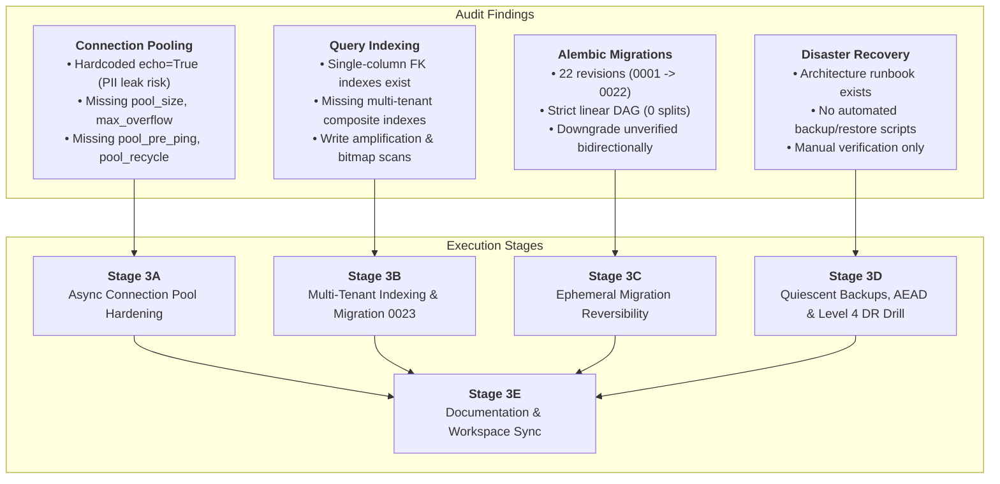
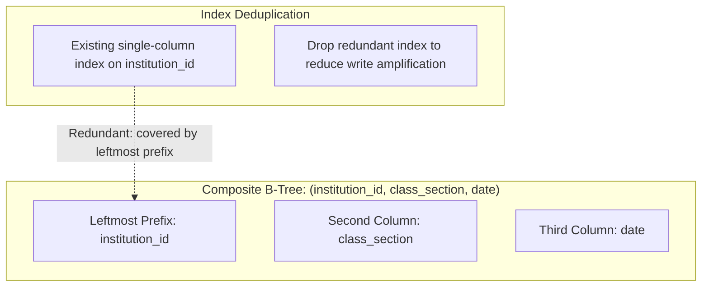
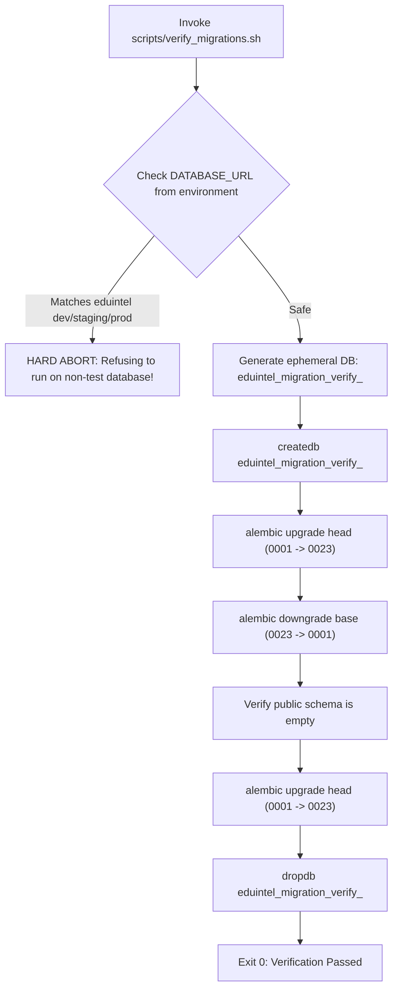
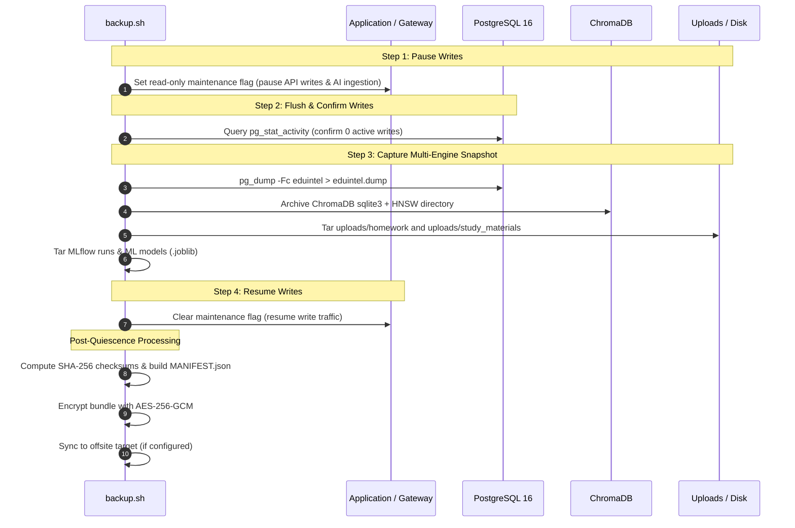
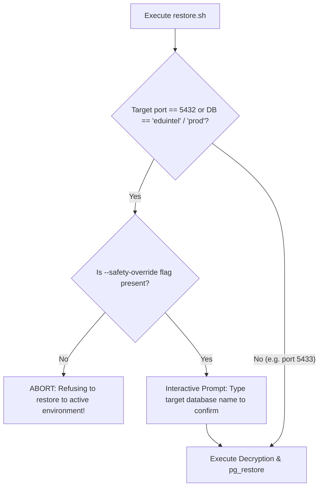

# Phase 3 Implementation Plan: Database Integrity, Performance & Disaster Recovery

**Project:** EduIntel AI — Educational Decision Intelligence Platform  
**Target Branch:** `develop/production-readiness`  
**Document Status:** Approved for Implementation (Revision 3 — Final)  
**Author / Engineering Role:** Antigravity AI / Principal Database Infrastructure  
**Date:** November 2026  

---

## 1. Executive Summary & Codebase Audit Baseline

Phase 3 establishes production resilience, performance optimization, and disaster recovery for EduIntel AI's persistence layer. In strict alignment with architectural boundaries, Phase 3 is scoped exclusively to database reliability, connection pooling resilience ([ADR-0002](file:///home/dell/projects/eduIntel/docs/architecture/adr/0002-async-sqlalchemy-fastapi.md)), multi-tenant query indexing, migration DAG reversibility, and multi-engine backup automation. Platform Admin portal development and `is_platform_admin` schema modifications remain decoupled and scheduled for a dedicated post-Phase 3 workstream.



### Audit Findings Summary

| Area | Current Baseline (`develop/production-readiness`) | Production Risk / Gap | Phase 3 Target State |
|---|---|---|---|
| **Connection Pooling** | `create_async_engine(settings.DATABASE_URL, echo=True)` with zero pooling parameters in [`database.py`](file:///home/dell/projects/eduIntel/backend/app/core/database.py) | • `echo=True` prints plain-text PII, hashed passwords, and JWTs to stdout.<br>• Drops on idle connection timeouts.<br>• Thread/connection exhaustion under concurrent AI + portal load. | • Configurable native async pooling (`AsyncAdaptedQueuePool`).<br>• Deployment-aware pool sizing formula.<br>• `pool_size=10`, `max_overflow=5`, `pool_recycle=1800`, `pool_pre_ping=True`.<br>• `DB_ECHO=False` in prod; active health check probe. |
| **Indexing Strategy** | Single-column B-tree indexes on `institution_id` across domain tables | Multi-tenant composite filters under Row-Level Security (e.g. `WHERE institution_id = :id AND class_section = :cs AND date = :dt`) trigger expensive bitmap index scans or sequential heap scans. | Composite B-tree indexes on high-frequency tenant paths (`attendance_records`, `homework_submissions`, `exam_results`, `fee_records`) with leftmost prefix deduplication. |
| **Alembic Migration Chain** | 22 migrations (`0001_initial` through `0022_f6b8c0d2e4a6_enable_postgresql_rls`) form a single linear chain | Full downgrade to base and re-upgrade to head has not been programmatically validated against real PostgreSQL schemas with foreign keys and custom enums. | Automated bidirectional migration verification harness (`scripts/verify_migrations.sh`) running against an isolated ephemeral database with strict target safeguards. |
| **Disaster Recovery Automation** | [`docs/operations/backup-and-recovery.md`](file:///home/dell/projects/eduIntel/docs/operations/backup-and-recovery.md) documents manual commands; `/scripts/` directory does not exist | Lack of standard CLI commands for operational backup and recovery; risk of operator error during an outage or data corruption event. | Production-grade shell scripts `scripts/backup.sh` and `scripts/restore.sh` with authenticated encryption (AES-256-GCM), quiescence protocol, safety aborts, and Level 4 DR drill. |

---

## 2. Stage-by-Stage Implementation Plan

### Stage 3A: Deployment-Aware Async Connection Pooling ([ADR-0002](file:///home/dell/projects/eduIntel/docs/architecture/adr/0002-async-sqlalchemy-fastapi.md))

#### Sizing Model & Concurrency Math
Database connections scale multiplicatively across application worker processes and container replicas:
$$\text{Max DB Connections} = N_{\text{replicas}} \times N_{\text{workers/replica}} \times (\text{DB\_POOL\_SIZE} + \text{DB\_MAX\_OVERFLOW}) + \text{Admin Reserve} \le \text{PostgreSQL } \texttt{max\_connections}$$

Assuming standard staging/production configurations with PostgreSQL `max_connections = 100`:
- 2 container replicas $\times$ 2 Uvicorn workers per replica = 4 workers.
- Each worker configured with `DB_POOL_SIZE = 10` and `DB_MAX_OVERFLOW = 5` ($15 \text{ max connections/worker}$).
- $4 \times 15 = 60 \text{ application connections}$, leaving 40 connection slots for migrations, administrative CLI access, and safety headroom.

#### Implementation Steps
1. **Add Validated Pool Configuration ([config.py](file:///home/dell/projects/eduIntel/backend/app/core/config.py)):**
   ```python
   # Database Connection Pool Settings (ADR-0002)
   DB_POOL_SIZE: int = 10  # Baseline persistent connections per worker
   DB_MAX_OVERFLOW: int = 5  # Temporary burst connections above pool_size
   DB_POOL_TIMEOUT: int = 30  # Seconds to wait before timing out on pool exhaustion
   DB_POOL_RECYCLE: int = 1800  # 30 min socket recycling to prevent stale firewall drops
   DB_POOL_PRE_PING: bool = True  # Liveness probe on checkout (recovers from network drops)
   DB_ECHO: bool = False  # Disabled in production to prevent PII and credential leaks
   ```

2. **Refactor Async Engine ([database.py](file:///home/dell/projects/eduIntel/backend/app/core/database.py)):**
   > [!IMPORTANT]
   > Do NOT explicitly instantiate synchronous `QueuePool`. In SQLAlchemy 2.0+, `create_async_engine` automatically configures native `AsyncAdaptedQueuePool` when passed `pool_size` and `max_overflow`.
   ```python
   engine = create_async_engine(
       settings.DATABASE_URL,
       echo=settings.DB_ECHO,
       pool_size=settings.DB_POOL_SIZE,
       max_overflow=settings.DB_MAX_OVERFLOW,
       pool_timeout=settings.DB_POOL_TIMEOUT,
       pool_recycle=settings.DB_POOL_RECYCLE,
       pool_pre_ping=settings.DB_POOL_PRE_PING,
   )
   ```

3. **Active Health Probe Utility:**
   Implement `check_database_health()` returning latency in milliseconds and connection liveness.

4. **Pool Saturation & Recovery Concurrency Test (`tests/test_database_pooling.py`):**
   Simulate $N = (\text{DB\_POOL\_SIZE} + \text{DB\_MAX\_OVERFLOW} + 10)$ concurrent async tasks. Verify:
   - Queued tasks within timeout resolve without dropped sockets.
   - Tasks exceeding timeout fail cleanly with `TimeoutError` without worker crashes.
   - The pool immediately recovers to normal state once queries release connections.

---

### Stage 3B: Query-Grounded Index Optimization & Migration 0023

#### Multi-Tenant Query Patterns Under Row-Level Security
Because PostgreSQL Row-Level Security (RLS) enforces `institution_id = current_setting('app.current_institution_id')` on every tenant query, **every query against tenant data is inherently a composite query with `institution_id` as the leading predicate**.

Currently, tables have separate single-column indexes on `institution_id`, `class_section`, `student_id`, and `date`. This forces PostgreSQL to perform expensive `BitmapAnd` scans across multiple single-column index bitmaps or execute sequential heap scans.

#### Target Indexes & Leftmost Prefix Redundancy Analysis



| Table | Proposed Composite Index | Indexed Columns | Query Pattern Matched | Redundancy Evaluation |
|---|---|---|---|---|
| `attendance_records` | `ix_attendance_inst_class_date` | `(institution_id, class_section, date)` | Attendance service rosters: `WHERE institution_id = :inst AND class_section = :cs AND date = :dt` | Makes single-column `ix_attendance_records_institution_id` redundant. Leftmost prefix satisfies institution filtering. |
| `fee_records` | `ix_fee_records_inst_student` | `(institution_id, student_id)` | Student portal invoices & payment lookups | Accelerates student-scoped billing queries. |
| `fee_records` | `ix_fee_records_inst_status` | `(institution_id, payment_status)` | Admin revenue dashboard: pending vs paid breakdown | Highly selective when querying overdue accounts. |
| `exam_results` | `ix_exam_results_inst_student` | `(institution_id, student_id)` | Student grade history and AI weak topic analysis | Supports student-specific ML feature extraction. |
| `homework_submissions` | `ix_homework_sub_inst_student` | `(institution_id, student_id)` | Student dashboard: pending and graded homework | Covers student profile lookups under tenant RLS. |

#### Author Migration 0023
- Revision: `0023_a7c8e9d0b1f2_add_multi_tenant_composite_indexes.py`
- Down Revision: `f6b8c0d2e4a6` (Revision ID of Migration 0022)
- Reversible `downgrade()`: drops created indexes and restores single-column indexes if applicable.

#### Empirical Benchmarking Protocol
Instead of enforcing an arbitrary $3\times$ speedup across all data volumes, we enforce an empirical measurement methodology:
1. **Realistic Data Volume**: Benchmark against representative test data ($> 1,000$ rows per tenant).
2. **Execution Plan Measurement**: Run `EXPLAIN (ANALYZE, BUFFERS)` on candidate queries before and after index creation.
3. **Acceptance Threshold**:
   - For selective tenant queries ($< 5\%$ of table rows), the query planner must select `Index Scan` or `Bitmap Index Scan`.
   - Measurable reduction in shared buffer reads and execution time compared to baseline.
   - For queries returning a large proportion of the table ($> 20\%$) or tiny tables ($< 100$ rows), sequential scans remain legitimate and acceptable.
4. **Write Overhead Verification**: Measure insert latency on indexed tables before and after adding composite indexes to confirm write overhead remains acceptable ($< 10\%$ increase).

---

### Stage 3C: Ephemeral Migration Reversibility Verification

#### Revision Numbering Assignment
- Current Head: `backend/alembic/versions/0022_f6b8c0d2e4a6_enable_postgresql_rls.py`.
- **Phase 3 Assignment**: `backend/alembic/versions/0023_a7c8e9d0b1f2_add_multi_tenant_composite_indexes.py`.
- **Platform Admin Roadmap Assignment**: Deferred to post-Phase 3 as `0024_<hash>_add_platform_admin_role.py` (`down_revision = 'a7c8e9d0b1f2'`).

#### Hardened Ephemeral Reversibility Harness (`scripts/verify_migrations.sh`)
> [!CAUTION]
> Running `alembic downgrade base` destroys all schemas and data. It must **never** be executed against active development, staging, or production databases.



**Explicit Safety Guardrails Built into `scripts/verify_migrations.sh`:**
1. **Target Validation**: Inspects current `.env` and environment variables. If target database matches `eduintel`, contains `prod`, or lacks the test prefix, the script aborts immediately.
2. **UUID Suffix**: Generates a strictly unique temporary database: `TEST_DB="eduintel_migration_verify_$(uuidgen | tr -d '-' | cut -c1-8)"`.
3. **Strict Cleanup**: The `trap` cleanup handler guarantees that `dropdb` is executed **only** against `${TEST_DB}`, preventing accidental deletion of any other database even if an intermediate step fails.

---

### Stage 3D: Enterprise Backup, Quiescence, AEAD Encryption & Level 4 DR Drill

#### Scope Distinction: Logical Consistent Backups vs. PITR
- **Phase 3 Scope (Logical Multi-Engine Backup & Restore)**: Automated, consistent logical backup bundle generation (`scripts/backup.sh` and `scripts/restore.sh`), authenticated encryption (AES-256-GCM), SHA-256 verification, and isolated sandbox restore verification.
- **Phase 8 Scope (Continuous Cloud PITR)**: Base physical backups and continuous Write-Ahead Log (WAL) streaming (e.g. AWS RDS 5-minute RPO automated snapshots, WAL-G, or pgBackRest). Documented in [`docs/operations/backup-and-recovery.md`](file:///home/dell/projects/eduIntel/docs/operations/backup-and-recovery.md).

#### Consolidated Storage Format
Eliminate duplicate `.sql.gz` generation. Standardize exclusively on the **PostgreSQL Custom Dump Format (`-Fc`)**:
- Inherently zlib-compressed.
- Supports parallel restore (`pg_restore -j 4`), schema-only/data-only filtering, and table reordering.
- Plain SQL generation is available only via an optional `--plain-sql` flag.

#### 4-Step Coordinated Quiescence Protocol
EduIntel's persistence encompasses PostgreSQL (relational), ChromaDB (vectors), and physical storage (`uploads/homework/`, `uploads/study_materials/`).



> [!NOTE]
> **Consistency Boundaries**: When executed without maintenance mode (e.g. ad-hoc background backup), the script documents in `MANIFEST.json` that the snapshot is "non-quiescent", noting that minor point-in-time drift may exist between relational records and physical file attachments created during backup execution.

#### Authenticated Encryption (AES-256-GCM)
To provide both confidentiality and cryptographic tamper detection (AEAD), `scripts/backup.sh` enforces AES-256-GCM:
- Employs OpenSSL 3.0+ or Python AEAD cryptography with a randomly generated 96-bit IV and 128-bit authentication tag.
- Decryption during `scripts/restore.sh` validates the authentication tag before any files are unpacked. If ciphertext is altered, restoration halts immediately.
- **Key Isolation**: The encryption key is sourced solely from `BACKUP_ENCRYPTION_KEY` via environment variable or secret file; it is **never** written to disk alongside backups and is masked from all terminal logs.

#### Restore Safety Guardrails (`scripts/restore.sh`)


1. **Target Abort**: Refuses to connect to port `5432` or database `eduintel`/`production` unless `--safety-override` is provided AND the user explicitly types the confirmation string.
2. **Sandbox Target**: Defaults to an isolated disposable container on port `5433` (`eduintel-restore-sandbox`).
3. **Application-Level Post-Restore Verification**:
   - Reconciles restored table row counts directly against `MANIFEST.json`.
   - Executes Python ChromaDB client probe querying collection count and document count.
   - Verifies physical file existence for all attachments recorded in `homework_submissions`.

#### Level 4 Disaster Recovery Drill & Empirical RTO/RPO
- **Level 1 (Archive & Cryptographic Integrity)**: AES-256-GCM tag verification and SHA-256 manifest check.
- **Level 2 (Isolated Relational Recovery)**: Custom dump restored into isolated target (port 5433); schema and constraint checks.
- **Level 3 (Auxiliary State Restoration)**: ChromaDB embeddings, uploaded assignments, and ML model binaries unpacked and queried in isolation.
- **Level 4 (Integrated Multi-Service Sandbox Drill)**: Full operational system validation:
  - Restored database (port 5433), restored ChromaDB directory, and restored uploads directory mounted into an isolated application sandbox.
  - Run live end-to-end domain operations: student timetable retrieval, class attendance roster query, RAG semantic search across restored study materials, and submission attachment download.
  - Validates that all decoupled datastores operate in unison with zero primary environment downtime.
- **Measured Metrics**:
  - Measured RTO (wall-clock time from restore invocation to healthy response).
  - Measured RPO ($T_{\text{disaster}} - T_{\text{newest\_record}}$).

---

### Stage 3E: Documentation & Knowledge Base Synchronization

1. **Operational Runbooks**:
   - Update [`docs/operations/backup-and-recovery.md`](file:///home/dell/projects/eduIntel/docs/operations/backup-and-recovery.md) with AEAD encryption syntax, quiescence procedures, sandbox restore runbooks, and the Phase 8 continuous PITR cloud specification.
2. **Phase Completion Report**:
   - Author [`docs/production-readiness/09-phase-3-database-integrity-report.md`](file:///home/dell/projects/eduIntel/docs/production-readiness/09-phase-3-database-integrity-report.md) recording observed pool saturation behavior, EXPLAIN query plan improvements, migration test outputs, and empirical Level 4 DR drill metrics.
3. **Workspace Learning Sync ([Hisham-workspace/03-database-and-recovery/](file:///home/dell/projects/eduIntel/Hisham-workspace/03-database-and-recovery/))**:
   - Fully populate all 16 template files (learning notes on GCM AEAD vs CBC, async pooling queue dynamics, B-tree leftmost prefix rules; reviewer question bank; test results; terminal command logs).
   - Update [`Hisham-workspace/implementation-plans/PHASE-TRACKER.md`](file:///home/dell/projects/eduIntel/Hisham-workspace/implementation-plans/PHASE-TRACKER.md).

---

## 3. Acceptance Gates & Verification Thresholds

| Gate | Focus | Verification Method | Acceptance Threshold |
|---|---|---|---|
| **Gate 1** | **Connection Pool Resilience** | Concurrency test with $N > (\text{pool\_size} + \text{max\_overflow})$ async tasks | Clean queueing; `pool_pre_ping` transparently reconnects on drop; zero worker crashes or connection leaks. |
| **Gate 2** | **Query Optimization** | `EXPLAIN (ANALYZE, BUFFERS)` on representative attendance, exam, and fee lookups | Multi-column filter queries select composite index with measurable execution time and buffer reduction on selective data; write latency impact $< 10\%$. |
| **Gate 3** | **Migration DAG Safety** | `scripts/verify_migrations.sh` using ephemeral UUID database | Clean `upgrade head` $\rightarrow$ `downgrade base` $\rightarrow$ `upgrade head`; zero lingering schema objects; active dev DB untouched. |
| **Gate 4** | **Encrypted Backup & Safety** | `scripts/backup.sh` (AES-256-GCM) $\rightarrow$ `scripts/restore.sh` | Restores to isolated target (port 5433); GCM tag and checksums match; row counts match manifest; safety guard blocks active dev port 5432. |
| **Gate 5** | **Level 4 Integrated DR Drill** | End-to-end sandbox system test | Multi-engine queries (relational, vector RAG, media attachments, ML models) succeed against restored sandbox; empirical RTO and RPO measured and logged. |
| **Gate 6** | **Regression Test Suite** | Full backend test suite | 328 / 328 tests pass with 0 failures, 0 errors, and zero RLS isolation regressions. |

---

## 4. File Creation & Modification Inventory

```
backend/
├── alembic/versions/
│   └── 0023_a7c8e9d0b1f2_add_multi_tenant_composite_indexes.py    # [CREATE] Migration 0023
├── app/
│   ├── core/
│   │   ├── config.py                                               # [MODIFY] Pool parameters (10/5/30/1800/True/False)
│   │   └── database.py                                             # [MODIFY] Async engine pool config & check_database_health()
│   ├── admin/models.py                                             # [MODIFY] Composite indexes in Attendance & FeeRecord
│   ├── teacher/models.py                                           # [MODIFY] Composite index in ExamResult; TYPE_CHECKING guard
│   └── student/models.py                                           # [MODIFY] Composite index in HomeworkSubmission
scripts/
├── backup.sh                                                       # [CREATE] Quiescent backup with AES-256-GCM & manifest
├── restore.sh                                                      # [CREATE] Guarded sandbox restoration & parity verification
└── verify_migrations.sh                                            # [CREATE] Hardened ephemeral migration reversibility harness
docs/
├── README.md                                                       # [MODIFY] Index Phase 3 implementation plan
├── operations/backup-and-recovery.md                               # [MODIFY] Runbooks, AEAD encryption, offsite sync, PITR spec
└── production-readiness/
    ├── 09-phase-3-database-integrity-implementation-plan.md        # [CREATE] This plan
    └── 10-phase-3-database-integrity-report.md                     # [CREATE upon completion] Final closure report
Hisham-workspace/
├── implementation-plans/
│   ├── PHASE-3-IMPLEMENTATION-ROADMAP.md                           # [CREATE] Detailed stage-by-stage engineering plan
│   └── PHASE-TRACKER.md                                            # [MODIFY] Phase 03 stage tracking
└── 03-database-and-recovery/                                       # [MODIFY] All 16 files populated
```

