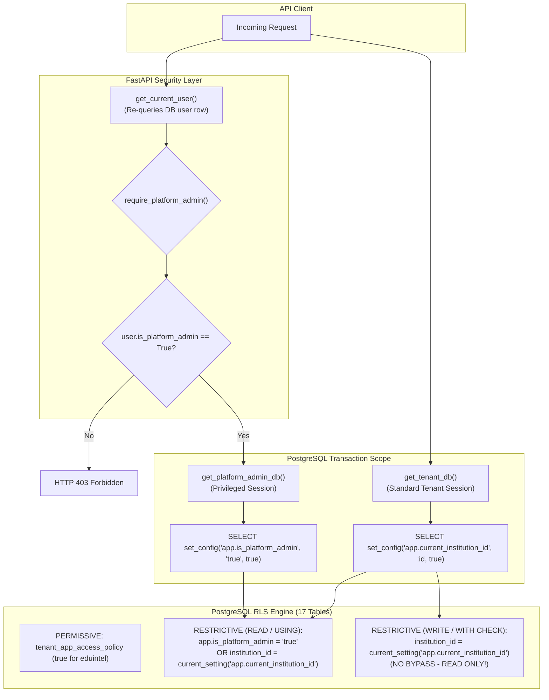

# Platform Admin Workstream — Hardened Implementation Plan (Release 1)

**Milestone:** Post-Phase 3 Platform Admin Workstream (Release 1)  
**Lead Engineer:** Senior Database Reliability & Security Specialist  
**Alembic Target:** `0025_c9e0f2a1b3c4_split_rls_policies_for_read_write_isolation` (via `0024_b8d9f0e1c2a3`)  
**Base Revision:** `0023_a7c8e9d0b1f2` (`a7c8e9d0b1f2`)  
**Status:** 🟢 **COMPLETED, AUDITED & REMEDIATED (All 5 Stages + Remediation Passed)**  

---

## 1. Executive Summary & Production Safeguards

This plan implements the Platform Admin capability for EduIntel AI with hardened database and application boundaries. It incorporates all security review recommendations:

1. **Read-Only Cross-Tenant RLS Bypass:** Cross-tenant access is strictly **read-only** (`USING` clause). Mutating operations (`INSERT`, `UPDATE`, `DELETE`) in `WITH CHECK` clauses remain strictly bound to `institution_id = app.current_institution_id`. Platform admins cannot bypass tenant fences to write arbitrary records into academic tables.
2. **Database Trust Boundary & Session Isolation:** Documents the application-level trust boundary. The `app.is_platform_admin` session variable is accessible only via `get_platform_admin_db()`. It re-verifies the user's `is_platform_admin` boolean against the database row on every request and scopes the setting strictly to the current transaction (`is_local = true`), preventing pool leakage.
3. **Verified RLS Policy Architecture:** Preserves PostgreSQL's dual-policy model:
   - `tenant_app_access_policy` (PERMISSIVE to `eduintel`): Grants baseline table access.
   - `tenant_isolation_policy` (RESTRICTIVE to `PUBLIC`): Enforces the tenant fence. Every restrictive policy must evaluate to true.
4. **Hardened CLI & Zero-Disclosure Invitations:** `scripts/create_platform_admin.py` never logs passwords or tokens. Initial administrators receive a one-time invitation/password-setup token with SHA-256 storage, 48-hour expiration, and single-use invalidation.
5. **Multi-Institution Suspension Semantics:** Users with memberships across multiple institutions are never globally locked out if at least one institution is active. Suspension is evaluated strictly against the target institution in `get_tenant_context()`.
6. **Schema & Model Alignment:** Migration 0024 adds `is_platform_admin` on `users` and `contact_email` on `institutions`, maintaining 100% parity across DDL, SQLAlchemy models, and Pydantic schemas.

---

## 2. Architecture & Privilege Boundaries



---

## 3. Database Schema & Migration Specification (0024)

### 3.1. DDL Changes
- **File:** `backend/alembic/versions/0024_<hash>_add_platform_admin_and_institution_contact.py`
- **Down Revision:** `0023_a7c8e9d0b1f2` (`a7c8e9d0b1f2`)

#### `upgrade()` DDL Actions:
1. **`users` Table:**
   - Add column `is_platform_admin` (`Boolean`, `nullable=False`, `server_default=sa.text('false')`).
   - Create B-Tree index `ix_users_is_platform_admin` on `users(is_platform_admin)`.
2. **`institutions` Table:**
   - Add column `contact_email` (`String`, `nullable=True`).
3. **RLS Policy Reconfiguration Across 17 Tenant Tables:**
   - For all 17 tenant tables:
     ```sql
     DROP POLICY IF EXISTS tenant_isolation_policy ON {tbl};
     CREATE POLICY tenant_isolation_policy ON {tbl}
     AS RESTRICTIVE FOR ALL TO PUBLIC
     USING (
         current_setting('app.is_platform_admin', true) = 'true'
         OR institution_id = NULLIF(current_setting('app.current_institution_id', true), '')::uuid
     )
     WITH CHECK (
         institution_id = NULLIF(current_setting('app.current_institution_id', true), '')::uuid
     );
     ```
   > [!IMPORTANT]
   > Notice that `WITH CHECK` does NOT contain `app.is_platform_admin = 'true'`. The bypass is strictly **read-only**.

#### `downgrade()` DDL Actions:
1. Revert `tenant_isolation_policy` on all 17 tables to the Phase 2 definition (both `USING` and `WITH CHECK` check only `institution_id`).
2. Drop column `contact_email` from `institutions`.
3. Drop index `ix_users_is_platform_admin` from `users`.
4. Drop column `is_platform_admin` from `users`.

---

## 4. Stage Breakdown & Execution Plan

| Stage | Focus Area | Deliverables & Scope |
|:---:|---|---|
| **Stage 1** | **Database DDL & Symmetrical RLS Policy Upgrade** | Author Migration 0024; update ORM models (`User`, `Institution`); run isolated migration verification harness (`scripts/verify_migrations.sh`). |
| **Stage 2** | **Identity, Dependencies & CLI Provisioner** | Pydantic schema lockdown; `require_platform_admin`; `get_platform_admin_db`; `scripts/create_platform_admin.py` with password complexity and zero logging. |
| **Stage 3** | **Institution Lifecycle & Atomic Onboarding API** | Atomic `POST /institutions` with SHA-256 setup token; `PATCH /status`; multi-tenant suspension semantics. |
| **Stage 4** | **Minimal Platform Admin Portal UI** | Platform admin dashboard; institution table; onboarding modal; route protection. |
| **Stage 5** | **Automated Tests & Final Verification** | Dedicated test suite (`test_platform_admin.py`); cumulative regression suite ($\ge 334$ pass); linting. |

---

## 5. Verification Gates

| Gate | Acceptance Criteria | Status |
|:---:|---|:---:|
| **PA-Gate 1 (Migration)** | Migration 0024 applies cleanly; `verify_migrations.sh` completes bidirectional test with 0 schema diffs on downgrade to 0023. | 🟢 **PASSED** (Dual-policy RLS on 17 tables, reversibility verified) |
| **PA-Gate 2 (Identity & CLI)** | Platform Admin created exclusively via CLI; CLI never logs credentials; schemas forbid `is_platform_admin`. | 🟢 **PASSED** (`scripts/create_platform_admin.py`, complexity $\ge 12$ enforced) |
| **PA-Gate 3 (Read-Only RLS)** | Platform Admin reads cross-tenant records via `get_platform_admin_db`; attempts to write cross-tenant records fail closed via `WITH CHECK`. | 🟢 **PASSED** (SQLSTATE 42501 InsufficientPrivilegeError proven under `eduintel_app`) |
| **PA-Gate 4 (Atomic Onboarding)** | `POST /institutions` executes in one transaction; rollbacks are 100% clean on failure; one-time setup token returned hashed in DB; inactive pre-activation account. | 🟢 **PASSED** (Single transaction, unusable initial password, SHA-256 tokens) |
| **PA-Gate 5 (Suspension)** | Inactive institutions block tenant requests with HTTP 403; users with another active membership remain able to access the active institution. | 🟢 **PASSED** (Multi-tenant login isolation preserved, single-tenant blocked) |
| **PA-Gate 6 (Regression)** | Master test suite maintains **$\ge 334$ tests passed**; `ruff check` passes with 0 errors; Vite frontend build succeeds. | 🟢 **PASSED** (530 backend tests passed, 12 Vitest frontend tests passed, 8 Node tests passed, 0 ruff errors, frontend built cleanly) |

---

## 6. Independent Security Audit & Post-Stage Remediation

Following the completion of Stages 1–5, an independent read-only security audit identified five findings (SEC-01 through SEC-05), which were systematically remediated:

| Finding ID | Scope | Defect Description | Remediation Implemented | Verification Test |
|:---:|---|---|---|---|
| **SEC-01** | Input Validation | `InstitutionOnboardRequest` used loose `str` instead of `EmailStr` | Enforced Pydantic `EmailStr` on `admin_email` and optional `contact_email` | `test_onboarding_rejects_malformed_emails_with_422` (HTTP 422 on bad emails) |
| **SEC-02** | Session Integrity | `sessionStorage.is_authenticated` was set before `/users/me` returned | Purged storage before submit; set state atomically only after both calls succeed; clear on error | `login_flow.test.jsx` (5 tests covering atomic state and error wiping) |
| **SEC-03** | RLS Defense | In PostgreSQL RLS, `DELETE` evaluates only `USING` clause under `FOR ALL` | Authored Migration 0025 splitting RLS into command-specific policies (`FOR SELECT` vs `FOR INSERT/UPDATE/DELETE`) | `test_cross_tenant_delete_blocked_by_rls_policy` (`DELETE 0` on foreign tenant rows) |
| **SEC-04** | Invitation Delivery | `invitation_sent=True` returned synchronously regardless of delivery | Accurately evaluated SMTP outcome (`sent`, `unconfigured`, `failed`); preserved one-time token in modal | `test_invitation_status_semantics_configured_vs_unconfigured_vs_failed` |
| **SEC-05** | Test Coverage | Complete absence of automated frontend unit and routing tests | Configured Vitest + React Testing Library + JSDOM with 12 automated unit/integration tests | `npm test` runs 12 Vitest tests across route guards, login, and institution management |

### 6.1. Migration 0025: Command-Specific RLS Policy Architecture
Migration `0025_c9e0f2a1b3c4_split_rls_policies_for_read_write_isolation` replaces the single `FOR ALL` policy with:
1. `tenant_isolation_read_policy FOR SELECT`:
   ```sql
   USING (
       current_setting('app.is_platform_admin', true) = 'true'
       OR institution_id = NULLIF(current_setting('app.current_institution_id', true), '')::uuid
   )
   ```
2. `tenant_isolation_insert_policy FOR INSERT`:
   ```sql
   WITH CHECK (institution_id = NULLIF(current_setting('app.current_institution_id', true), '')::uuid)
   ```
3. `tenant_isolation_update_policy FOR UPDATE`:
   ```sql
   USING (institution_id = NULLIF(current_setting('app.current_institution_id', true), '')::uuid)
   WITH CHECK (institution_id = NULLIF(current_setting('app.current_institution_id', true), '')::uuid)
   ```
4. `tenant_isolation_delete_policy FOR DELETE`:
   ```sql
   USING (institution_id = NULLIF(current_setting('app.current_institution_id', true), '')::uuid)
   ```
This guarantees that Platform Admins have read-only cross-tenant visibility, while `INSERT`, `UPDATE`, and `DELETE` remain strictly locked to `app.current_institution_id`.
