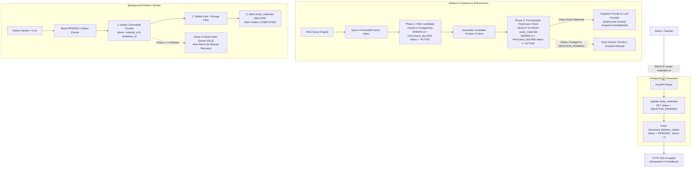

# EduIntel Phase 5: AI Safety, Evaluation & Model Governance Implementation Plan

**Project:** EduIntel AI — Educational Decision Intelligence Platform  
**Target:** Production-Ready Coaching Institute & Multi-Tenant School Management SaaS  
**Branch:** `develop/production-readiness`  
**Execution Lead:** Principal AI Systems Engineer & Machine Learning Architect  
**Parent Phase:** Phase 05 (Master Roadmap)  
**Document Status:** 🟢 **FINAL AUTHORITATIVE IMPLEMENTATION SPECIFICATION**  
**Creation Date:** November 6, 2026  
**Revision:** 2.6 (Final Acceptance Corrections & Operational Rigor)

---

## 1. Executive Summary & Review Reconciliation

Following the comprehensive audit of EduIntel's AI and Machine Learning subsystems (LangGraph state machines, ChromaDB RAG vector pipelines, heuristic guardrails, XGBoost classifiers, and observability telemetry) and the rigorous review of Revision 2.5, **Revision 2.6 establishes the final acceptance corrections and operational boundaries**:

* **Request-Level Authorized Context Snapshot Policy (RAG Deletion Consistency):** Replaces misleading terminology with the **Request-Level Authorized Context Snapshot Policy**. Explicitly establishes that an authorized context snapshot is bound at the successful conclusion of Phase 2 pre-dispatch verification, immediately before LLM prompt transmission. New requests arriving after `DELETION_PENDING` retrieve zero chunks from deleted material (strictly and immediately filtered in Phase 1). Requests that retrieved material but have not yet dispatched it follow the Phase 2 pre-dispatch check (chunks stripped or gracefully refused). Already-dispatched requests finish using their previously authorized context snapshot, avoiding mid-stream UI corruption. The specification explicitly disclaims eliminating every theoretical distributed TOCTOU race, providing instead deterministic, predictable lifecycle semantics.
* **Dual-Ledger Accounting & Monetary Exposure Ceilings:** Clarifies the core accounting invariant: post-flight reconciliation **replaces** the estimated reservation with confirmed actual costs rather than counting both as separate expenses. Tracks provider, model, input tokens, output tokens, and dynamic `pricing_version_id` (pricing rates are configurable and not assumed permanently zero). Enforces a stakeholder-configurable institutional daily financial ceiling (`INSTITUTION_MAX_DAILY_FINANCIAL_EXPOSURE_INR = 500.00`). Retains the 20% token reserve cap for availability (`PENDING_RISK_RESERVE_CAP_PERCENT = 0.20`), bounding platform exposure while guaranteeing $\ge 80\%$ operational capacity.
* **Explicit Four-State Streaming Completion Lifecycle:** Introduces an explicit **`TRUNCATED`** terminal completion state, formally distinguishing `COMPLETED`, `TRUNCATED`, `BLOCKED`, and `FAILED`. A response terminated by the 2,048-token or 64 KB limit is never recorded as a normal successful completion; it emits SSE `event: truncated`, persists to `agent_session_messages` with `status = 'TRUNCATED'` and `metadata.finish_reason = 'length'`, logs a `STREAM_TRUNCATED` audit event, and disallows automated client retry loops.
* **Internal Reservation-Level Quota Reconciliation Idempotency:** Establishes internal `reservation_id` (UUID) as the primary reconciliation anchor, providing at-most-once reconciliation per reservation. Operates reliably even when upstream providers omit request IDs, while recording `provider_request_id` when available (`UNIQUE (provider, provider_request_id)`). Duplicate reconciliation calls act as safe idempotent no-ops, protecting against double deductions or double credits, and recording immutable audit adjustments in `quota_reconciliation_adjustments`.
* **ReDoS Worker Isolation via Supervised Subprocesses:** Clarifies that terminating an active worker inside a shared `ProcessPoolExecutor` corrupts Python's internal executor state (`BrokenProcessPool`). Re-affirms Google `re2` DFA patterns as primary. For unavoidable standard regex fallback, specifies an isolated, dedicated **supervised subprocess** with explicit `SIGTERM`/`SIGKILL` termination, cleanup, and worker replacement without impacting the parent application pool.
* **External Side-Effect Fencing & UNCERTAIN Reconciliation:** Explicitly clarifies that PostgreSQL fencing tokens (`lease_generation`) are strictly local and cannot undo side effects already accepted by third-party systems (SMS, payment gateways). Enforces downstream idempotency keys (`Idempotency-Key: {tool_call_id}`). Preserves `UNCERTAIN` status on timeouts without blind retries, and defines a manual reconciliation protocol (`CONFIRM_DISPATCHED`, `MARK_FAILED`, `COMPENSATING_ACTION`) when inquiry endpoints are unavailable.
* **Phase 0 Fresh Baseline Protocol:** Re-affirms that prior test numbers (608 backend tests, 67.13% coverage) serve as historical reference points; mandates fresh independent execution of backend, frontend, coverage, and retrieval benchmarks immediately prior to Step 1.

---

## 2. Review Reconciliation Matrix (Revision 2.6)

| Technical Area | Technical Review Finding | Phase 05 Architectural Solution (Rev 2.6) |
|---|---|---|
| **RAG Deletion Consistency** | Terminology "Read-Committed Snapshot" misleading; race closure overclaimed; lifecycle phases undefined. | **Request-Level Authorized Context Snapshot Policy:** Snapshot established at Phase 2 pre-dispatch gate. New queries retrieve 0 chunks. In-flight undispatched queries strip pending chunks. Already-dispatched requests finish using authorized snapshot. Explicitly disclaim eliminating every distributed TOCTOU race. |
| **Financial Ledger Accounting** | Reconciliation must replace estimated with actual costs, not sum both; pricing rates not permanently zero; monetary ceiling needed. | **Replacement Accounting Invariant & Financial Ceiling:** Reconciliation replaces estimated reservation with actual cost ($\Delta = \text{actual} - \text{estimated}$). Enforce `INSTITUTION_MAX_DAILY_FINANCIAL_EXPOSURE_INR = 500.00` (configurable). Track versioned pricing; do not assume permanent zero rates. |
| **Streaming Completion States** | Truncation at 2,048 tokens / 64 KB must not be recorded as normal completion; states undefined. | **Explicit Four-State Lifecycle:** Distinguish `COMPLETED`, `TRUNCATED`, `BLOCKED`, `FAILED`. Truncation emits `event: truncated`, persists `status = 'TRUNCATED'`, logs `STREAM_TRUNCATED` audit record, and forbids automated retry loops. |
| **Reconciliation Idempotency** | External `provider_request_id` may be missing or replayed; duplicate reconciliations risk ledger skew. | **Internal `reservation_id` Anchor & Idempotent No-Ops:** Reconcile via internal `reservation_id` (at-most-once). Safe fallback when provider ID missing. Duplicate calls are no-ops. Protects against double deductions/credits with immutable audit trail. |
| **ReDoS Worker Isolation** | Killing a worker in `ProcessPoolExecutor` corrupts the pool (`BrokenProcessPool`). | **Dedicated Supervised Subprocess:** Prefer `re2` DFA. For standard `re` fallback, use a dedicated standalone supervised subprocess with explicit `SIGKILL`, cleanup, and replacement, keeping parent worker pools healthy. |
| **External Side-Effect Fencing** | PostgreSQL fencing tokens cannot undo external operations already accepted downstream. | **Downstream Idempotency & Manual Reconciliation Protocol:** Acknowledge fencing tokens are local. Pass downstream `Idempotency-Key`. Retain `UNCERTAIN` on timeout; never blindly retry. Provide operator resolution protocol (`CONFIRM`, `FAIL`, `COMPENSATE`). |

---

## 3. End-to-End AI Request Lifecycle & Data Governance

```mermaid
sequenceDiagram
    autonumber
    actor User as Client / User
    participant Auth as Auth & Authorization Gate
    participant Quota as Tenant Quota Ledger
    participant GuardIn as Input Guardrails (re2 DFA <= 150ms)
    participant Agent as LangGraph Engine
    participant PostCheck as Two-Phase Freshness Gate
    participant Tool as Tool Execution & Fencing
    participant Provider as LLM Provider Registry
    participant GuardOut as Streaming Overlap Buffer (In-Memory)
    participant DB as PostgreSQL (Pool & RLS Sessions)

    User->>Auth: HTTP POST /agents/.../chat (JWT, Session, Query)
    Note over Auth: Verify JWT, Role & app.current_institution_id
    Auth->>Auth: Pre-Model Authorization Gate (SEC-03/06/10)
    alt Unauthorized
        Auth-->>User: HTTP 403 Forbidden
    else Authorized
        Auth->>DB: Read Session History (Turn N)
        Note over DB: Release Connection back to Pool immediately!
        Auth->>Quota: Pre-Flight Token & Financial Check (20% Reserve & Financial Ceiling)
        alt Daily Institutional Quota or Financial Limit Exceeded
            Quota-->>User: HTTP 429 Too Many Requests (Retry-After)
        else Limit Available (RESERVED with reservation_id & quota_period_id)
            Quota->>GuardIn: Safe DFA Check (re2 Linear Time <= 150ms)
            alt Injection / ReDoS Timeout / Fail-Closed
                GuardIn->>DB: Log Security Audit Event (was_blocked=True)
                GuardIn-->>User: Refusal Envelope (200 OK, blocked=True)
            else Clean Input
                GuardIn->>Agent: Invoke StateGraph(State)
                
                opt Agent Executes RAG Retrieval
                    Agent->>Agent: Query ChromaDB Vector Index (tenant metadata filter)
                    Agent->>PostCheck: Phase 1: Filter candidate chunks in PostgreSQL (status = 'ACTIVE')
                    PostCheck-->>Agent: Filtered Active Chunks
                    Agent->>PostCheck: Phase 2: Pre-Dispatch Freshness Check (No DELETION_PENDING)
                    Note over PostCheck,Agent: Authorized Context Snapshot bound at dispatch!
                    PostCheck-->>Agent: Final Verified Chunks
                end
                
                opt Side-Effecting Tool Called
                    Agent->>Tool: Execute Tool (tool_call_id, args_hash)
                    Tool->>DB: Atomic Lease Check / Increment lease_generation
                    alt Internal DB Tool
                        Tool->>DB: Single Atomic TX: Apply Mutation + Verify Generation + Status=COMPLETED
                    else External API Tool (SMS/Payment)
                        Tool->>Tool: Pass Idempotency-Key header; if timeout, Status=UNCERTAIN (No blind retries!)
                    end
                end

                Note over Agent,Provider: ZERO DB connections open during generation!
                Note over Agent,Provider: Enforce limits: max 2,048 tokens, max 64KB staged bytes
                Agent->>Provider: Node: generate_answer (Gemini / Groq fallback)
                Provider-->>GuardOut: Stream Chunks (Tokens into In-Memory Staging Buffer)
                GuardOut->>GuardOut: Hold 256-512 Char Lookahead Overlap Buffer
                GuardOut-->>User: SSE Safe Prefixes (Irreversible on Wire)
                
                alt Security Violation in Lookahead Buffer
                    GuardOut-->>User: SSE event: security_violation (status: BLOCKED)
                    Note over User: Client UI clears partial text & displays red banner
                    GuardOut->>GuardOut: Discard In-Memory Staging Buffer (Zero DB Write)
                    GuardOut->>DB: Log Security Audit Event
                else Stream Exceeds 2,048 Tokens or 64 KB
                    GuardOut-->>User: SSE event: truncated (status: TRUNCATED)
                    Note over User: Client UI displays length truncation notice
                    GuardOut->>DB: Commit Staged Message with status=TRUNCATED (Millisecond TX)
                    GuardOut->>Quota: Post-Flight Reconcile (replace estimated with actual cost)
                else Clean Completion under limits
                    GuardOut-->>User: Flush Trailing Buffer & [DONE] (status: COMPLETED)
                    GuardOut->>DB: Commit Staged Message with status=COMPLETED (Millisecond TX)
                    GuardOut->>Quota: Post-Flight Reconcile (replace estimated with actual cost)
                end
            end
        end
    end
```

### Data Classification & Transmission Invariants

| Data Category | Target Destination | Minimization / Encryption Invariant | Allowed Providers |
|---|---|---|---|
| **Student Credentials & Auth Tokens** | Local PostgreSQL Only | Encrypted at rest (Argon2id/AES-256); **NEVER** sent to LLM providers. | Internal Only |
| **Student PII (Aadhaar, Phone, Home Address)** | Local PostgreSQL Only | Stripped/Tokenized prior to prompt formatting (`[STUDENT_REDACTED]`). | Internal Only |
| **Academic Performance (Grades, Attendance)** | Primary LLM (Gemini) | Anonymized student IDs (`student_id=hash(uuid)`); strictly bounded context. | Gemini, Groq (Fallback) |
| **Curriculum & Study Materials** | ChromaDB & LLMs | Public/Institutional educational text; encrypted at rest. Authorized context snapshot policy. | Gemini, Groq, ChromaDB |
| **System Prompts & Metaprompts** | LLM Engine | Guardrail output scanning to prevent reverse engineering and extraction leaks. | Gemini, Groq |

---

## 4. Phase 0: Baseline Audit & Pre-Implementation State

Before initiating Phase 5 Step 1, the following clean-room verification protocol is executed to establish the authoritative starting baseline:

```bash
# 1. Clean-Room Test Suite Execution & Coverage Measurement
pytest --cov=backend/app --cov-report=term-missing backend/tests/
# Target: Record current test count and exact coverage percentage

# 2. Frontend Test Suite Execution
cd frontend && npm run test:run
# Target: Record passing frontend test count

# 3. Initial RAG Retrieval Accuracy & Latency Benchmark
python backend/scripts/eval_rag_retrieval_baseline.py
# Target: Measure pre-Phase 5 Hit Rate@3, MRR, and p95 retrieval latency across existing test collections
```

The measured metrics, git SHA, and environment configuration will be recorded in `docs/production-readiness/15-phase-5-execution-evidence.md` as the immutable baseline against which all Phase 5 exit criteria are evaluated.

---

## 5. The Refined 7-Step Implementation Sequence


---

## 6. Detailed Step Specifications

### Step 1: AI Provider Architecture, Data Governance & Tool Fallbacks

#### 1. Provider Abstraction & Registry (`backend/app/core/llm_provider.py`)
- `BaseLLMProvider`: Abstract base class defining:
  - `generate_text(prompt: str, config: LLMConfig) -> tuple[str, LLMCallUsage]`
  - `decide_tools(prompt: str, tools: list[ToolDefinition], config: LLMConfig) -> tuple[list[ToolCall], LLMCallUsage]`
- `GeminiProvider`: Google GenAI implementation with exponential backoff on transient errors (503, connection drops).
- `GroqProvider`: Groq implementation with bidirectional schema mapping (Gemini `FunctionDeclaration` $\leftrightarrow$ OpenAI `tools` JSON schema).
- `LLMProviderRegistry`: Manages primary and fallback providers, enforcing data minimization before dispatch.

#### 2. Three-Tier Failure Handling & Node-Scoped Fallback
- **Tier 1 (Provider Failure):** Transient 503 / connection errors retry twice with exponential backoff. HTTP 429 quota exhaustion immediately triggers Groq fallback.
- **Tier 2 (Tool Decision Failure):** If Gemini produces malformed tool calls or schema errors, delegate tool decision to Groq. Do not retry Gemini in a loop.
- **Tier 3 (Tool Execution Failure):** Database errors or RLS blocks in `execute_tools` return a standard error dictionary to the agent state. Do NOT retry the LLM provider!
- **Node-Scoped Fallback Invariant:** If Gemini succeeds at `decide_tools` (Node 1) and tools execute (Node 2), but generation (Node 3) fails on Gemini:
  - Fallback to Groq executes for Node 3 (`generate_answer`) **ONLY**.
  - It uses the already computed `tool_results` from the agent state.
  - The workflow is **never** rewound, strictly preventing duplicate tool execution.

#### 3. Fenced Tool Idempotency & External Side-Effect Boundaries
- Implement `tool_execution_records` table with lease and fencing token tracking:
  ```sql
  CREATE TABLE tool_execution_records (
      id UUID PRIMARY KEY DEFAULT gen_random_uuid(),
      institution_id UUID NOT NULL REFERENCES institutions(id),
      session_id VARCHAR(255) NOT NULL,
      turn_id INTEGER NOT NULL,
      tool_call_id VARCHAR(100) NOT NULL,
      tool_name VARCHAR(100) NOT NULL,
      arguments_hash VARCHAR(64) NOT NULL,
      status VARCHAR(30) NOT NULL, -- RESERVED, EXECUTING, COMPLETED, FAILED, UNCERTAIN
      attempt_count INTEGER NOT NULL DEFAULT 1,
      lease_generation INTEGER NOT NULL DEFAULT 1, -- Monotonically increasing fencing token
      last_attempt_at TIMESTAMPTZ NOT NULL DEFAULT NOW(),
      lease_expires_at TIMESTAMPTZ NOT NULL DEFAULT (NOW() + INTERVAL '60 seconds'),
      result_payload JSONB,
      error_details TEXT,
      created_at TIMESTAMPTZ NOT NULL DEFAULT NOW(),
      UNIQUE (institution_id, session_id, turn_id, tool_call_id)
  );
  ```
- **Fencing Token Reclaim Algorithm:**
  - If a worker crashes or stalls (e.g. GC pause), subsequent workers inspect `lease_expires_at`:
    - If `NOW() < lease_expires_at`: Active execution in progress. Wait or return 409 Conflict.
    - If `NOW() >= lease_expires_at`: Stalled lease. If `attempt_count < 3`, atomically reclaim the lease and increment `lease_generation`:
      ```sql
      UPDATE tool_execution_records
      SET attempt_count = attempt_count + 1,
          lease_generation = lease_generation + 1,
          last_attempt_at = NOW(),
          lease_expires_at = NOW() + INTERVAL '60 seconds',
          status = 'EXECUTING'
      WHERE id = :record_id AND lease_expires_at <= NOW()
      RETURNING lease_generation;
      ```
  - **Fencing Out Stale Workers:** If Worker A stalls on `generation=1` and Worker B reclaims the lease with `generation=2`, when Worker A awakens, its completion statement includes `WHERE lease_generation = :my_generation`. If `rowcount == 0`, Worker A detects revocation and aborts its transaction immediately.
- **Single Atomic Transaction Invariant:**
  - Internal database mutations and completion updates MUST execute within the same database transaction:
    ```python
    async with db.begin():
        await execute_internal_mutation(db, tool_args)
        result = await db.execute(
            update(ToolExecutionRecord)
            .where(
                ToolExecutionRecord.id == record_id,
                ToolExecutionRecord.lease_generation == my_generation
            )
            .values(status="COMPLETED", result_payload=payload)
        )
        if result.rowcount == 0:
            raise FencingTokenRevokedError("Lease was reclaimed by another worker; transaction aborted.")
    ```
- **External Side-Effect Fencing Boundaries:**
  - **PostgreSQL Fencing Limitation:** Fencing tokens are local to PostgreSQL and **cannot undo or roll back side effects already accepted by downstream systems** (e.g. Twilio SMS, payment captures).
  - **Mitigation Protocol:**
    1. Pass `Idempotency-Key: {tool_call_id}` to external endpoints supporting idempotency.
    2. On timeout or connection drop, transition status to `UNCERTAIN`.
    3. **Rule: Never Blindly Retry UNCERTAIN Operations.** Retrying an uncertain operation can cause duplicate SMS or double charges.
    4. **Manual Reconciliation Protocol:** When downstream inquiry endpoints are unavailable, records surface in the Admin Dashboard with an audit action:
       - `CONFIRM_DISPATCHED`: Operator confirms upstream delivery from external logs (marks `COMPLETED`).
       - `MARK_FAILED`: Operator confirms downstream never received payload (marks `FAILED`, permitting retry).
       - `COMPENSATING_ACTION`: Operator triggers a compensating transaction (e.g. fee credit).

#### 4. Settings Configuration (`backend/app/core/config.py`)
```python
# Dynamic AI Configuration Settings
GEMINI_MODEL: str = "gemini-1.5-flash"
GROQ_FALLBACK_MODEL: str = "openai/gpt-oss-120b"
LLM_REQUEST_TIMEOUT_SECONDS: int = 25
LLM_MAX_RETRIES: int = 2
LLM_RETRY_BACKOFF_FACTOR: float = 1.5

# Dynamic Pricing Versioning Matrix (INR per 1k tokens)
# Configurable rates; not assumed permanently zero
AI_PRICING_VERSION: str = "2026-11-v1"
GEMINI_INPUT_COST_PER_1K_INR: float = 0.0066
GEMINI_OUTPUT_COST_PER_1K_INR: float = 0.0264
GROQ_INPUT_COST_PER_1K_INR: float = 0.0040
GROQ_OUTPUT_COST_PER_1K_INR: float = 0.0080

# Stakeholder-Configurable Business Limits
INSTITUTION_MAX_DAILY_FINANCIAL_EXPOSURE_INR: float = 500.00
PENDING_RISK_RESERVE_CAP_PERCENT: float = 0.20

# Streaming Resource Limits
MAX_STREAMING_OUTPUT_TOKENS: int = 2048
MAX_STREAMING_STAGED_BYTES: int = 65536  # 64 KB
MAX_CONCURRENT_STREAMS_PER_INSTITUTION: int = 10
```

---

### Step 2: Configurable Multi-Stage Guardrail Engine & Streaming Validation

#### 1. Configurable Policy Engine (`backend/app/guardrails/engine.py`)
- Support institutional context modes configured via `institution.settings`:
  - `STRICT`: Complete homework assistance restriction; forces Socratic guidance on all academic problem queries.
  - `BALANCED` (Default): Socratic guidance on direct solution requests ("give me the answer"); direct conceptual explanations allowed.
  - `PERMISSIVE`: Allows worked solutions with pedagogical explanations; flags sessions in audit logs.
  - `EXAM`: Strict refusal on all queries related to ongoing exam topics during active testing windows.

#### 2. ReDoS Protection & Supervised Subprocess Isolation
- **ProcessPoolExecutor Failure Clarification:** Killing a worker process inside Python's shared `ProcessPoolExecutor` corrupts the executor queue reader, throwing a permanent `BrokenProcessPool` exception that breaks all subsequent tasks in the application.
- **Architectural Solution:**
  1. **Primary DFA Engine (`google-re2`):** Primary inspection uses Google's DFA `re2` engine, guaranteeing $O(n)$ linear matching time in input length.
  2. **Startup Pattern Validation:** During application startup (`lifespan`), compile all guardrail regexes with `re2.compile()`. If any pattern contains unsupported backtracking syntax (backreferences, lookaround), startup halts with a configuration error.
  3. **Dedicated Supervised Subprocess Fallback:** If standard `re` must be used for a specific check, run it in an isolated, dedicated **supervised subprocess** (`multiprocessing.Process` with an explicit communication pipe):
     - If the regex match exceeds 150ms:
       - The supervisor sends `SIGTERM` to the specific worker PID.
       - If not terminated after 50ms, sends `SIGKILL`.
       - Reaps the process (`process.join()`) to avoid zombie processes.
       - The parent application pool remains completely healthy and uncorrupted.
       - Fails closed immediately (`blocked=True, block_reason="GUARDRAIL_TIMEOUT"`).
  4. **Pathological Testing:** Author unit tests with pathological inputs (`"a" * 2000 + "!"`) proving evaluation completes in $\le 50\text{ms}$ under RE2 or terminates via supervised subprocess without parent pool disruption.

#### 3. Explicit Four-State Streaming Completion Lifecycle & Resource Limits
- **Four Terminal Completion States:**
  1. **`COMPLETED`:** Clean generation under all token and byte limits, passing all guardrail checks.
     - *Persistence:* Inserted into `agent_session_messages` with `status = 'COMPLETED'`.
     - *Frontend:* Receives trailing lookahead buffer and final SSE `event: done`.
  2. **`TRUNCATED`:** Generation halted because output exceeded `MAX_STREAMING_OUTPUT_TOKENS` (2,048 tokens) or `MAX_STREAMING_STAGED_BYTES` (64 KB).
     - *Frontend Protocol:* Emits SSE event:
       ```
       event: truncated
       data: {"finish_reason": "length", "tokens": 2048, "warning": "Response truncated due to maximum length limit."}
       ```
       UI displays an informational notice (*"[Response truncated at length limit]"*).
     - *Persistence:* Persisted to `agent_session_messages` with `status = 'TRUNCATED'` and `metadata = {"finish_reason": "length", "token_count": 2048}`. Must **never** be recorded as a normal successful completion.
     - *Audit Event:* Logged to `agent_trace_log` with `event_type = 'STREAM_TRUNCATED'`, recording exact tokens/bytes reached.
     - *Retry Behavior:* The user may manually prompt to continue ("continue"), but automated client retry loops are forbidden to prevent infinite token consumption.
  3. **`BLOCKED`:** Generation terminated mid-stream due to safety, PII, or prompt-leak detection in the lookahead buffer.
     - *Frontend Protocol:* Emits SSE event `event: security_violation`. Client UI removes partial text and renders safety retraction banner.
     - *Persistence:* Zero persistence in `agent_session_messages`. Staged buffer discarded. Logged to `guardrail_audit_log` with `was_blocked=True`.
  4. **`FAILED`:** Generation aborted due to upstream provider disconnect, timeout, or network crash.
     - *Frontend Protocol:* Emits SSE event `event: error`. In-memory staged buffer discarded. Zero persistence in session messages.
- **Decoupled Database Persistence:**
  - Read session history on a short-lived connection; **release connection back to pool immediately** before LLM generation begins.
  - Zero open database connections exist during the 10–30s token streaming window.
  - Commit occurs in a brief millisecond transaction ONLY after clean stream completion or truncation.
- **Streaming Concurrency Limit:**
  - `MAX_CONCURRENT_STREAMS_PER_INSTITUTION = 10`: Enforced at route entry; exceeding streams return HTTP 429 `CONCURRENT_STREAM_LIMIT_EXCEEDED` with `Retry-After: 5`.

---

### Step 3: LangGraph Agent Hardening & Fail-Closed Multi-Tenant Sessions

#### 1. Strict Environment Enforcement (No Silent In-Memory Fallback)
- `AbstractSessionStore`: Defines interface for agent checkpointing.
- `InMemoryLRUSessionStore`: Permitted strictly in `TESTING` or `LOCAL_DEV` environments.
- `DatabaseSessionStore`: Required in `STAGING` and `PRODUCTION`. Backed by PostgreSQL `agent_sessions` and `agent_session_messages` with multi-tenant RLS.
- **Fail-Closed Rule:** If PostgreSQL connection fails in production, return HTTP 503 Service Unavailable immediately. Never silently fall back to ephemeral in-memory storage.

#### 2. Explicit 4-Stage Session Lifecycle Definitions
1. **Inactivity Expiration (24 Hours):** Sessions with no turns for 24 hours are marked `is_expired=True` and closed to new messages.
2. **Conversation Retention Window (30 Days):** Expired sessions remain accessible in read-only mode for student review and teacher analytics for 30 days.
3. **User-Requested Deletion (Immediate Soft-Delete):** User or teacher deletion marks `is_deleted=True`, hides conversation from portal lists, and invalidates active checkpoints.
4. **Automated Permanent Purge (Daily Hard-Delete):** Scheduled background worker hard-deletes sessions where `is_deleted=True` OR `created_at < NOW() - INTERVAL '30 days'`, cascading across messages, checkpoints, and traces.

#### 3. Timezone & Multi-Tenant Storage Invariants
- All database timestamps stored in UTC (`TIMESTAMPTZ`).
- Institutional local dates computed dynamically using `institution.timezone` (e.g. `Asia/Kolkata`).
- `AgentTraceLog` strictly scrubs raw user credentials, student phone numbers, and full prompt text, storing only token metrics, sanitized tool names, and execution latencies.

---

### Step 4: Document-Aware Semantic Chunking, Header Injection & Saga Deletion

#### 1. Character-Based Recursive Splitter Specification
Clarification: `RecursiveCharacterTextSplitter` operates on **characters** by default (`length_function=len`).
- **Target Sizes (in Characters, with Token Equivalence):**
  - Config A: `chunk_size=1200` chars (~250–300 tokens), `overlap=150` chars
  - Config B (Candidate): `chunk_size=1800` chars (~350–450 tokens), `overlap=200` chars
  - Config C: `chunk_size=2400` chars (~500–600 tokens), `overlap=300` chars
  - Config D: `chunk_size=3000` chars (~650–750 tokens), `overlap=400` chars

#### 2. Document-Aware Separation Precedence
```python
separators = [
    "\n# ", "\n## ", "\n### ",       # Markdown Section Headings
    "$$\n", "\n$$", "\[", "\]",       # LaTeX Display Math Blocks
    "\n\n",                          # Paragraph Breaks
    "|\n", "\n|",                    # Markdown Table Row Delimiters
    "\nQ. ", "\nQuestion ", "\n[0-9]+\. ", # Question-Paper Items
    ". ", "? ", "! ",                # Sentence Boundaries
    " ", ""                          # Word & Character Fallbacks
]
```

#### 3. PDF Table Header Injection Rule
- When a large table spans across chunk boundaries:
  - Extract the table header row (`| Col 1 | Col 2 |` and `|---|---|`).
  - Prepend the extracted header row to every subsequent continuation chunk.
  - Ensures data rows never lose column semantics when retrieved in isolation.

#### 4. Cryptographic Chunk Hashing
- Compute tenant-isolated content hash:
  $$\text{chunk\_hash} = \text{sha256}(f"{inst\_id}:{material\_id}:{material\_version}:{normalized\_text}").\text{hexdigest}()[:24]$$
- Skip duplicate chunks on document re-ingestion.

#### 5. Request-Level Authorized Context Snapshot Policy (RAG Deletion Consistency)

- **Policy Definition & Lifecycle Timing:**
  1. **Snapshot Establishment Timing:** A request's authorized context snapshot is established at the successful conclusion of the Phase 2 pre-dispatch validation gate, immediately before the assembled prompt is dispatched to the upstream LLM API.
  2. **New Requests After Deletion:** Any new retrieval request arriving at or after $t \ge t_{delete}$ is strictly and immediately blocked: Phase 1 filters out materials in `DELETION_PENDING` status, returning 0 chunks.
  3. **Requests Retrieved But Not Yet Dispatched:** If chunks were retrieved while a material was active, but deletion was initiated during prompt assembly, the Phase 2 pre-dispatch check detects that `status != 'ACTIVE'`. The affected chunks are stripped before LLM dispatch, or the turn emits a graceful refusal.
  4. **Already-Dispatched Requests:** Requests that have successfully passed Phase 2 and have begun generation/streaming are authorized to finish using their previously authorized context snapshot. Revoking context mid-generation after safe tokens have reached the student's screen is rejected to prevent UI corruption.
  5. **No Absolute Distributed Elimination Claim:** The architecture explicitly does not claim to eliminate every theoretical distributed TOCTOU race across asynchronous network boundaries; instead, it enforces a deterministic, bounded policy that balances multi-tenant data governance with client conversational stability.
- **DLQ Recovery:** If background worker exceeds 5 retries, document moves to `status="DELETION_FAILED"`. Admin endpoint `reprocess_failed_document_deletions()` allows safe manual recovery.

---

### Step 5: Automated RAG Quality Benchmark & Offline CI Harness

#### 1. Dual-Tier Evaluation Architecture
- **Tier 1 (Hermetic CI Regression Benchmark):** Runs in GitHub Actions on every pull request under Phase 4 socket guard (0 network calls). Asserts Hit Rate@3, MRR $\ge 0.80$, distance gating $\le 0.45$, and zero cross-tenant leakage.
- **Tier 2 (Periodic Live Evaluation via Ragas):** Scheduled night/weekly workflow calling live Gemini/Groq models to evaluate generation quality (Faithfulness, Answer Relevancy, Citation Integrity) logged to `tenant_{institution_uuid}_rag_eval`.

#### 2. Evaluation Dataset Provenance & Privacy
- Dataset stored in immutable versioned file: `backend/app/rag/eval/eval_set_v1.0.json`.
- Provenance Manifest: 100% synthetic/public domain; zero tenant PII present.

#### 3. Authoritative MLflow Network Isolation & Canonical Path Authorization
- **Strict Network Isolation:** MLflow server daemon (`mlflow server`) is bound strictly to `127.0.0.1` (localhost) with **no public host port mapped**.
- **Authenticated Reverse Proxy Enforcement:** All ingress traffic routes through an authenticated proxy requiring a valid JWT:
  - Canonicalizes and decodes all URI paths before inspection (resolving `%2e%2e%2f` and `%252e%252e%252f`).
  - Path-level tenant check: requests to `/experiments/tenant_{id}_*` or `/artifacts/tenant_{id}/*` MUST match `jwt.institution_id`.
  - Any cross-tenant access attempt returns **HTTP 403 Forbidden**.
- **Negative Security Test Suite:**
  - Direct artifact download without JWT $\rightarrow$ 401 Unauthorized.
  - Cross-tenant artifact request $\rightarrow$ 403 Forbidden.
  - Raw, encoded, and double-encoded path traversal $\rightarrow$ 403 Forbidden.
  - Verify `google-re2` binary wheels in Docker environment.

---

### Step 6: Asymmetric ML Model Verification & Feature Drift Gating

#### 1. Air-Gapped Ed25519 Signing Architecture
- **Signing Standard:** Ed25519 asymmetric cryptography.
- **Key Separation:** Private key is never stored in CI/CD build environments; release manifests are signed in a dedicated air-gapped environment or restricted release pipeline requiring multi-party approval.
- **Runtime Public Key:** Public key `model_signing_public_key.pem` bundled in `backend/app/ml/models/`.
- **Manifest Format:**
  ```json
  {
    "model_name": "student_at_risk_xgboost",
    "model_version": "1.0.0",
    "created_at": "2026-11-06T00:00:00Z",
    "algorithm": "xgboost.XGBClassifier",
    "feature_schema_version": "2.1",
    "sha256": "3a7b9c1d8e...",
    "features": [
      {"name": "attendance_rate", "type": "float", "min": 0.0, "max": 1.0},
      {"name": "homework_submission_rate", "type": "float", "min": 0.0, "max": 1.0},
      {"name": "avg_score_overall", "type": "float", "min": 0.0, "max": 100.0},
      {"name": "score_trend", "type": "float", "min": -100.0, "max": 100.0},
      {"name": "doubt_thread_count", "type": "int", "min": 0, "max": 500}
    ]
  }
  ```
- **Independent Fallback Verification:** If primary model verification fails, fallback model (`at_risk_model_v1.0.0.joblib`) MUST independently verify its own digital signature and SHA-256 before loading.

#### 2. Statistically Grounded Feature Drift & Tripartite Response
- **Grounded Feature Bounds:** Validated directly against [`backend/app/ml/service.py`](file:///home/dell/projects/eduIntel/backend/app/ml/service.py#L76-L110):
  - `attendance_rate`: $[0.0, 1.0]$
  - `homework_submission_rate`: $[0.0, 1.0]$
  - `avg_score_overall`: $[0.0, 100.0]$
  - `score_trend`: $[-100.0, +100.0]$ explicitly measured in **percentage points**
  - `doubt_thread_count`: $[0, 500]$
- **Laplace-Smoothed Population Stability Index (PSI):**
  $$\text{PSI} = \sum_{b=1}^{B} \left( P_b - Q_b \right) \times \ln\left( \frac{P_b + \epsilon}{Q_b + \epsilon} \right)$$
  where $\epsilon = 10^{-4}$ is the smoothing constant, and bin $B+1$ is reserved for `"MISSING"` values.
- **Configurable Sample Window:** Window size $N \ge 200$ is configurable via Pydantic `Settings`.
- **Tripartite Response Policy:**
  1. **Invalid Inputs (Physical Bounds Violation):** Return HTTP 422 Unprocessable Entity immediately.
  2. **Feature Drift Alert ($\text{PSI} \ge 0.20$):** Emit observability alert to MLflow and Prometheus for data science investigation. **Do NOT automatically roll back the model.**
  3. **Integrity Failure (Signature Mismatch):** Fail closed, reject model load, and switch to independently verified fallback.

---

### Step 7: Dual-Ledger Quotas, Financial Exposure & Idempotent Reconciliation

#### 1. Dual-Ledger Accounting & Replacement Invariant
- **Core Accounting Invariant:** Post-flight reconciliation **replaces** the estimated reservation with confirmed actual costs rather than counting both as separate expenses.
- **Dual-Ledger Schema:**
  ```sql
  CREATE TABLE quota_reservations (
      id UUID PRIMARY KEY DEFAULT gen_random_uuid(), -- Unique internal reservation identifier
      institution_id UUID NOT NULL REFERENCES institutions(id),
      quota_period_id VARCHAR(50) NOT NULL,
      reservation_date DATE NOT NULL,
      provider VARCHAR(50) NOT NULL,
      model VARCHAR(100) NOT NULL,
      pricing_version_id VARCHAR(50) NOT NULL,
      estimated_input_tokens INTEGER NOT NULL,
      estimated_output_tokens INTEGER NOT NULL,
      estimated_cost_inr NUMERIC(10, 4) NOT NULL,
      actual_input_tokens INTEGER,
      actual_output_tokens INTEGER,
      actual_cost_inr NUMERIC(10, 4),
      provider_request_id VARCHAR(255), -- Upstream provider telemetry ID (optional)
      status VARCHAR(30) NOT NULL, -- RESERVED, RECONCILED, TRUNCATED, RELEASED, UNKNOWN_USAGE, MANUALLY_RECONCILED
      created_at TIMESTAMPTZ NOT NULL DEFAULT NOW(),
      reconciled_at TIMESTAMPTZ,
      UNIQUE (provider, provider_request_id)
  );
  ```
- **Financial Ledger Calculations:**
  1. **Estimated Reserved Cost:**
     $$\text{estimated\_cost\_inr} = \frac{\text{estimated\_in} \times P_{\text{in}} + \text{estimated\_out} \times P_{\text{out}}}{1000}$$
  2. **Confirmed Actual Cost:**
     Upon completion, calculated from exact provider usage metadata:
     $$\text{actual\_cost\_inr} = \frac{\text{actual\_in} \times P_{\text{in}} + \text{actual\_out} \times P_{\text{out}}}{1000}$$
  3. **Total Daily Financial Exposure:**
     $$\text{Financial Exposure} = \sum_{D} \text{actual\_cost\_inr} \;(\text{for status in ('RECONCILED', 'TRUNCATED')}) + \sum_{D} \text{estimated\_cost\_inr} \;(\text{for status = 'RESERVED'}) + \sum_{\text{unresolved}} \text{estimated\_cost\_inr} \;(\text{for status = 'UNKNOWN\_USAGE'})$$
  4. **Remaining Daily Financial Allowance:**
     $$\text{Remaining Allowance} = \text{DAILY\_FINANCIAL\_CEILING\_INR} - \text{Financial Exposure}$$
     If remaining allowance $\le 0$, block new requests with HTTP 429 `FINANCIAL_EXPOSURE_CEILING_REACHED`.
  5. **Unresolved Requests (`UNKNOWN_USAGE`):** Retain estimated cost reservations held against the financial ledger until audited.
- **Dynamic Pricing Versioning:** Rates are loaded from `Settings` and versioned via `pricing_version_id`. Pricing is not assumed permanently zero for any provider.
- **Institutional Ceiling:** Documented as a stakeholder-configurable business setting (`INSTITUTION_MAX_DAILY_FINANCIAL_EXPOSURE_INR = 500.00`).
- **Capped 20% Pending Risk Reserve:**
  $$\text{effective\_token\_hold} = \min\left(\sum \text{unresolved\_unknown\_tokens}, \; 0.20 \times \text{DAILY\_QUOTA}\right)$$

#### 2. Internal Reservation-Level Reconciliation Idempotency
- **Internal `reservation_id` Anchor:** Reconciliation targets the primary key `id = :reservation_id`.
- **At-Most-Once Reconciliation:** Transitions to `RECONCILED` or `MANUALLY_RECONCILED` once. If a reservation is already in a terminal state, subsequent reconciliation calls return the existing record as an **idempotent no-op**.
- **Missing Provider Request IDs:** If an upstream provider omits request IDs, reconciliation operates reliably using `reservation_id`. When present, `UNIQUE (provider, provider_request_id)` prevents external replay attacks.
- **Double-Deduction Protection:** Over-reserved tokens are credited back to the originating `quota_period_id` ($\Delta = \text{actual} - \text{estimated}$), preventing double deductions or double credits.
- **Append-Only Adjustment History:** Manual adjustments write an immutable row to `quota_reconciliation_adjustments`.

#### 3. Three-Way ChromaDB Failure Semantics
```
┌─────────────────────────────────────────────────────────────────────────────┐
│                          CHROMADB RETRIEVAL TRIAGE                          │
├──────────────────────────┬──────────────────────────┬───────────────────────┤
│ Condition                │ Internal State           │ User-Facing Result    │
├──────────────────────────┼──────────────────────────┼───────────────────────┤
│ 1. Successful Retrieval, │ is_relevant=False        │ Standard Fallback:    │
│    No Matching Docs      │ error=None               │ "I couldn't find docs │
│    (distance > 0.45)     │ status="ok"              │ on that; ask teacher."│
├──────────────────────────┼──────────────────────────┼───────────────────────┤
│ 2. Service Unavailable   │ is_relevant=False        │ Service Degraded:     │
│    (Connection timeout,  │ error="UNAVAILABLE"      │ "Help search offline; │
│    container crash)      │ status="degraded"        │ please check later."  │
├──────────────────────────┼──────────────────────────┼───────────────────────┤
│ 3. Corrupted Payload     │ is_relevant=False        │ Error Notice:         │
│    (Dimension mismatch,  │ error="CORRUPTED"        │ "Search error logged; │
│    deserialization error)│ status="error"           │ support notified."    │
└──────────────────────────┴──────────────────────────┴───────────────────────┘
```
- Raw database tracebacks and connection strings are strictly scrubbed.

---

## 7. Subsystem Failure Behavior Matrix

| Subsystem Component | Primary Failure Mode | Immediate Behavior | Fallback / Recovery Mechanism |
|---|---|---|---|
| **Primary LLM (Gemini)** | 429 Quota Exhaustion | Fail over Node 1 or Node 3 to Groq | Groq tool-calling provider takes over that node; workflow does not rewind. |
| **Tool Execution** | Stale worker wakes after GC stall | Fencing token check fails (`lease_generation`) | Transaction aborts; stale mutations cannot commit. |
| **Tool External APIs** | Downstream 504 Gateway Timeout | Mark status `UNCERTAIN` | Pass idempotency keys; do NOT blindly retry; operator reconciliation. |
| **Input Guardrails** | Pathological ReDoS Input | Timeout at 150ms / re2 DFA bound | Supervised subprocess sends SIGKILL to worker; fresh worker spawned. |
| **Streaming Output** | Token ceiling (>2048) or byte limit | Terminate emission; emit `event: truncated` | Persist turn with `status=TRUNCATED`; disallow automated retry loops. |
| **Document Deletion** | In-flight turn during deletion | Snapshot established at pre-dispatch gate | Request-Level Authorized Context Snapshot allows in-flight turn to complete. |
| **MLflow Telemetry** | URL-encoded traversal attempt | Request reaches reverse proxy | Proxy normalizes path, detects cross-tenant mismatch, returns HTTP 403. |
| **Model Verification** | Ed25519 signature mismatch | Block `.joblib` deserialization | Attempt loading fallback model; if fallback fails, fail closed (HTTP 503). |
| **Token Ledger** | Provider timeout during streaming | Mark `UNKNOWN_USAGE` with `period_id` | Retain tokens in capped 20% risk reserve; idempotent reconciliation via `reservation_id`. |

---

## 8. Test Strategy & Acceptance Criteria

### Measurable Definition of Done (DoD) Criteria
1. **RAG Deletion Concurrency:** Concurrency tests prove that queries arriving after deletion initiation receive 0 chunks, undispatched turns strip inactive chunks, and already-dispatched in-flight turns complete safely under the authorized context snapshot policy.
2. **ReDoS Supervised Subprocess:** Tests prove that terminating a timed-out subprocess via `SIGKILL` reaps the worker cleanly without throwing `BrokenProcessPool` on the parent application.
3. **Streaming Truncation & Resource Limits:** Tests prove that exceeding 10 concurrent streams returns HTTP 429, and responses exceeding 2,048 tokens or 64 KB emit `event: truncated` and persist with `status = 'TRUNCATED'`.
4. **Idempotent Reservation Reconciliation:** Tests prove that reconciling via internal `reservation_id` is an idempotent no-op on repeat calls, replacing estimated with actual costs without double-crediting.
5. **Tool Fencing Tokens:** Tests prove stale workers whose leases were incremented fail their commit statement (`rowcount == 0`) and roll back.
6. **MLflow Canonicalization:** Negative test suite proves direct artifact download without JWT returns 401, cross-tenant requests return 403, and raw/encoded traversals return 403.
7. **RAG CI Benchmark:** Offline regression test runs under socket guard (0 network calls) asserting Hit Rate@3 and MRR.
8. **CI Ratchet:** GitHub Actions pipeline passes 100% Green with code coverage $\ge 67\%$.

---

## 9. Risks, Trade-offs & Human Approval Points

### Architectural Trade-offs
1. **Request-Level Authorized Context Snapshot Policy vs. Mid-Stream Invalidation:** Allowing in-flight requests that passed pre-dispatch verification to complete preserves client conversational integrity, avoiding abrupt disconnects for already-delivered safe tokens.
2. **Capped 20% Reserve & Financial Ceiling vs. 100% Reserve:** Bounding token holds to 20% and enforcing an explicit `INSTITUTION_MAX_DAILY_FINANCIAL_EXPOSURE_INR = 500.00` protects schools from total service lockout during provider outages while strictly capping monetary risk.
3. **Dedicated Supervised Subprocess vs. ProcessPoolExecutor:** A dedicated subprocess adds ~5ms spawn overhead for standard regex fallback, but prevents catastrophic pool corruption (`BrokenProcessPool`) when terminating stuck backtracking tasks.

### Decisions Requiring Human Approval
1. **Approval of Institutional Financial Ceiling:** Confirmation of `INSTITUTION_MAX_DAILY_FINANCIAL_EXPOSURE_INR = 500.00` as the default configurable business threshold.
2. **Approval of Request-Level Authorized Context Snapshot Policy:** Confirmation of allowing already-dispatched in-flight RAG turns to complete using their snapshot.
3. **Approval of Truncated Completion State Semantics:** Confirmation of recording length-truncated responses with `status = 'TRUNCATED'` rather than normal completion.
4. **Approval of Internal `reservation_id` Reconciliation Anchor:** Confirmation of primary reconciliation keyed by internal reservation UUID.

---

## 10. Revision History

* **Revision 2.6 (November 6, 2026):** Final acceptance corrections: Terminology refined to Request-Level Authorized Context Snapshot Policy with explicit lifecycle timing; dual-ledger accounting enforcing the replacement invariant (reconciliation replaces estimated with actual costs) and ₹500 financial ceiling; explicit four-state streaming completion lifecycle (`COMPLETED`, `TRUNCATED`, `BLOCKED`, `FAILED`); internal `reservation_id` reconciliation anchor guaranteeing idempotency even when provider IDs are omitted; supervised subprocess isolation for ReDoS; and external side-effect fencing boundaries.
* **Revision 2.5 (November 6, 2026):** Concurrency, accounting & resilience hardening: Tool execution fencing via monotonic `lease_generation` tokens; originating `quota_period_id` preservation with 20% capped Pending Risk Reserve; two-phase RAG deletion verification closing TOCTOU races; ReDoS process watchdog; decoupled streaming persistence (staged assistant response pattern with zero open DB transactions during streaming); and MLflow URL-encoded path traversal verification.
* **Revision 2.4 (November 6, 2026):** Production edge-case hardening: Leased tool idempotency recovery with atomic DB transactions; persistent `UNKNOWN_USAGE` carryover risk reserves; post-retrieval PostgreSQL status gate eliminating ChromaDB deletion race conditions; ReDoS defense via DFA guarantees (`re2`) and process isolation; authoritative MLflow reverse proxy isolation; and server-side zero persistence for aborted streaming responses.
* **Revision 2.3 (November 6, 2026):** Zero-trust governance: Streaming lookahead buffer retraction protocol; database idempotency with `tool_call_id` and arguments hash; Laplace-smoothed PSI drift monitoring; Saga deletion with immediate RAG gating; ReDoS timeout benchmarking; and Phase 0 baseline protocol.
* **Revision 2.2 (November 6, 2026):** Technical hardening: Distributed document deletion, air-gapped model signing, streaming buffer reliability, fail-closed sessions, statistical drift response, and quota reconciliation.
* **Revision 2.1 (November 6, 2026):** Operational refinements: Provider data minimization, node-scoped fallback, idempotency tokens, configurable Socratic modes, 4-stage session lifecycle, and character chunking targets.
* **Revision 2.0 (November 6, 2026):** Enterprise quality hardening: Three-tier failure triage, cross-cutting request lifecycle, dual-tier RAG evaluation, model manifest hashing, feature drift gating, and Phase 0 baseline audit.
* **Revision 1.0 (November 6, 2026):** Initial draft formulation based on roadmap goals.
