# Phase 5: AI Safety, Evaluation & Governance — Execution Evidence

**Project:** EduIntel AI — Educational Decision Intelligence Platform  
**Branch:** `develop/production-readiness`  
**Git Commit SHA:** `b9491de57ecb722a00690a120bf3488b4476c2b4`  
**Execution Timestamp:** 2026-11-06T17:14:00Z  
**Phase Author / Lead:** AI Safety & Multi-Tenant Governance Architect  
**Current Milestone:** **Step 0 — Fresh Baseline Measurements Protocol (COMPLETED)**

---

## 1. Executive Summary: Pre-Implementation Starting Baseline

Prior to implementing any architectural modifications, new dependencies, or database migrations for Phase 5 (AI Safety, Evaluation & Governance), a clean-room baseline measurement protocol was executed across all platform test suites and evaluation harnesses.

This document serves as the immutable empirical reference against which all Phase 5 exit criteria and regression thresholds will be strictly validated.

### Master Baseline Summary Table

| Evaluation Domain | Metric / Component | Verified Pre-Phase 5 Measurement | Threshold / Ratchet Target | Status |
|---|---|:---:|:---:|:---:|
| **Git Baseline** | Commit SHA | `b9491de57ecb722a00690a120bf3488b4476c2b4` | Immutable Head | 🟢 Verified |
| **Backend Testing** | Total Tests Executed | **608 passed** (0 failed, 0 skipped) | 100% Pass Rate | 🟢 Verified |
| **Backend Code Coverage** | Branch / Stmt Coverage | **67.13%** (4079 stmts, 1196 missed) | Enforced $\ge 66.00\%$ | 🟢 Verified (+1.13%) |
| **Frontend Unit & Portal** | Vitest Test Suite | **19 passed** across 6 modules | 100% Pass Rate | 🟢 Verified |
| **Frontend Security** | Node SEC-11 Invariant | **8 passed** (0 failed) | 100% Pass Rate | 🟢 Verified |
| **Frontend Build** | Vite Production Build | **Successfully compiled** in 2.05s | Zero build errors | 🟢 Verified |
| **RAG Retrieval (Global)** | Hit Rate @ 1 | **100.00%** (11/11 in-domain) | Target $\ge 90.00\%$ | 🟢 Verified |
| **RAG Retrieval (Global)** | Hit Rate @ 3 | **100.00%** (11/11 in-domain) | Target $\ge 95.00\%$ | 🟢 Verified |
| **RAG Retrieval (Global)** | Mean Reciprocal Rank (MRR) | **1.0000** | Target $\ge 0.8500$ | 🟢 Verified |
| **RAG Retrieval (Latency)** | Latency p50 / p95 / Mean | **492.8ms / 735.6ms / 511.7ms** | p95 $\le 1000\text{ms}$ | 🟢 Verified |
| **RAG Retrieval (Tenant)** | Hit Rate @ 3 (Filtered) | **54.55%** (6/11 hits) | Pre-Migration Audit | 🟡 Documented |
| **Ragas Generation Quality** | Faithfulness (Grounding) | **0.9750** (portal: 0.967, study: 1.000) | Baseline Reference | 🟢 Verified |
| **Ragas Generation Quality** | Context Precision | **0.8571** (portal: 0.857, study: 0.857) | Baseline Reference | 🟢 Verified |

---

## 2. Step 0 Baseline Verification Protocol & Detailed Results

### 2.1. Backend Pytest & Coverage Measurement

- **Command:**
  ```bash
  cd backend && ./venv/bin/pytest --cov=app --cov-config=.coveragerc --cov-report=term-missing --cov-report=xml:coverage.xml tests/
  ```
- **Execution Environment:** Python 3.12.3, pytest-9.1.1, pluggy-1.6.0, PostgreSQL 16 container (`backend-db-1`) on localhost:5432.
- **Results:**
  - **Total Items Collected:** 608
  - **Passed:** 608 (100%)
  - **Failed:** 0
  - **Warnings:** 39 (Deprecation warnings from passlib, Pydantic class-based config, SHAP cmap)
  - **Execution Duration:** 239.57s (~3m 59s)
  - **Coverage Ratchet Evaluation:**
    - Achieved: **67.13%**
    - Enforced CI Failure Threshold: `66.0%`
    - Safety Margin: **+1.13%**
- **Detailed Module Coverage Highlights:**
  - `app/admin/router.py`: 86.26%
  - `app/admin/service.py`: 80.75%
  - `app/agents/admin_assistant.py`: 86.01%
  - `app/auth/router.py`: 93.33%
  - `app/auth/service.py`: 87.50%
  - `app/institutions/router.py`: 89.47%
  - `app/institutions/service.py`: 88.64%
  - `app/observability/service.py`: 92.54%
  - `app/ocr/router.py`: 96.61%
  - `app/ocr/service.py`: 76.47%
  - `app/rag/router.py`: 71.05%
  - `app/rag/service.py`: 78.38%
  - `app/student/router.py`: 90.53%
  - `app/student/service.py`: 86.67%
  - `app/teacher/router.py`: 90.41%
  - `app/teacher/service.py`: 84.03%
  - `app/users/dependencies.py`: 93.22%
  - `app/users/schemas.py`: 97.73%

---

### 2.2. Frontend Test Suites & Build Verification

- **Command 1: Vitest Component & Route Suite**
  ```bash
  cd frontend && npm test
  ```
  - **Test Files:** 6 passed (6 total)
  - **Tests:** 19 passed (19 total)
  - **Duration:** 24.72s
  - **Suites Verified:**
    - `tests/session_expiry.test.jsx`: 3 tests passed
    - `tests/protected_route.test.jsx`: 4 tests passed
    - `tests/login_flow.test.jsx`: 5 tests passed
    - `tests/student_portal.test.jsx`: 2 tests passed
    - `tests/institution_management.test.jsx`: 3 tests passed
    - `tests/teacher_portal.test.jsx`: 2 tests passed

- **Command 2: Security Invariants (SEC-11)**
  ```bash
  node frontend/tests/test_sec11_demo_mode_remediation.js
  ```
  - **Tests:** 8 passed (8 total)
  - **Duration:** 56.3ms
  - **Assertions:** Demo mode removal verified from Route Guard, localStorage, sessionStorage, Login UI, auth client, and compiled production bundle.

- **Command 3: Vite Production Build Compilation**
  ```bash
  cd frontend && npm run build
  ```
  - **Compiler:** Vite v8.1.5 (Client production environment)
  - **Modules Transformed:** 123
  - **Bundle Outputs:**
    - `dist/index.html`: 0.92 kB (gzip: 0.47 kB)
    - `dist/assets/index-R0kOxS0_.css`: 7.98 kB (gzip: 2.52 kB)
    - `dist/assets/index-z24DGuBm.js`: 746.92 kB (gzip: 173.91 kB)
  - **Build Duration:** 2.05s (Zero compilation errors)

---

### 2.3. RAG Retrieval Accuracy & Latency Benchmark

- **Harness Script:** [`backend/scripts/eval_rag_retrieval_baseline.py`](file:///home/dell/projects/eduIntel/backend/scripts/eval_rag_retrieval_baseline.py)
- **Dataset:** Versioned evaluation set [`backend/app/rag/eval/eval_set.json`](file:///home/dell/projects/eduIntel/backend/app/rag/eval/eval_set.json) containing 14 representative questions (7 portal help docs, 7 study materials).
- **Index Inventory:**
  - `portal_help_docs`: 6 documents (global system help collection)
  - `study_materials`: 38 chunk documents (academic curriculum text)

#### Evaluation 1: Raw Global Vector Retrieval (Baseline Index Performance)

Measures pure vector similarity matching against ChromaDB without tenant metadata restrictions:

| Query Text | Collection | Query Type | Top-1 Match Rank | Distance (L2) | Latency (ms) |
|---|:---:|:---:|:---:|:---:|:---:|
| How do I submit my homework? | `portal_help_docs` | Standard | **Rank 1** | 0.358 | 598.6 |
| How do I ask a doubt on the platform? | `portal_help_docs` | Standard | **Rank 1** | 0.293 | 524.6 |
| Where can I find study materials uploaded by my teachers? | `portal_help_docs` | Standard | **Rank 1** | 0.231 | 485.8 |
| What does the Self-Evaluation page show me? | `portal_help_docs` | Standard | **Rank 1** | 0.354 | 735.6 |
| What information appears on my dashboard right after I log in? | `portal_help_docs` | Standard | **Rank 1** | 0.415 | 505.4 |
| I forgot my password, what should I do? | `portal_help_docs` | Standard | **Rank 1** | 0.549 | 471.6 |
| Can I pay my tuition fees through the student portal? | `portal_help_docs` | Adversarial (OOD) | N/A (Out of domain) | 0.880 | 489.3 |
| What is the domain of the sine and cosine functions? | `study_materials` | Standard | **Rank 1** | 0.497 | 492.8 |
| How does sin x behave as x increases from 0 to pi/2? | `study_materials` | Standard | **Rank 1** | 0.499 | 488.7 |
| What are the key areas covered in the Algebra study notes? | `study_materials` | Standard | **Rank 1** | 0.293 | 499.8 |
| What is the most common root cause of difficulty in Trigonometry? | `study_materials` | Standard | **Rank 1** | 0.423 | 433.2 |
| What do the Acids & Bases study notes cover? | `study_materials` | Standard | **Rank 1** | 0.253 | 456.1 |
| Explain Newton's second law of motion in detail (math derivation) | `study_materials` | Adversarial (OOD) | N/A (Out of domain) | 0.845 | 466.1 |
| Summarize the theory of relativity. | `study_materials` | Adversarial (OOD) | N/A (Out of domain) | 0.869 | 515.8 |

- **Global Retrieval Metrics:**
  - **Hit Rate @ 1:** **100.00%** (11 / 11 in-domain queries retrieved ground truth as top result)
  - **Hit Rate @ 3:** **100.00%** (11 / 11 in-domain queries retrieved ground truth within top 3)
  - **Mean Reciprocal Rank (MRR):** **1.0000**
  - **Out-of-Domain Separation:** All 3 adversarial queries recorded cosine distance $> 0.845$, clearly separable by distance gating threshold ($0.450$).
  - **Latency Distribution:**
    - Min: `433.20 ms`
    - Mean: `511.74 ms`
    - Median (p50): `492.81 ms`
    - p95: `735.60 ms`
    - Max: `735.60 ms`

#### Evaluation 2: Tenant-Filtered Metadata State (Pre-Step 4 Audit)

When the mandatory tenant filter `where={"institution_id": ...}` is applied:
- **`portal_help_docs` Queries (6/6):** Achieved **100% Hit Rate@1** and **100% Hit Rate@3** (global system help collection is not tenant-restricted).
- **`study_materials` Queries (0/5 hits):** **0% Hit Rate** because the existing 38 legacy vector chunks stored in ChromaDB were seeded prior to the introduction of multi-tenant metadata tagging (`institution_id` field is absent on legacy records).
- **Architectural Significance:** This empirical baseline confirms the exact necessity of **Step 4 (Semantic Chunking & Snapshot RAG Deletion)**, which includes migrating legacy documents to enforce complete metadata schemas (`institution_id`, `material_id`, `chunk_index`, `content_hash`).

---

### 2.4. Pre-Existing Generation Quality Baseline (Ragas Benchmark)

Derived from the historical reference evaluation in `backend/app/rag/eval/eval_results.csv`:
- **Total Evaluated Cases:** 14
- **Faithfulness (Answer Grounding):**
  - Mean Faithfulness: **0.9750** (97.5%)
  - `portal_help_docs`: **0.9667**
  - `study_materials`: **1.0000**
- **Context Precision (LLM judge without reference):**
  - Mean Context Precision: **0.8571** (85.7%)
  - `portal_help_docs`: **0.8571**
  - `study_materials`: **0.8571**

---

## 3. Pre-Step 1 Technical Findings & Invariants Summary

1. **Test Suite Integrity:** The test suite is fully functional with 608 passing backend tests and 27 passing frontend/security tests.
2. **PostgreSQL Container Requirement:** Full backend tests require access to `127.0.0.1:5432` where `backend-db-1` runs the PostgreSQL 16 container. In sandbox mode, socket connection fails closed, confirming that our network safety harness is operating properly.
3. **ChromaDB Chunk Architecture:** Existing chunks use fixed 800-character windows without semantic boundaries. Step 4 will upgrade this to semantic boundary chunking with complete multi-tenant metadata schemas.
4. **Coverage Ratchet:** Current coverage sits at 67.13%, preserving a +1.13% safety buffer above the enforced 66.0% CI ratchet.

---

## 4. Phase 5 Roadmap & Next Step

```mermaid
flowchart LR
    Step0["Step 0: Baseline Protocol<br/>(COMPLETED)"]:::done --> Step1["Step 1: Provider & Fenced Idempotency<br/>(Awaiting User Auth)"]:::active
    Step1 --> Step2["Step 2: Guardrails, Supervised ReDoS & Staged Bounds"]
    Step2 --> Step3["Step 3: Durable Sessions & Fail-Closed Memory"]
    Step3 --> Step4["Step 4: Semantic Chunking & Snapshot RAG Deletion"]
    Step4 --> Step5["Step 5: RAG Benchmark & MLflow Proxy Auth"]
    Step5 --> Step6["Step 6: Ed25519 Signatures & Smoothed PSI Drift"]
    Step6 --> Step7["Step 7: Dual-Ledger Quotas, Idempotent Reconcile & Triage"]

    classDef done fill:#2ea44f,stroke:#22863a,color:#fff;
    classDef active fill:#0366d6,stroke:#005cc5,color:#fff;
```



**Next Action:** Await user authorization before commencing **Step 1: AI Provider Architecture, Data Governance & Tool Fallbacks**.

