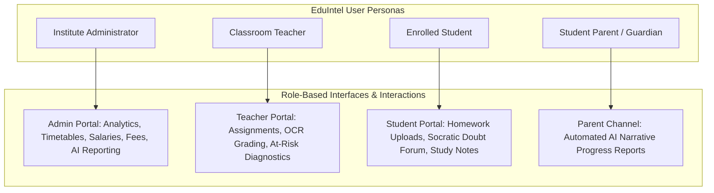

# EduIntel AI — Purpose and Scope

## 1. Executive Summary & Vision

**EduIntel AI** is an agentic, AI-powered decision intelligence platform specifically engineered for coaching institutes, private tutoring centers, and competitive exam preparation schools (e.g., JEE, NEET, Foundation courses). 

Modern educational institutions suffer from a critical operational divide:
- **Administrative ERP tools** focus purely on business metrics (fee collections, teacher payroll, attendance logs) but are completely disconnected from classroom learning outcomes.
- **Academic Learning Management Systems (LMS)** store assignments and notes, but provide zero predictive insight into student struggles until exam scores drop.
- **Generic Commercial AI Tools** (e.g., ChatGPT) undermine educational discipline by functioning as answer engines—giving students immediate, copy-paste homework answers rather than cultivating cognitive problem-solving skills.

EduIntel AI bridges this divide. It fuses institutional management with deep academic decision intelligence: leveraging OCR for homework digitization, predictive machine learning (XGBoost + SHAP) to detect learning risks weeks before exams, Socratic Retrieval-Augmented Generation (RAG) to mentor students without giving away direct answers, and stateful LangGraph agents to synthesize complex administrative operations.

---

## 2. Target User Personas & Workflows

### Persona 1: Enrolled Student
- **Profile**: A student attending regular coaching or school sessions preparing for board or entrance examinations.
- **Core Needs**:
  - Access class study materials and lecture notes organized by subject.
  - Submit handwritten homework assignments via photo or PDF upload.
  - Clarify difficult academic questions 24/7 without being handed direct answers that short-circuit the learning process.
  - Track attendance and historical test scores across academic terms.
- **Key Interactions**:
  - Uses `Student Portal` (`/student/dashboard`, `/student/homework`, `/student/doubts`, `/student/materials`).
  - Interacts with the **Socratic AI Doubt Tutor** (`/api/student/doubts/{id}/messages`), which encourages guided problem-solving.

### Persona 2: Classroom Teacher
- **Profile**: Subject-matter educator managing 50–200 students across multiple batches.
- **Core Needs**:
  - Publish assignments with submission deadlines and maximum marks.
  - Efficiently grade student submissions without squinting at blurry handwritten notebook pages.
  - Identify struggling students *before* exams occur, understanding *why* they are struggling.
  - Record and publish periodic exam results.
- **Key Interactions**:
  - Uses `Teacher Portal` (`/teacher/dashboard`, `/teacher/grading`, `/teacher/materials`, `/teacher/exams`, `/teacher/flagged`).
  - Reviews digitized text generated by the **PyTesseract OCR Pipeline** alongside student image uploads.
  - Inspects **SHAP diagnostic breakdowns** (`/api/ml/diagnose/{student_id}`) showing top factors impacting at-risk students.

### Persona 3: Institute Administrator / Owner
- **Profile**: Operations manager, principal, or coaching institute proprietor.
- **Core Needs**:
  - Create and manage daily timetable schedules across subjects and teachers.
  - Track teacher salary disbursements, base pay, and payment dates.
  - Track student fee installments, overdue balances, and collection status.
  - Query operational health without clicking through multiple dense spreadsheets.
- **Key Interactions**:
  - Uses `Admin Portal` (`/admin/dashboard`, `/admin/timetable`, `/admin/salary`, `/admin/fees`, `/admin/attendance`, `/admin/risk`).
  - Uses the natural-language **LangGraph Admin Assistant** (`/api/admin/assistant/query`) to ask operational questions like *"What is the total unpaid fee balance?"* or *"List all teachers who do not have a class scheduled on Monday."*

### Persona 4: Parent / Guardian
- **Profile**: Parent seeking regular, transparent updates on student performance, attendance, and emotional/academic health.
- **Core Needs**:
  - Understand student attendance patterns and homework submission timeliness.
  - Receive constructive, narrative summaries rather than raw percentage numbers.
- **Key Interactions**:
  - Receives automated email reports generated by the **Parent Report Agent** (`/api/reports/parent-report/{student_id}`), which combines attendance, homework, exam trends, and LLM-generated positive reinforcement.

---

## 3. Functional Requirements (Delivered Capabilities)

| Domain | Functional Capabilities | Implementation Status |
|---|---|---|
| **Identity & Access** | Email/password registration, bcrypt hashing, JWT access tokens, role-based route guards (`admin`, `teacher`, `student`). | Fully Implemented |
| **Document Processing** | Optical Character Recognition for JPEG/PNG images via PyTesseract; PDF digital text parsing via PyPDF. | Fully Implemented |
| **Socratic AI Tutoring** | Vector search in ChromaDB, Gemini embedding generation, prompt injection protection, Socratic pedagogical redirection. | Fully Implemented |
| **Academic Diagnostics** | XGBoost classifier predicting student academic risk; weak topic identification; SHAP tree explainability plots and metrics. | Fully Implemented |
| **Administrative Intelligence** | LangGraph state machine orchestrating 6 validated reporting tools for fees, salaries, timetables, and attendance. | Fully Implemented |
| **Parent Reporting** | FastMCP server integration executing student telemetry extraction and SMTP email dispatch with PII masking. | Fully Implemented |
| **Guardrails & Privacy** | Regex-based in-flight redaction of Aadhaar, telephone, email, IP, and credit card numbers; append-only audit logging. | Fully Implemented |

---

## 4. Non-Functional Requirements & Architectural Constraints

1. **Modular Monolith Integrity**: All modules reside within a unified FastAPI codebase (`backend/app/`) but maintain strict boundary separation. Cross-module calls must use designated service interfaces, never circular imports or private database modifications.
2. **Asynchronous I/O Performance**: The backend relies on SQLAlchemy 2.0 AsyncIO with `asyncpg` connection pooling to handle concurrent database sessions without blocking the Python event loop.
3. **Data Security & Privacy**: No plain-text PII is persisted in AI audit logs or sent to external LLM providers unredacted. All role-based endpoints enforce JWT claims.
4. **Predictable Local Reproducibility**: The complete system must be locally runnable on standard Linux/WSL2 workstations using Docker Compose for PostgreSQL and Python virtual environments, without hard dependencies on AWS cloud services.
5. **LLM Cost & Quota Resilience**: The system must track token expenditures in Indian Rupees (₹) and seamlessly fall back to Groq (`openai/gpt-oss-120b`) when Google Gemini rate limits are hit.

---

## 5. Scope Boundaries

### In Scope (Current Baseline)
- Complete single-tenant educational operations for one coaching institute or school.
- 16 backend domain modules and 21 frontend pages.
- Local execution of PostgreSQL 16, ChromaDB vector persistence, and MLflow tracking.
- Pre-trained XGBoost models for at-risk classification and weak topic diagnosis.
- Socratic doubt resolution and Admin assistant via LangGraph.

### Deferred / Out-of-Scope (Roadmap)
- **Multi-Tenant Data Isolation**: Database schema currently lacks an `institution_id` discriminator column. Multi-institution tenant isolation is planned for Phase 2.
- **Payment Gateway Integration**: Fee tracking records payment statuses (`paid`, `partial`, `pending`), but direct integration with Razorpay/Stripe is stubbed for a future phase.
- **Asynchronous Task Queues**: Email dispatch, PDF ingestion, and embedding generation currently execute synchronously within the HTTP request lifecycle; transition to Celery/Redis is scheduled for Phase 6.
- **Live Video Streaming / LMS Video**: EduIntel focuses on decision intelligence and homework/doubt workflows; video conferencing (Zoom/WebRTC) is outside current scope.

