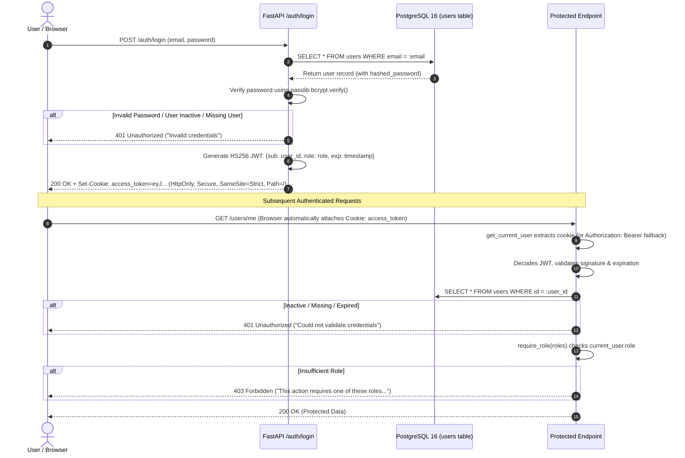
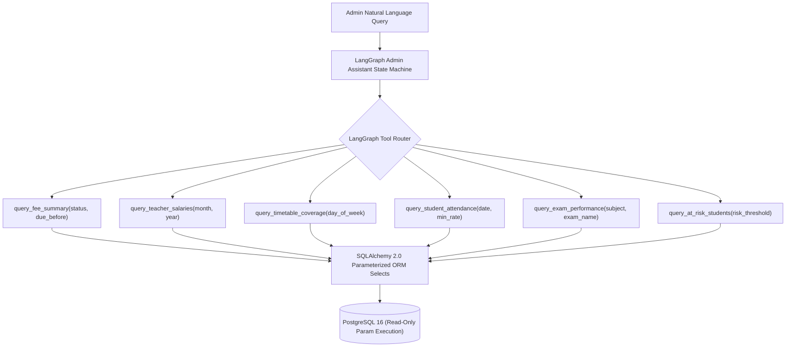

# EduIntel AI — Authentication, RBAC & Security Architecture

This document details EduIntel AI's identity management, token lifecycle, role-based access control (RBAC), multi-factor relational authorization, and security mitigations on branch `develop/production-readiness`.

---

## 1. Authentication Flow & Token Lifecycle

EduIntel implements JSON Web Token (JWT) authentication using the `HS256` symmetric signing algorithm and the `passlib` bcrypt hashing library. Following Phase 2B (SEC-10), web browser clients store tokens exclusively in `HttpOnly` cookies, preventing XSS credential theft.



### 1.1. Password & Token Hashing Specification
- **User Passwords**: `bcrypt` via `passlib.context.CryptContext(schemes=["bcrypt"], deprecated="auto")`.
  - 12 salt rounds automatically generated per password.
  - Plaintext passwords are never logged, stored, or cached.
- **Password Reset Tokens (SEC-01)**:
  - Cryptographically generated 32-byte raw token via `secrets.token_urlsafe(32)`.
  - Server immediately hashes the token via `hashlib.sha256(raw_token.encode("utf-8")).hexdigest()`.
  - Database stores strictly the 64-character hexadecimal digest at rest (`PasswordResetToken.token`).
  - Zero raw tokens are stored in the database or disclosed in API JSON responses.

### 1.2. JWT Token Payload & Claims
Access tokens are signed using `JWT_SECRET_KEY` with a 30-minute expiration (`settings.ACCESS_TOKEN_EXPIRE_MINUTES = 30`).
```json
{
  "sub": "b8f9e0a1-4321-4def-89ab-123456789abc",
  "role": "admin",
  "exp": 1732982400
}
```

### 1.3. Cookie Security Attributes (SEC-10)
Web authentication uses `Response.set_cookie()` with strict security attributes:
- **`HttpOnly=True`**: Token cannot be accessed by client-side JavaScript (`document.cookie`), neutralizing token exfiltration via Cross-Site Scripting (XSS).
- **`SameSite=Strict`**: Browser refuses to attach the cookie on cross-site requests, mitigating Cross-Site Request Forgery (CSRF).
- **`Secure`**: Enforced in production (`settings.ENVIRONMENT == "production"` or explicit `AUTH_COOKIE_SECURE=True`). Allowed over HTTP in local development (`localhost`).
- **`Path=/`**: Cookie scope covers all API routes.
- **`Max-Age`**: Synchronized with JWT expiration (`ACCESS_TOKEN_EXPIRE_MINUTES * 60`).
- **Logout Endpoint (`POST /auth/logout`)**: Deletes the cookie with matching `Path`, `HttpOnly`, `Secure`, and `SameSite` flags.

### 1.4. Dual-Mode Authentication (SEC-10)
[`backend/app/users/dependencies.py`](file:///home/dell/projects/eduIntel/backend/app/users/dependencies.py) supports dual authentication:
1. **Primary (Browsers)**: Extracts the token from `request.cookies.get(settings.AUTH_COOKIE_NAME)`.
2. **Fallback (CLI / Automated Tests)**: Extracts the token from `Authorization: Bearer <token>` via `HTTPBearer(auto_error=False)`.
3. If neither credential source contains a valid token, the request fails closed with `401 Unauthorized`.

---

## 2. Role-Based & Relationship-Based Access Control

Access control in EduIntel combines single-dimension RBAC with multi-factor relationship-based access control (ABAC).

### 2.1. Authentication & Role Dependencies

```python
async def get_current_user(
    request: Request,
    credentials: HTTPAuthorizationCredentials | None = Depends(bearer_scheme),
    db: AsyncSession = Depends(get_db),
) -> User:
    # 1. Primary: Extract from HttpOnly cookie
    if settings.AUTH_COOKIE_NAME in request.cookies:
        token = request.cookies[settings.AUTH_COOKIE_NAME]
    # 2. Fallback: Extract from Authorization Bearer header
    elif credentials is not None:
        token = credentials.credentials
    else:
        raise HTTPException(401, detail="Could not validate credentials")

    # 3. Decode JWT payload, extract 'sub', validate UUID
    # 4. Fetch active user from database
    # 5. Fail closed (401) on missing, expired, invalid, or inactive user
    return user

def require_role(*allowed_roles: str):
    async def role_checker(current_user: User = Depends(get_current_user)) -> User:
        if current_user.role not in allowed_roles:
            raise HTTPException(403, detail=f"This action requires one of these roles: {', '.join(allowed_roles)}")
        return current_user
    return role_checker
```

### 2.2. Multi-Factor Relationship-Based Authorization (SEC-03, SEC-06, SEC-07)

Simple role checks (`require_role("teacher")`) are insufficient for multi-tenant and multi-class environments. EduIntel enforces student-specific academic relationships:

1. **Parent Reports (`POST /reports/parent-report/{student_id}`, SEC-03)**:
   - For teachers, requires an active timetable entry linking the teacher to the student's assigned grade and section, OR a concrete academic submission (graded homework, exam result, or attendance entry).
   - Recipient email override is forbidden; report is strictly dispatched to the verified `parent_email` stored in `student_profiles`.
2. **File Downloads (`/teacher/homework/{id}/file`, `/student/study-materials/{id}/file`, SEC-06)**:
   - Homework download requires either ownership by the submitting student OR timetable/grader assignment for the teacher.
   - Study material download requires enrollment in the grade/section where the material was assigned.
3. **ML Diagnostics (`/ml/predict/*`, `/ml/diagnose/*`, `/ml/explain/*`, SEC-07)**:
   - Verifies target user is an active student with a valid profile (returns 404 if missing or non-student).
   - Verifies requesting teacher has an active timetable assignment for that student's section (returns 403 otherwise). Administrators have supervisory read access.

### 2.3. Endpoint Authorization Matrix

| Endpoint Path | Method | Minimum Role | Relational / Ownership Requirement |
|---|:---:|:---:|---|
| `/auth/login` | `POST` | Public | Valid credentials; sets `HttpOnly` cookie |
| `/auth/logout` | `POST` | Public | Clears `HttpOnly` cookie |
| `/auth/signup` | `POST` | Disabled | **403 Forbidden** — Public self-registration disabled (SEC-02) |
| `/auth/password-reset/request` | `POST` | Public | Rate limited (5 req/min); background SMTP dispatch; zero disclosure |
| `/auth/password-reset/confirm` | `POST` | Public | Valid SHA-256 token digest required |
| `/users/me` | `GET`, `PUT` | Authenticated | Scoped strictly to `current_user.id` |
| `/admin/teachers` | `POST` | `admin` | Admin provisions teacher account (SEC-02) |
| `/admin/students` | `POST` | `admin` | Admin provisions student account with profile (SEC-02) |
| `/admin/administrators` | `POST` | `admin` | Admin provisions additional administrator (SEC-02) |
| `/admin/dashboard` | `GET` | `admin` | Protected dashboard overview |
| `/student/dashboard` | `GET` | `student` | Scoped to `current_user.id` |
| `/student/homework/upload` | `POST` | `student` | Scoped to student's enrolled section |
| `/student/study-materials/{id}/file`| `GET` | `student` | Section-enrolled students only (SEC-06) |
| `/teacher/dashboard` | `GET` | `teacher` | Scoped to teacher's classes |
| `/teacher/homework/{id}/file` | `GET` | `teacher` | Assigned teacher or student owner only (SEC-06) |
| `/teacher/study-materials/upload` | `POST` | `teacher` | Timetable assigned teacher |
| `/ocr/extract` | `POST` | Authenticated | `get_current_user` required; 5 MB limit; magic bytes (SEC-05) |
| `/rag/query` | `POST` | Authenticated | Mandatory tenant filter `where={"institution_id": ...}` (SEC-08) |
| `/rag/debug-query` | `GET` | `admin` | Administrator only; mandatory tenant filter (SEC-08) |
| `/ml/diagnose/{student_id}` | `GET` | `teacher`, `admin` | Timetable section assignment required for teachers (SEC-07) |
| `/ml/predict/at-risk/{student_id}` | `GET` | `teacher`, `admin` | Timetable section assignment required for teachers (SEC-07) |
| `/ml/explain/at-risk/{student_id}` | `GET` | `teacher`, `admin` | Timetable section assignment required for teachers (SEC-07) |
| `/reports/parent-report/{student_id}`| `POST`| `teacher`, `admin` | Timetable section assignment + academic records (SEC-03) |
| `/agents/admin-assistant/chat` | `POST` | `admin` | Tenant reporting authorization required (SEC-09) |

---

## 3. Frontend Route Protection & Storage Hygiene (SEC-10, SEC-11)

### 3.1. Route Guard ([`frontend/src/components/ProtectedRoute.jsx`](file:///home/dell/projects/eduIntel/frontend/src/components/ProtectedRoute.jsx))
- Evaluates strictly `sessionStorage.getItem("is_authenticated") === "true"`.
- `localStorage.getItem("demo_mode")` bypass is completely removed.
- Unauthenticated requests immediately execute `<Navigate to="/login" replace />`.

### 3.2. Response Interceptor & Storage Purging ([`frontend/src/api/client.js`](file:///home/dell/projects/eduIntel/frontend/src/api/client.js))
- Configured with `withCredentials: true` so modern browsers automatically send `HttpOnly` cookies.
- On HTTP `401 Unauthorized`:
  - Purges `sessionStorage.is_authenticated` and `sessionStorage.user_role`.
  - Clears `localStorage.access_token` and `localStorage.demo_mode`.
  - Redirects to `/login` without infinite loops.

### 3.3. Development Credentials Protection ([`frontend/src/pages/auth/Login.jsx`](file:///home/dell/projects/eduIntel/frontend/src/pages/auth/Login.jsx))
- Demo bypass buttons are deleted from the codebase.
- Helper Fill buttons are wrapped in `{import.meta.env.DEV && (...)}`, ensuring development credentials are completely stripped from production bundles by the Vite compiler.

---

## 4. Phase 0A: Critical SQL Execution Risk Containment

### 3.1. Vulnerability Root Cause (Baseline Audit)
During the Phase 0 baseline audit, an unrestricted SQL execution vulnerability was identified in the LangGraph Admin Assistant ([`backend/app/agents/admin_assistant.py`](file:///home/dell/projects/eduIntel/backend/app/agents/admin_assistant.py)):
- The agent was configured with a tool named `execute_sql` that accepted an arbitrary string parameter `query: str`.
- The tool executed `await db.execute(text(query))` directly against the PostgreSQL connection.
- Because the database user possessed table creation and modification privileges, prompt injection or LLM hallucination could execute destructive DDL (`DROP TABLE`), arbitrary data modification (`UPDATE salary_records SET net_salary = 999999`), or multi-statement injections.

### 3.2. Implemented Containment (Phase 0A)
In Phase 0A, the arbitrary SQL tool was completely eliminated and replaced with **6 safe, strictly parameterized reporting tools**:



### Safety Guarantees:
1. **Zero Dynamic SQL Strings**: All queries use SQLAlchemy `select(...)` constructs with strict column bindings.
2. **Strict Parameter Validation**: Tool inputs are validated using Pydantic models (e.g. date formats, enums for days of week).
3. **No Write / DDL Operations**: The reporting tools contain only read-only `select()` statements, making data modification architecturally impossible through the agent.

