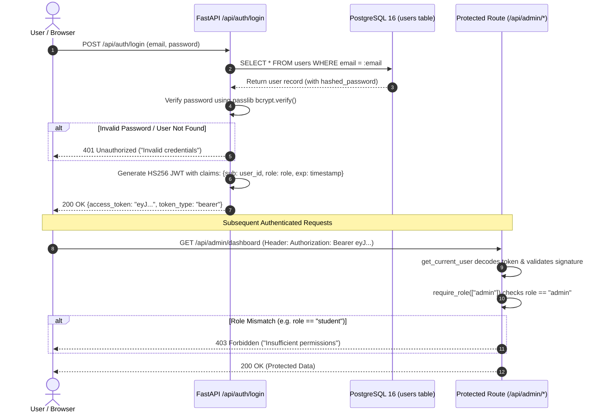
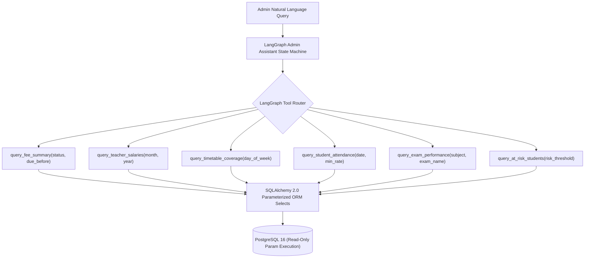

# EduIntel AI — Authentication, RBAC & Security Architecture

This document details EduIntel AI's identity management, token lifecycle, role-based access control (RBAC), and security mitigations on branch `develop/production-readiness`.

---

## 1. Authentication Flow & Token Lifecycle

EduIntel implements stateless JSON Web Token (JWT) authentication using the `HS256` symmetric signing algorithm and the `passlib` bcrypt hashing library.



### 1.1. Password Hashing Specification
- **Algorithm**: `bcrypt` via `passlib.context.CryptContext(schemes=["bcrypt"], deprecated="auto")`.
- **Salt Generation**: 12 salt rounds automatically generated per password.
- **Storage**: Plain-text passwords are never stored, logged, or cached. Only the 60-character bcrypt hash string is persisted in `users.hashed_password`.

### 1.2. JWT Token Payload
Access tokens are signed using `JWT_SECRET_KEY` with a configurable expiration window (`ACCESS_TOKEN_EXPIRE_MINUTES`, default 30 days in dev).
```json
{
  "sub": "b8f9e0a1-4321-4def-89ab-123456789abc",
  "email": "admin@eduintel.ac.in",
  "role": "admin",
  "exp": 1732982400
}
```

---

## 2. Role-Based Access Control (RBAC) Architecture

Access to backend endpoints is governed by FastAPI dependencies declared in [`backend/app/users/dependencies.py`](file:///home/dell/projects/eduIntel/backend/app/users/dependencies.py) (leveraging JWT utilities in [`backend/app/auth/security.py`](file:///home/dell/projects/eduIntel/backend/app/auth/security.py)):

```python
async def get_current_user(
    token: str = Depends(oauth2_scheme),
    db: AsyncSession = Depends(get_db)
) -> User:
    # 1. Decode token using SECRET_KEY and ALGORITHM
    # 2. Extract 'sub' (user_id) claim
    # 3. Fetch active user from database
    # 4. Raise 401 if token invalid, expired, or user inactive

def require_role(allowed_roles: list[str]):
    async def role_checker(current_user: User = Depends(get_current_user)) -> User:
        if current_user.role not in allowed_roles:
            raise HTTPException(
                status_code=status.HTTP_403_FORBIDDEN,
                detail=f"Access denied. Requires one of: {allowed_roles}"
            )
        return current_user
    return role_checker
```

### RBAC Permission Matrix

| Resource / Endpoint Scope | Permitted Roles | Enforcement Mechanism |
|---|---|---|
| `/api/auth/*` | Public (Unauthenticated) | No dependency |
| `/api/users/me` | `student`, `teacher`, `admin` | `Depends(get_current_user)` |
| `/api/student/*` | `student` | `Depends(require_role(["student"]))` |
| `/api/teacher/*` | `teacher` | `Depends(require_role(["teacher"]))` |
| `/api/admin/*` | `admin` | `Depends(require_role(["admin"]))` |
| `/api/ml/diagnose/*` | `teacher`, `admin` | `Depends(require_role(["teacher", "admin"]))` |
| `/api/reports/*` | `teacher`, `admin` | `Depends(require_role(["teacher", "admin"]))` |
| `/api/observability/*` | `admin` | `Depends(require_role(["admin"]))` |

---

## 3. Phase 0A: Critical SQL Execution Risk Containment

### 3.1. Vulnerability Root Cause (Baseline Audit)
During the Phase 0 baseline audit, an unrestricted SQL execution vulnerability was identified in the LangGraph Admin Assistant ([`backend/app/agents/admin_assistant.py`](file:///home/dell/projects/eduIntel/backend/app/agents/admin_assistant.py)):
- The agent was configured with a tool named `execute_sql` that accepted an arbitrary string parameter `query: str`.
- The tool executed `await db.execute(text(query))` directly against the PostgreSQL connection.
- Because the database user possessed table creation and modification privileges, prompt injection or LLM hallucination could execute destructive DDL (`DROP TABLE`), arbitrary data modification (`UPDATE salary_records SET net_salary = 999999`), or multi-statement injections.

### 3.2. Implemented Containment (Phase 0A)
In Phase 0A, the arbitrary SQL tool was completely eliminated and replaced with **6 safe, strictly parameterized reporting tools**:



### Safety Guarantees:
1. **Zero Dynamic SQL Strings**: All queries use SQLAlchemy `select(...)` constructs with strict column bindings.
2. **Strict Parameter Validation**: Tool inputs are validated using Pydantic models (e.g. date formats, enums for days of week).
3. **No Write / DDL Operations**: The reporting tools contain only read-only `select()` statements, making data modification architecturally impossible through the agent.

