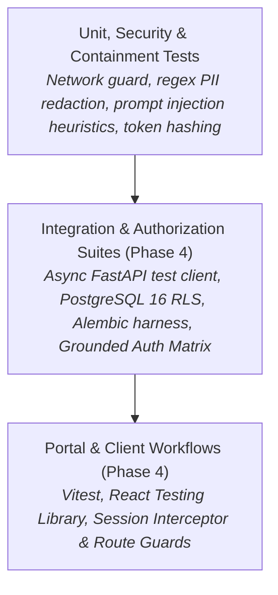

# EduIntel AI — Testing Strategy & Quality Assurance Architecture

This document establishes the testing strategy, test inventory, fixtures harness, DevSecOps gates, and quality assurance architecture for EduIntel AI on branch `develop/production-readiness`.

---

## 1. Testing Philosophy & Test Pyramid

EduIntel follows an automated testing pyramid designed to ensure high confidence in security, authentication, AI safety guardrails, multi-tenant isolation, and deterministic agent behavior without requiring external cloud connectivity.



### Core Testing Principles:
1. **Zero External Cloud Dependencies & Network Guard**: Tests must execute in CI/CD and offline development environments without invoking live Google Gemini, Groq, ChromaDB, or SMTP cloud endpoints. A loopback-filtered transport guard in [`backend/tests/conftest.py`](file:///home/dell/projects/eduIntel/backend/tests/conftest.py) enforces fail-closed interception of all non-loopback TCP and DNS calls.
2. **Deterministic Mocking**: All external LLM, embedding, and email dispatches are routed through centralized deterministic fixtures with predictable payloads and recorded latency.
3. **Multi-Tenant Row-Level Security Enforcement**: Multi-tenant database tests run under the unprivileged PostgreSQL role `eduintel_app` (`NOSUPERUSER, NOBYPASSRLS`), ensuring PostgreSQL RLS policies cannot be bypassed.
4. **Dual-Tier Transaction Isolation**: Test mutations are bound to nested PostgreSQL savepoints (`join_transaction_mode="create_savepoint"`). Connections are cleansed with `RESET ROLE; RESET ALL; PERFORM set_config(...)` on teardown, preventing cross-test data leakage.
5. **Grounded Authorization & IDOR Verification**: 58 automated tests rigorously verify tenant boundaries, Platform Admin governance, role gating, and parameter-tampering invariants.
6. **Coverage Ratchet**: Test coverage on core business domain logic (`backend/app/`) is measured via branch coverage and enforced with a fail-closed CI ratchet (`--cov-fail-under=66`).

---

## 2. Test Configuration & Harness

- **Test Runner**: Pytest 9.1+ with `pytest-asyncio 1.4+`, `pytest-cov 6.0+`, and `pytest-randomly 3.16+`.
- **Configuration Files**: [`backend/pytest.ini`](file:///home/dell/projects/eduIntel/backend/pytest.ini) and [`backend/.coveragerc`](file:///home/dell/projects/eduIntel/backend/.coveragerc).
- **Core Fixture Harness**: [`backend/tests/conftest.py`](file:///home/dell/projects/eduIntel/backend/tests/conftest.py):
  - **Fail-Closed Database Safety Guard (`assert_safe_test_database`)**: Multi-factor URL verification enforcing test-mode flags (`ENVIRONMENT='testing'`, `EDUINTEL_TEST_MODE='true'`), loopback host (`localhost`/`127.0.0.1`), standard port 5432, zero rogue query parameters, prohibited protected database names, and strict regex allowlisting (`^eduintel_test(_[a-zA-Z0-9_-]+)?$`).
  - **Dynamic Alembic Migration & Schema Assertion (`verify_and_prepare_test_database`)**: Runs `alembic upgrade head` dynamically and asserts schema integrity (22 tables, 17 `FORCE ROW LEVEL SECURITY` tables, 68 split policies, and unprivileged application role).
  - **Savepoint Transaction Isolation (`db_connection`)**: Executes tests inside nested savepoints (`join_transaction_mode="create_savepoint"`). Route and service commits release savepoints rather than committing the outer transaction. Teardown unconditionally rolls back the outer transaction.
  - **Resilient Session Teardown Reset**: Cleanses connection state after every test: `RESET ROLE; RESET ALL; PERFORM set_config('app.current_institution_id', '', false); PERFORM set_config('app.is_platform_admin', '', false);`.
  - **Unprivileged Role Execution**: Connects under `eduintel_app` (`NOSUPERUSER, NOBYPASSRLS`) so PostgreSQL RLS policies cannot be bypassed.
  - **Loopback-Aware Network Guard (`network_guard`)**: Autouse fixture intercepting `socket.socket.connect` and `socket.getaddrinfo`. Permits exclusively loopback destinations (`127.0.0.1`, `::1`, `localhost`); raises `RuntimeError("Network access blocked during tests")` on any external attempt.
  - **Centralized Deterministic Mocks**:
    - `mock_gemini_client`: Intercepts Google Generative AI / Gemini SDK calls and embedding generations with deterministic vectors (`[0.05] * 768`).
    - `mock_groq_client`: Intercepts Groq completions with structured pedagogical responses.
    - `mock_chroma_client`: Intercepts ChromaDB collection operations and queries.
    - `prevent_live_smtp_during_tests`: Autouse fixture intercepting `aiosmtplib.send` and `smtplib.SMTP`, capturing messages in memory.
  - `client`: FastAPI `AsyncClient` via `ASGITransport` wired to the savepoint transaction session.
  - `admin_token`, `teacher_token`, `student_token`: Pre-provisioned user tokens scoped to transaction savepoints.
  - `reset_app_engine_pool`: Autouse teardown disposing pooled connections across event loop lifecycles.

---

## 3. Comprehensive Backend Test Inventory (608 Automated Tests)

The test suite in [`backend/tests/`](file:///home/dell/projects/eduIntel/backend/tests/) contains **608 collected tests across 24 test modules**, with a **100% pass rate**:

### 3.1. Grounded Authorization Matrix Suite (1 Module — 58 Tests, Step 6)
1. **`test_authorization_matrix.py`** (58 tests):
   - **Tier 1: Platform Admin Governance (14 tests)**: Verifies that `/institutions` CRUD, institution suspension, and tenant provisioning require `is_platform_admin=True`; rejects forged claims, institutional admins, teachers, students, and unauthenticated callers with 403/401.
   - **Tier 2: Academic Domain Role Gating (16 tests)**: Verifies role gating across all domain routers (`/student/*`, `/teacher/*`, `/admin/*`). Students cannot grade or publish assignments; teachers cannot modify administrative salaries or timetables; institutional admins cannot submit student coursework.
   - **Tier 3: Cross-Tenant IDOR Boundaries (16 tests)**: Proves that tenant boundaries hold even for users with identical roles across different institutions. Cross-tenant access to homework files, assignments, teacher rosters, timetable entries, and ML predictions fails closed (404/403).
   - **Tier 4: Public Security Invariants & Containment (12 tests)**: Verifies that `/auth/signup` is permanently disabled (403), `/health` is public (200), `/ocr/extract` rejects unauthenticated payloads (401), parent reports reject arbitrary parent email overrides, and rate limiters enforce throttling.

### 3.2. Phase 2B Security & Containment Suites (11 Modules — 249 Tests)
2. **`test_admin_assistant_security.py`** (17 tests): Parameter validation, regex SQL containment, extra field forbidden.
3. **`test_guardrails.py`** (44 tests): PII redaction (Aadhaar, phone, email, IPv4/v6, credit card), prompt injection heuristic filters, Socratic redirects.
4. **`test_password_reset_lifecycle.py`** (22 tests, SEC-01): 32-byte cryptographically secure random token, SHA-256 token hashing at rest, sanitized response payloads, user enumeration timing mitigation, 5 req/min rate limit.
5. **`test_registration_privilege_escalation.py`** (26 tests, SEC-02): Public signup disabled (403 Forbidden), admin user provisioning (`/admin/teachers`, `/admin/students`, `/admin/administrators`), offline CLI bootstrap tool.
6. **`test_parent_report_authorization.py`** (30 tests, SEC-03): Multi-factor relational authorization, timetable section matching, strict dispatch to verified `parent_email`.
7. **`test_ocr_security.py`** (19 tests, SEC-05): Authenticated extraction, 5 MB streaming file cutoff, image magic byte verification, `asyncio.Semaphore` bounded worker concurrency (max 2), 10s timeout.
8. **`test_file_download_idor.py`** (25 tests, SEC-06 & SEC-S3-03): Student homework ownership, teacher timetable assignment verification, student grade/section enrollment check for study materials, institutional `tenant.role` evaluation.
9. **`test_ml_diagnostics_idor.py`** (34 tests, SEC-07): Student profile join verification, teacher section matching, sanitized `502 Bad Gateway` error envelopes.
10. **`test_rag_tenant_isolation.py`** (33 tests, SEC-08): Server-side trusted tenant resolution, mandatory `where={"institution_id": ...}` ChromaDB metadata filter, authenticated `/rag/collections`.
11. **`test_admin_ai_tenant_isolation.py`** (23 tests, SEC-09): Pre-SQL `verify_tenant_reporting_authorized()` guard, namespaced LRU conversation memory.
12. **`test_auth_cookie_security.py`** (12 tests, SEC-10): Backend `HttpOnly`, `SameSite=Strict`, `Secure` cookie issuance with dual-mode Bearer header fallback.

### 3.3. Phase 2 Stage 3 Multi-Tenancy & Scoping Suites (7 Modules — 79 Tests)
13. **`test_tenant_isolation_rls.py`**: Validates schema definitions, migration models, and PostgreSQL RLS policy structures.
14. **`test_tenant_student_scoping.py`**: Scoped homework submissions, doubt threads, attendance history, SEC-S3-02 filename sanitization (`os.path.basename`), and SEC-S3-03 `tenant.role` material download.
15. **`test_tenant_teacher_scoping.py`**: Scoped class creation, study material management, assignment grading, and student roster access.
16. **`test_tenant_admin_scoping.py`**: Scoped administrative dashboards, timetable scheduling, fee collections, and teacher salary disbursements.
17. **`test_tenant_announcements_scoping.py`**: Scoped institution broadcast filtering and target audience delivery.
18. **`test_tenant_observability_scoping.py`**: Scoped telemetry tracking, LLM token logging, INR cost calculations, and trace log filtering by `institution_id`.
19. **`test_tenant_agents_scoping.py`**: Portal assistant session isolation, LRU memory bounds, session TTL cleanup, and MCP server tenant scoping with `tenant_session_scope`.

### 3.4. Phase 2 Stages 4 & 5 Platform Admin Suite (1 Module — 20 Tests)
20. **`test_platform_admin.py`** (20 tests):
    - **Authorization & Dependency Checks**: `require_platform_admin` verifies database `is_platform_admin` column; rejects forged JWT claims, unauthenticated users, and institutional admins with 403.
    - **Atomic Institution Onboarding**: 100% rollback on duplicate slug or email; verifies initial admin account is inactive (`is_active=False`) with random password lockout; verifies 48-hour single-use SHA-256 hashed activation token.
    - **Operational Suspension**: Verifies `PATCH /institutions/{id}/status` suspends institutions, blocking single-tenant members while preserving multi-tenant users' access to other active institutes.
    - **Database RLS Read-Write Isolation**: Verifies Platform Admin cross-tenant `SELECT` queries succeed with `app.is_platform_admin = 'true'`, while cross-tenant `INSERT`, `UPDATE`, and `DELETE` queries are denied by PostgreSQL with SQLSTATE `42501`.

### 3.5. Deterministic Network Guard & Isolation Suites (4 Modules — 202 Tests)
21. **`test_network_guard.py`** (10 tests, Step 4): Positive proof of network interception; verifies that socket and DNS calls to non-loopback IPs or external domains fail with `RuntimeError`, while loopback (`127.0.0.1`, `localhost`) succeeds. Verifies deterministic mock behaviors for Gemini, Groq, ChromaDB, and SMTP.
22. **`test_database_isolation_between_tests.py`** (10 tests, Step 3): Fail-closed safety guard enforcement, unprivileged role RLS blocking (SQLSTATE 42501), clean session GUC verification, and savepoint rollback isolation tested under forward, reverse, and randomized orders via `pytest-randomly`.
23. **`test_database_pooling.py`** (6 tests): Pool settings validation (`pool_size=10, max_overflow=5, timeout=30, recycle=1800, pre_ping=True, echo=False`), queue pool starvation handling, and connection reset verification.
24. **`test_auth_rbac.py`**: End-to-end authentication, password hashing, role transitions, and profile resolution.
25. **`test_observability.py`**: Metrics endpoints, cost aggregation, and trace instrumentation.

---

## 4. Coverage Baseline & CI Ratchet Configuration (Step 5)

Application test coverage is measured across core business logic in [`backend/app/`](file:///home/dell/projects/eduIntel/backend/app/) with strict scope enforcement via [`backend/.coveragerc`](file:///home/dell/projects/eduIntel/backend/.coveragerc):

```ini
[run]
branch = True
source = app
omit =
    app/database.py
    app/main.py
    app/celery_app.py
    app/agents/mcp_server.py
```

### Coverage Metrics & Ratchet Enforcement:
- **Baseline Coverage (Step 5)**: **66.72%** (4,079 total statements, 740 branch conditions).
- **Current Coverage (Step 6 & 7)**: **67.13%** (with Grounded Authorization Matrix).
- **CI Ratchet Threshold**: `--cov-fail-under=66` enforced on all pushes and pull requests. Any change that reduces coverage below 66% triggers immediate CI failure.
- **Excluded Areas & Rationale**:
  - `app/database.py`: Low-level engine lifecycle and GUC setting hooks exercised during container startup.
  - `app/main.py`: Top-level ASGI entrypoint and lifespan startup routines.
  - `app/celery_app.py`: Background worker configuration.
  - `app/agents/mcp_server.py`: Dedicated FastMCP protocol server.

---

## 5. Frontend Testing Architecture & Suites (Vitest, RTL & Node)

A comprehensive frontend testing suite protects user-facing portals, authentication lifecycles, and security controls:
- **Test Runner**: Vitest v4.1.12 with `jsdom` environment ([`frontend/vitest.config.js`](file:///home/dell/projects/eduIntel/frontend/vitest.config.js)).
- **Testing Utilities**: React Testing Library (`@testing-library/react`), `@testing-library/jest-dom`.
- **Command**: `cd frontend && npm test`

### 5.1. Vitest Test Suites (6 Modules — 19 Tests)
1. **`tests/session_expiry.test.jsx`** (3 tests, Step 7):
   - Verifies that HTTP 401 responses on any protected endpoint purge `sessionStorage` (`is_authenticated`, `user_role`, `is_platform_admin`) and `localStorage` (`access_token`, `demo_mode`).
   - Verifies automatic redirection to `/login` via `window.location.href`.
   - Prevents recursive redirection loops when already on login routes (`/login`, `/auth/login`).
   - Ensures non-401 responses pass through cleanly without storage purge.
2. **`tests/student_portal.test.jsx`** (2 tests, Step 7):
   - **`StudentDashboard`**: Renders student academic overview, resolves API metrics (`4 Tasks Due`, `2 Unresolved`, `97.5%`), and handles quick action button routing.
   - **`HomeworkUpload`**: Renders pending assignments queue, enforces file selection validation with alerts, and dispatches multi-part form submissions via `POST /student/homework/submit`.
3. **`tests/teacher_portal.test.jsx`** (2 tests, Step 7):
   - **`TeacherDashboard`**: Renders faculty intelligence header, classroom overview, loads faculty metrics (`82 Students`, `19 Items`, `94.5%`), and tests quick action navigation to `/teacher/grading` and `/teacher/materials`.
   - **`AssignmentsGrading`**: Tests coursework publishing form validation (`POST /teacher/assignments`), cohort selection, active submissions queue row inspection, and grade updates (`PATCH /teacher/homework/:id/grade`) with scores and feedback.
4. **`tests/protected_route.test.jsx`** (4 tests):
   - Redirects unauthenticated users to `/login`.
   - Allows authenticated users with matching roles to access protected components.
   - Redirects users with mismatched roles to their designated home routes.
   - Restricts Platform Admin routes exclusively to sessions where `sessionStorage.is_platform_admin === "true"`.
5. **`tests/login_flow.test.jsx`** (5 tests):
   - Verifies atomic session storage cleanup on submission start.
   - Validates that `sessionStorage.is_authenticated`, `user_role`, and `is_platform_admin` are set atomically only after both `/auth/login` and `/users/me` succeed.
   - Clears all session keys on `/users/me` failure, 401 error, or inactive account status.
   - Enforces correct post-login routing: Platform Admins $\rightarrow$ `/platform-admin/dashboard`; institutional users $\rightarrow$ role home route.
6. **`tests/institution_management.test.jsx`** (3 tests):
   - Verifies input validation on the institution onboarding modal (name, slug, email format).
   - Verifies single-use activation token presentation dialog and copy-to-clipboard behavior without storing raw tokens in storage.
   - Verifies confirmation modals for institution suspension and reactivation.

### 5.2. Node.js Security Test Suite (1 Module — 8 Tests)
- **`frontend/tests/test_sec11_demo_mode_remediation.js`**: Native Node.js test runner (`node --test`).
- Verifies complete removal of `demo_mode` flags, demo bypass buttons, and hardcoded credentials from frontend source bundles and build artifacts.

---

## 6. DevSecOps & Security Scanning Gates (Step 6)

In addition to functional and integration tests, automated security scans run on every CI push:
- **Bandit SAST**: Runs `bandit -r backend/app/ -ll -ii` with zero tolerance for unexempted Medium/High vulnerabilities. Remediated Bandit B108 (`/tmp` file security) in `app/core/config.py` and `app/main.py`.
- **Gitleaks Secret Scanner**: Runs `gitleaks-action` across full git commit history to prevent credential and API key exposure.
- **Software Composition Analysis (SCA)**:
  - Backend: `pip-audit -r backend/requirements.txt` auditing Python wheels.
  - Frontend: `npm audit --audit-level=high` auditing npm packages.
- **Security Exceptions Register**: Documented in [`docs/security/security-exceptions.md`](file:///home/dell/projects/eduIntel/docs/security/security-exceptions.md) with risk justification, remediation plans, and expiry dates.

---

## 7. Test Execution Instructions

### 7.1. Running the Full Backend Test Suite
```bash
cd backend
source venv/bin/activate
set -a && source .env && set +a

# Run all 608 tests with coverage ratchet enforcement (>= 66%)
pytest --cov=app --cov-config=.coveragerc --cov-report=term-missing --cov-report=xml:coverage.xml --cov-fail-under=66 tests/ -v

# Run with randomized test ordering to verify order-independence
pytest tests/ -v --randomly-seed=12345
```

### 7.2. Running the Full Frontend Test Suite
```bash
cd frontend

# Run all 19 Vitest component & route protection tests
npm test

# Run SEC-11 demo mode security audit (8 tests)
node tests/test_sec11_demo_mode_remediation.js

# Run ESLint (0 errors)
npm run lint

# Run Vite production build compilation
npm run build
```

---

## 8. Automated GitHub Actions CI Pipeline Status

The complete CI/CD workflow is codified in [`.github/workflows/ci.yml`](file:///home/dell/projects/eduIntel/.github/workflows/ci.yml) and enforces four sequential quality gates on all pushes and pull requests:

1. **`lint` (Code Quality & Formatting)**:
   - Backend: `ruff check .` (Python 3.12, 0 errors).
   - Frontend: `eslint .` (Node 20, 0 errors).
2. **`security` (DevSecOps SAST & SCA)**:
   - Secret scanning: Gitleaks scan on commit history.
   - Python SAST: `bandit -r app/ -ll -ii`.
   - Dependency audits: `pip-audit` and `npm audit`.
3. **`backend` (Database Harness, Isolation & Pytest)**:
   - Launches PostgreSQL 16 service container.
   - Provisions `eduintel_app` unprivileged role.
   - Runs `alembic upgrade head` dynamically.
   - Executes all 608 Pytest tests with network guard and `--cov-fail-under=66` ratchet.
4. **`frontend` (Component Tests, Security & Build)**:
   - Runs all 19 Vitest unit/integration tests.
   - Runs Node.js SEC-11 demo mode security audit.
   - Verifies `npm run build` production asset generation.
